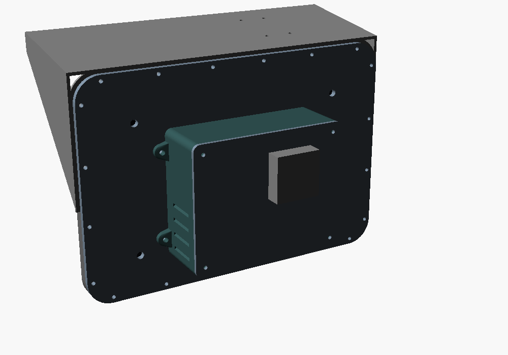

# Printed parts: screen mount and boxes

OpenSCAD designs for everything that gets 3D printed:

| Part | What it does | STL files |
|---|---|---|
| Screen frame | Tray the 10.1" screen drops into from the back. Front lip covers the screen's edge, drain slots let water out the bottom | `screen_frame_left/right` |
| Back plate | Clamps the screen in, carries the Pi box, bolts to the dash | `back_plate_left/right` |
| Sun hood | Top shade and side cheeks, tipped up 8° so rain runs off | `sun_hood_left/right` + `sun_hood_splice` |
| Pi 5 box | Pi 5, CAN HAT and the 5V 5A buck. Bolts to the back of the back plate; the screen's cables come straight in through the floor | `pi_box_box/lid/cowl/gasket` |
| Control box | Pico 2, MCP2515, MCP23017, ADS1115, opto board, MOSFET boards, 5V 2A buck | `control_box_box/lid/gasket/plate` |
| Relay box | 8-channel relay board and the three BTS7960 drivers | `relay_box_box/lid/gasket/plate` |
| Fit test | One corner of the screen frame, to check the fit before the big print | `fit_test_corner` |




**The sizes are guesses until the screen and dash are measured.** The
AliExpress listing for the screen couldn't be read automatically, so every
screen and dash number in [`measurements.scad`](measurements.scad) marked
`GUESS` needs checking. [MEASURING.md](MEASURING.md) walks through it.
Print the fit test first.

## Changing a size and making new STLs

1. Install [OpenSCAD](https://openscad.org/downloads.html) (2021.01 or newer).
2. Edit [`measurements.scad`](measurements.scad). Everything is in mm.
3. Run `./cad/build.sh` (Mac/Linux, or Git Bash on Windows). New STLs land in
   `cad/stl/`. `./cad/build.sh pi_box` does just the Pi box.

You can also open `cad/assembly.scad` in OpenSCAD to see it all put
together (set `explode = 40` to pull it apart), or open any file in
`cad/parts/` to look at one part. GitHub also builds the STLs on every pull
request (Actions tab, "Printed parts", download `teryx-stl`).

Parts bigger than the bed are cut in two automatically. Set `bed_x` and
`bed_y` to your printer. The cut lines on the frame, back plate and hood are
in different places, so once bolted up the three layers hold each other
straight. Short bits of 1.75 mm filament go in the pin holes at each cut to
line the halves up; glue the halves with a little superglue or plastic weld as
well.

## Material and print settings

| Part | Material | Why |
|---|---|---|
| Screen frame, sun hood, back plate | **ASA** (first choice) or PETG | In full sun all day. ASA handles UV and heat best (softens about 100°C). PETG (about 80°C) is OK but goes brittle and fades in UV over a year or two; paint it or wrap it if you use it |
| Pi box, control box, relay box, plate, cowl | **PETG** (or ASA) | Out of the sun, so PETG is fine and easier to print |
| Gaskets | **TPU 95A** | Or skip them and use 2 mm closed-cell foam cord in the groove |

**Don't use PLA.** A dash in the sun gets well over 60°C and PLA sags.

- 0.2 mm layers, 4 walls, 30% gyroid infill for the frame, plate and hood.
  4 walls round the gland holes and inserts matter more than infill.
- Screen frame: print **face down** (the STL is already that way round). No
  supports needed: the flange has a 45° slope underneath.
- Sun hood: prints standing on its back strip. No supports.
- Boxes: print open side up. Lids print flat. No supports.
- ASA needs an enclosure (or a box over the printer) and no cooling fan for
  the first few layers, or it lifts at the corners.

## Hardware

| Item | How many | Where |
|---|---|---|
| M3 brass heat-set inserts (4.0 mm hole, 5.7 mm long) | about 40 | 20 in the frame flange, 4 per box lid, 4 per grid plate |
| M3 x 12 bolts | 20 | Back plate and hood to the frame |
| M3 x 8 bolts | 12 | Box lids |
| M3 x 6 bolts | 8 | Grid plates |
| M2.5 inserts + M2.5 x 6 bolts | 4 | Pi 5 standoffs |
| M3 x 20 bolts + nyloc nuts | 4 | 30 mm fan through the cowl and lid |
| M3 x 10 bolts + nuts | 4 | Hood splice |
| M4 x 16 bolts + nyloc nuts + washers | 4 | Pi box to back plate |
| M4 bolts to suit | 8 | Control and relay box ears to the chassis |
| Cable glands | 4 Pi box, 5 control box, 5 relay box | Sizes are in `measurements.scad` (PG7, PG9, PG16, M20) |
| 30 mm 5V fan | 1 | Pi box lid (or set `pi_fan = 0` for no fan) |
| 2 mm foam tape | about 1 m | Between the screen face and the frame lip |
| 1.75 mm filament | a few cm | Alignment pins at the cuts |

## Putting it together

1. Press the M3 inserts into the back of the frame flange with a soldering
   iron (about 220°C for ASA/PETG). Do the Pi standoffs and box bosses the
   same way.
2. Glue the frame halves with filament pins at the cut.
3. Stick foam tape round the inside of the front lip.
4. Drop the screen in from the back, cables out through the back plate hole.
5. Lay the sun hood's back strip into the recess round the top of the
   flange, then the back plate over everything, and bolt through with the
   M3 x 12s.
6. Put foam or the TPU ring round the Pi box's floor hole and bolt the Pi box
   to the back plate with the M4s. The screen's HDMI and USB come straight
   into the box.
7. Fit the Pi, CAN HAT and buck, run the other cables through the glands in
   the bottom wall, then fit the gasket, lid, fan and cowl (cowl opening
   points down).
8. Bolt the back plate to the dash (see MEASURING.md for the holes) or to a
   RAM ball mount on the AMPS holes while you work out the final mount.

The glands are all in the bottom wall of each box so water runs off them
rather than sitting on them. Mount the control and relay boxes the same way
up, glands down. If a box gets wet inside anyway, drill a 3 mm weep hole in
its lowest corner.

## Files

```
cad/
  measurements.scad   every size, in one place (edit this)
  lib.scad            shared shapes and worked-out sizes
  models.scad         each part where it sits on the dash
  parts/*.scad        each part turned round for printing
  assembly.scad       everything together, for looking at
  build.sh            makes all the STLs
  stl/                the STLs, built from the current measurements
```
