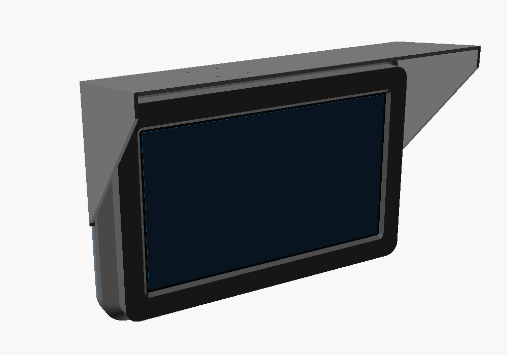
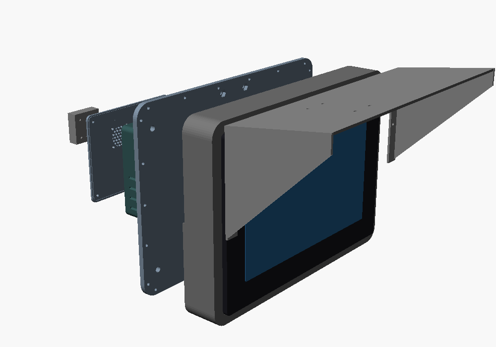
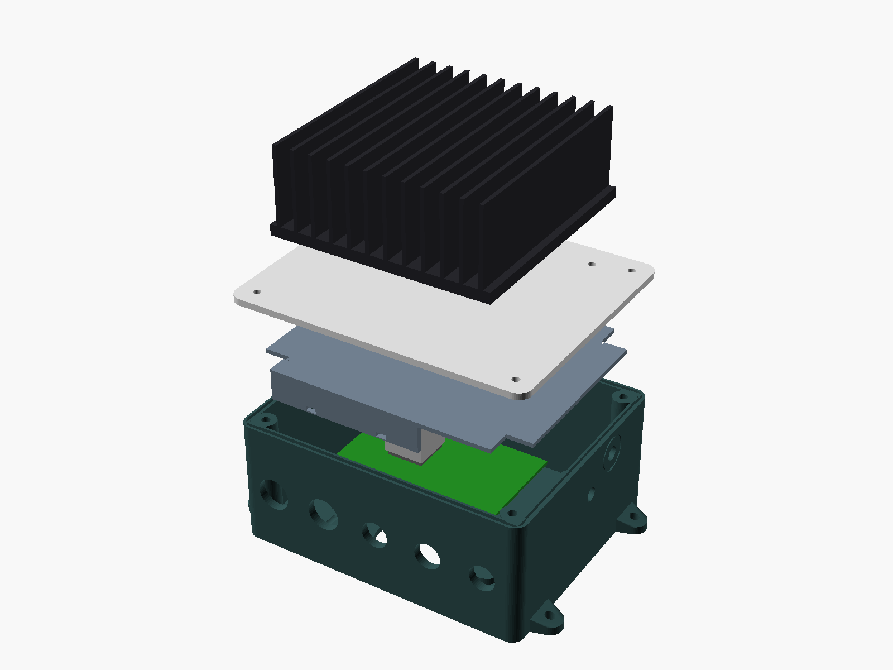
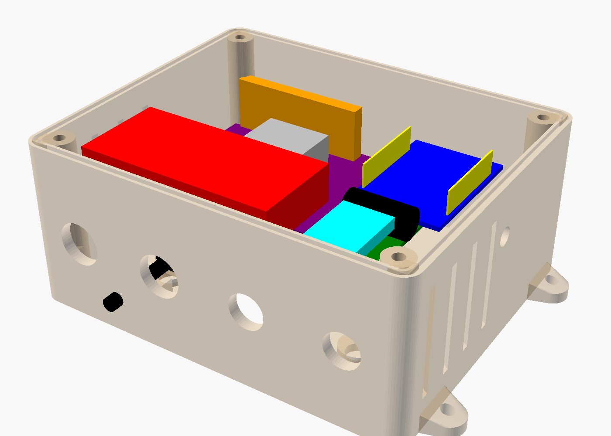
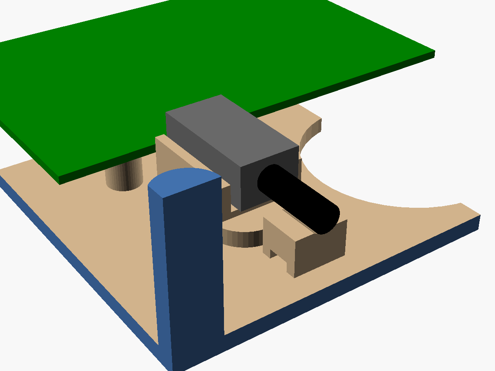
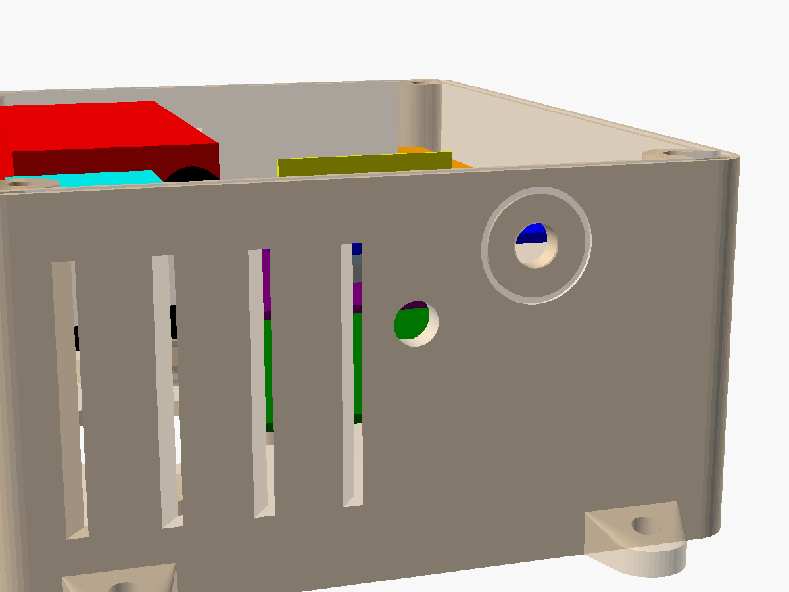

# Printed parts: screen mount and boxes

OpenSCAD designs for everything that gets 3D printed:

| Part | What it does | STL files |
|---|---|---|
| Dash panel | Flat face with the 217 x 135 cut-out. The screen's bezel sits on the front and its own clips clamp it from behind, as in its install guide. A rim round the back boxes in the screen's body, with ribs to stop flex | `dash_panel_left/right` |
| Back plate | Closes the back, bolts to the screen's wall-bracket holes (this carries the 2.8 kg), carries the Pi box and bolts to the dash. Also comes as a DXF to have it cut from 3 mm aluminium | `back_plate_left/right`, `back_plate.dxf` |
| Sun hood | Top shade and side cheeks, tipped up 8° so rain runs off | `sun_hood_left/right` + `sun_hood_splice` |
| Pi 5 box | **Sealed for wash-downs, no fan** ([`docs/pi-box-cooling.md`](../docs/pi-box-cooling.md)): a 3 mm aluminium lid plate (DXF) with a finned heatsink outside, and an aluminium pillar from the Pi's chip to the lid. Room for the AI HAT+ 2 later. Holds the Pi 5, a small MCP2515 CAN module, the 5V 5A buck and a 4G board with its buck and capacitor on a printed liner under the lid plate (SMA bulkheads for the 4G and GPS aerials in the wall). The liner also has a cradle for the video SSD (Kingston XS1000, [`docs/sentry.md`](../docs/sentry.md)). A cradle in the floor holds the micro HDMI plug still. Bolts to the back of the back plate; the screen's cables come straight in through the floor | `pi_box_box/lid/gasket` (lid = the printed liner), `pi_lid_plate.dxf` |
| Control box | Pico 2, MCP2515, MCP23017, ADS1115, opto board, MOSFET boards, 5V 2A buck | `control_box_box/lid/gasket/plate` |
| Relay box | 8-channel relay board and the three BTS7960 drivers | `relay_box_box/lid/gasket/plate` |
| Speaker pods | Sealed 6.85 L pods for the Kenwood 8" speakers, sized and EQ'd for sound, built as T. rex heads with the speaker in the mouth (multi-colour head and jaw bolt on). The back wraps round the cage tube with a cover and hidden M6 bolts. See [`docs/speaker-pods.md`](../docs/speaker-pods.md) | `speaker_pod`, `speaker_pod_cover`, `speaker_pod_head` (+ `_teeth`, `_eyes`, `_pupils`), `speaker_pod_jaw` (+ `_teeth`) (x2 each, ASA), `speaker_pod_plug` (x14), `speaker_pod_gasket` (x2, TPU) |
| Fit test | One corner of the dash panel (cut-out corner, bezel recess, inserts), to check the fit before the big print | `fit_test_corner` |










**Check the sizes before the big print.** The screen's outside size
(273 x 192 x 41 mm) and cut-out (217 x 135 mm) come from its listing and are
marked `LISTING` in [`measurements.scad`](measurements.scad). The bezel
thickness, wall-bracket hole spacing, cable position and the dash mounting
are marked `GUESS`. [MEASURING.md](MEASURING.md) walks through all of it.
Print the fit test first.

## About the screen

It's a 10.1" 1280x800 industrial panel-mount monitor in a metal case, and it
weighs **2.8 kg**. That's heavy for a printed part on a bouncing dash, so:

- The weight goes through the screen's wall-bracket holes straight into the
  back plate, and the back plate bolts to the dash. The panel's clips just
  hold the bezel tight against the face.
- For off-road use, have the back plate cut from **3 mm aluminium** using
  `stl/back_plate.dxf` (any laser or waterjet shop, or cut it by hand from the
  printed one as a template). The printed one is fine for the bench.
- Use the M4 bolts with nyloc nuts or threadlocker everywhere, and check them
  after the first few rides.

Things on the listing to check:

- **Power**: it comes with a mains plug pack. Read the label on the brick.
  Most of these run on 12V DC. If yours says 12V, it can run off the dash
  12V rail through a 3A fuse, ideally via a 12V-to-12V stabiliser (the
  Teryx's 12V swings from about 11 to 14.8V). If it's anything else, tell
  Claude and we'll sort a converter.
- **Why HDMI, not VGA, even though VGA screws in**: VGA is analogue, so
  the Pi would need an active converter (another box and another failure
  point), and the 1280x800 picture goes soft and can shimmer. The weak spot
  with HDMI is the little micro HDMI plug on the Pi, so the Pi box has a
  cradle and two cable ties to hold it still (see step 8 below).
- **Video input**: the listing says VGA. The Pi 5 only has micro HDMI. If the
  screen only has VGA, you'll need a micro HDMI to VGA adapter (one with its
  own chip, about NZ$20). If it has HDMI as well, use that.

## Changing a size and making new STLs

1. Install [OpenSCAD](https://openscad.org/downloads.html) (2021.01 or newer).
2. Edit [`measurements.scad`](measurements.scad). Everything is in mm.
3. Run `./cad/build.sh` (Mac/Linux, or Git Bash on Windows). New STLs land in
   `cad/stl/`. `./cad/build.sh pi_box` does just the Pi box.

You can also open `cad/assembly.scad` in OpenSCAD to see it all put
together (set `explode = 40` to pull it apart), or open any file in
`cad/parts/` to look at one part. GitHub also builds the STLs on every pull
request (Actions tab, "Printed parts", download `teryx-stl`).

Parts bigger than the bed are cut in two automatically. Set `bed_x` and
`bed_y` to your printer. The cut lines on the panel, back plate and hood are
in different places, so once bolted up the three layers hold each other
straight. Short bits of 1.75 mm filament go in the pin holes at each cut to
line the halves up; glue the halves with a little superglue or plastic weld as
well.

## Material and print settings

| Part | Material | Why |
|---|---|---|
| Dash panel, sun hood, back plate | **ASA** (first choice) or PETG | In full sun all day. ASA handles UV and heat best (softens about 100°C). PETG (about 80°C) is OK but goes brittle and fades in UV over a year or two; paint it or wrap it if you use it |
| Pi box, Pi box liner, control box, relay box, plate | **PETG** (or ASA) | Out of the sun, so PETG is fine and easier to print |
| Gaskets | **TPU 95A** | Or skip them and use 2 mm closed-cell foam cord in the groove |

**Don't use PLA.** A dash in the sun gets well over 60°C and PLA sags.

- 0.2 mm layers, 30% gyroid infill. Back plate: 6 walls and 50% infill,
  since it carries the screen. 4 walls round the gland holes and inserts
  matter more than infill.
- Dash panel: print **face down** (the STL is already that way round). No
  supports needed.
- Sun hood: prints standing on its back strip. No supports.
- Boxes: print open side up. Lids print flat. No supports.
- ASA needs an enclosure (or a box over the printer) and no cooling fan for
  the first few layers, or it lifts at the corners.

## Hardware

| Item | How many | Where |
|---|---|---|
| M3 brass heat-set inserts (4.0 mm hole, 5.7 mm long) | about 40 | 20 in the dash panel rim, 4 per box lid, 4 per grid plate |
| M3 x 16 bolts | 20 | Back plate and hood to the dash panel rim |
| M4 bolts to suit the screen + washers | 4 | Back plate to the screen's wall-bracket holes (check the thread and how deep the holes are) |
| The screen's own clips and screws | as supplied | Clamp the bezel to the panel |
| M3 x 8 bolts | 12 | Box lids |
| M3 x 6 bolts | 8 | Grid plates |
| M2.5 inserts + M2.5 x 6 bolts | 4 | Pi 5 standoffs |
| M2 inserts + M2 x 5 bolts (or M2 self-tappers) | 4 | 4G board standoffs under the Pi box lid |
| Cable ties, 3.6 mm wide or narrower, about 150 mm | 4 | Micro HDMI plug and cable (Pi box floor), 4G buck and capacitor (Pi box lid) |
| 1 mm foam tape | a scrap | On top of the micro HDMI cradle, under the plug |
| SMA female bulkheads with O-ring (6.35 mm thread), on u.FL leads | 2 | 4G aerial (plain hole) and active GPS aerial (higher hole with the ring round it), right-hand wall of the Pi box |
| M3 x 10 cap screws | 4 | Heatsink to the Pi box lid plate, from inside through the liner (tap the heatsink base M3) |
| M3 x 8 countersunk screw | 1 | Pillar to the lid plate |
| M3 x 10 bolts + nuts | 4 | Hood splice |
| M4 x 12 bolts + M4 nuts + threadlocker | 4 | Pi box to back plate (nuts sit in hex pockets on the front of the plate) |
| M5 nuts | 4 | AMPS mount, in hex pockets on the front of the plate |
| M4 bolts to suit | 8 | Control and relay box ears to the chassis |
| M12 breather vent plug | 1 | Last hole in the Pi box's bottom wall |
| Cable glands | 4 Pi box, 5 control box, 5 relay box | Sizes are in `measurements.scad` (PG7, PG9, PG16, M20) |
| Heatsink, pillar, pad, paste | 1 set | Pi box lid, see [`docs/pi-box-cooling.md`](../docs/pi-box-cooling.md) |
| 2 mm closed-cell foam tape | about 1 m | Between the bezel and the panel face |
| 1.75 mm filament | a few cm | Alignment pins at the cuts |

## Putting it together

1. Press the M3 inserts into the bolt bosses round the back of the panel rim
   with a soldering iron (about 220°C for ASA/PETG). Do the Pi standoffs and
   box bosses the same way.
2. Glue the panel halves with filament pins at the cut.
3. Stick foam tape in the shallow recess round the cut-out on the front.
4. Push the screen in from the front and fit its clips and screws from
   behind, as in its install guide. Snug, not tight: the foam does the seal.
5. Before the back plate goes on, drop the M4 nuts (Pi box) and M5 nuts
   (AMPS) into the hex pockets on its front face, and put the dash bolts
   through. They're trapped behind the screen afterwards.
6. Bolt the back plate to the screen's wall-bracket holes (the bolt heads sit
   in pockets under the Pi box). Then lay the sun hood's back strip into the
   recess round the top of the rim and bolt the plate to the rim with the
   M3 x 16s.
7. Put foam or the TPU ring round the Pi box's floor hole and bolt the Pi box
   to the back plate with the M4s. The screen's video, USB and power leads
   come straight into the box.
8. Fit the Pi (later: Active Cooler, then the AI HAT+ 2 on its 16 mm header and spacers), stick the CAN module to the box wall with foam tape and wire it to the HAT's stacking header pins, fit the buck, run the other cables through the glands in
   the bottom wall, then the breather in the last hole. Build the lid (aluminium plate, pillar,
   heatsink, printed liner) and fit it on the gasket as in
   [`docs/pi-box-cooling.md`](../docs/pi-box-cooling.md), with the thermal pad on the Pi's chip.
   - **Micro HDMI.** The Pi sits with its HDMI edge towards the glands. Plug
     the screen lead into HDMI0 (the one next to USB-C). Stick 1 mm foam on
     the cradle, then one cable tie through the tunnel under the cradle and
     round the plug's moulding, snug, not crushing. A second tie holds the
     cable on the little anchor past the plug. Leave a small loop of slack
     between the anchor and the floor hole, so nothing pulls on the plug.
   - **4G board (A7670SA).** Solder its wires on first: the header pins point
     up at the lid and there's 12 mm for them. Screw it to the four standoffs
     under the lid, parts facing into the box. To swap the SIM, take the lid
     off and flip it over. Tie the small buck to its pad and the 1000 uF
     capacitor into its saddle next to the board, with short thick leads to
     the board's power pins. Fit the two SMA bulkheads in the right-hand wall
     (O-rings on the outside). The **lower plain hole is 4G**, the **higher
     hole with a ring round it is GPS**. Clip each u.FL lead onto the matching
     socket on the board (LTE/MAIN and GNSS), and label the leads before they
     go in. The leads tie the lid to the box, so lay the lid beside the box
     when it's off. Both aerials screw on outside, away from metal. The GPS
     one is an active aerial, so it needs the board's GNSS socket to power it.
9. Bolt the back plate to the dash (see MEASURING.md for the holes) or to a
   RAM ball mount on the AMPS holes while you work out the final mount.

The glands are all in the bottom wall of each box so water runs off them
rather than sitting on them. Mount the control and relay boxes the same way
up, glands down. If a box gets wet inside anyway, drill a 3 mm weep hole in
its lowest corner.

## Files

```
cad/
  measurements.scad   every size, in one place (edit this)
  lib.scad            shared shapes and worked-out sizes
  models.scad         each part where it sits on the dash
  parts/*.scad        each part turned round for printing
  assembly.scad       everything together, for looking at
  build.sh            makes all the STLs
  stl/                the STLs (and back_plate.dxf), built from the current measurements
```
