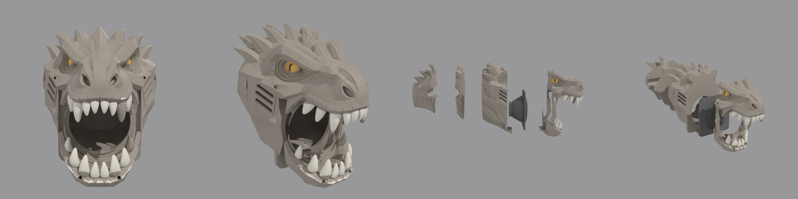

# Sculpted T. rex speaker pod (concept 4)

With the speaker in:

Without the speaker, and pulled apart:


The head is a real sculpt, not CAD shapes: four views of concept 4 were made in
Higgsfield, then Hunyuan3D turned them into a watertight model
(`trex_head_ai.glb`). `trex_pod.py` turns that into a working, printable
speaker pod for the Kenwood KFC-2053MRB 8".

```
pip install numpy scipy scikit-image trimesh manifold3d rtree
python cad/sculpt/trex_pod.py                     # Bambu H2C, both nozzles (300 x 320)
python cad/sculpt/trex_pod.py --bed 256 256 256   # X1, P1, A1
python cad/sculpt/trex_pod.py --scale 450         # smaller head
```

Output goes to `cad/sculpt/out/` (not in git, it's big): one `.3mf` per part
with the colours already painted on, `.print.stl` for every piece (already
turned the way up it prints), and `info.json` with the sizes and bolt list.

## Size

About 35 cm wide, 45 cm tall, 51 cm long (snout to back of skull) at the
default `--scale 480`. That's what it takes for the 230 mm grille to sit in
the mouth.

## The parts

| Part | What it is | Prints |
|---|---|---|
| mask | Snout, upper teeth, eyes. Goes on last, over the speaker | Flat back on the bed, snout up |
| jaw | Lower jaw and teeth. Bolts to the chin lug | Flat back on the bed |
| box | Sealed box: flat mounting plate with the 180 mm hole and 4 pilot holes, chin lug, gland and vent underneath | Front face on the bed. Open at the back, so any supports come out |
| seat | Solid block that closes the back of the box and holds the cage tube | Flat face down |
| cover | Back of the skull. Clamps the tube with 4 hidden M6 bolts | Flat face down |

The cage tube runs left to right through the back of the head, in a 1.5 mm
rubber strip, between the seat and the cover.

Air inside the box: **10.8 L** (`pod.gross_l` in `config/speaker_pods.yaml`;
the Pi's bass EQ is worked out from it).

## The speaker model and the fit check

`kenwood_kfc2053mrb.py` is the speaker on its own (grille, basket, magnet,
screw holes). `trex_pod.py` drops it in and checks, every build, that it
doesn't touch the box or face, the basket has room, the 4 screws land in
plastic and how much of the cone can see straight out of the mouth. The
answer is in `info.json` under `fit` (now: 9.5 mm round the basket, all 4
screws in plastic, 95% of the cone sees out, 86% counting the teeth).

Kenwood publish the cut-out, depth, grille and magnet. The grille height,
screw spacing and cone size are guesses: measure yours and change them at
the top of `kenwood_kfc2053mrb.py`.

## Sound

The throat is cut right through from the whole cone to the mouth at
45 degrees, so the face doesn't choke the speaker. The mouth is still deep
in front of the grille, which can add a small bump somewhere around 600 to
900 Hz. Measure it with a phone mic once it's in and notch it in the Pi EQ.

## Colours (AMS)

The 3MFs are painted: filament 1 body, 2 teeth (bone), 3 eyes (amber),
4 pupils (black). Open a 3MF in Bambu Studio, set those four filament slots
and slice. The teeth and eyes were picked out of the sculpt once by
`tools/label_*.py` (shape plus the colours in the concept views) and saved in
`trex_head_labels.npz`.

## Pieces (H2C, 300 x 320 bed)

mask 2, jaw 1, box 4, seat 4, cover 1.
Pieces join on flat upright cuts with 6 mm dowel holes (use 6 mm rod or
cut-off bolts) where there's room. Glue with ASA cement or epoxy.

**The box and the box-to-seat joint must be airtight**: glue all the way
round and run a bead of sealant inside before it closes up. A leaky box
loses the bass.

## Hardware per pod

- 4x M6 heat-set insert + M6x25 (cover to seat), heads under printed plugs
- 4x M5 heat-set insert: 2x M5x16 at the brow, 2x M5x35 through the chin
  into the chin lug. Counterbores from the front, plug them after
- PG7 gland (speaker wire) and M12 vent, both underneath
- 4 speaker screws into the 12 mm mounting plate (3.5 mm pilot holes)
- 1.5 mm rubber strip round the cage tube

## Filament and slicer settings

- 3 walls everywhere. Box and seat: 15% gyroid infill. Mask, jaw and
  cover: 5% lightning infill (it only holds up the top skins).
- ASA for the walls and colours, ABS for infill: in Bambu Studio, Others >
  Filament for features > Sparse infill = the ABS slot. Print the seat
  blocks all in ABS, they're hidden.
- Roughly 2.7 kg per head: 1.8 kg ASA, 0.95 kg ABS, under 100 g of each
  colour. The slicer will give the real number.

## Still guesses

- The speaker's grille height, screw spacing and cone size (see above).
- `TUBE_D`: 47.6 mm. Measure your cage tube.
