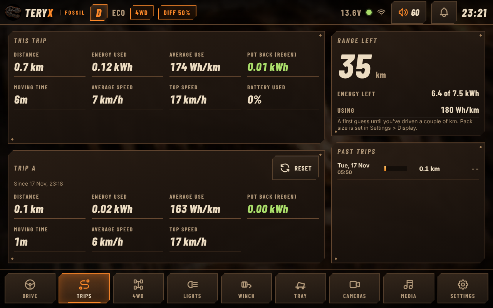
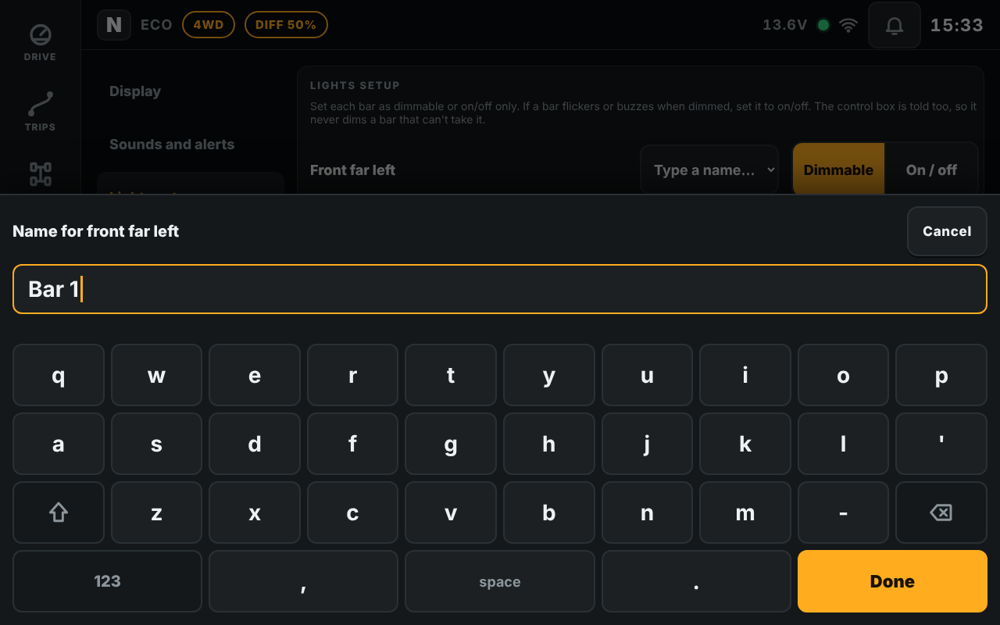
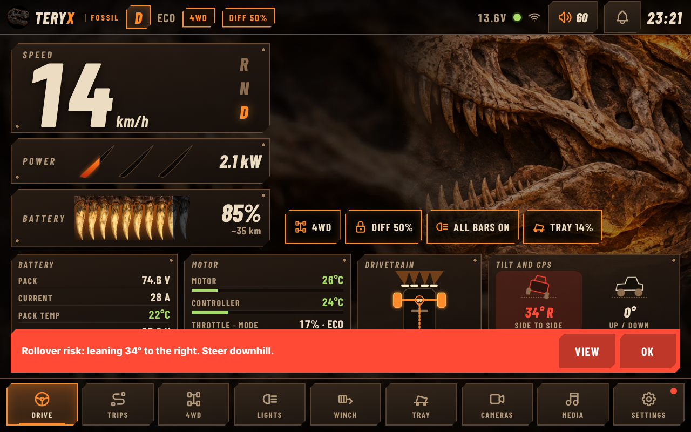

# Teryx dash UI

The touch screen dash for the Teryx: a rugged, high-contrast take on a Tesla-style screen,
built for a 10.1" 1280x800 touch screen on a Raspberry Pi 5, used with gloves on a bumpy track.

**The Pi only asks. The control box (Pico) decides.** Every button sends a request; what the
screen shows is what the control box reports back. If the control box says no (too fast,
not stopped, not armed), the dash says why in plain words.

## Screens

| Screen | What it does |
|---|---|
| Drive | Speed, gear (R/N/D), power and regen bar, battery % and range left, pack volts/amps/temp, 12V, motor and controller temps, throttle, mode, odometer, a top-down view showing 2WD/4WD, diff lock and lights, and the tilt and GPS widget |
| Trips | This trip (key on to key off), trip A (reset with two taps), range left, energy used and put back, Wh/km, and past trips |
| 4WD | 2WD/4WD switch and diff lock 0-100% (slider plus Open/25/50/75/Lock). Shows the target and where the actuator actually is, and locks out above the speed limits |
| Lights | 4 front bars, interior bar, rear pods (Off / Auto in reverse / On), trailer status. Each bar is dimmable or on/off only (set in Settings). Presets (All on/off, Trail, Work, Spot) and effects (Steady, Breathe, Strobe, Chase, Outside pair, Inside pair) |
| Winch | Slide to arm (so a knee can't arm it), then hold IN or OUT. Lifting your finger stops it. Shows checks and the auto-disarm countdown |
| Tray | Hold UP or DOWN. Only when stopped. Shows limit switches, current and position |
| Camera | Reverse camera with guide lines and mirror. Pops up on its own in reverse and goes back 3 s after |
| Media | Bluetooth audio from a phone, music on the Pi or a USB stick, internet radio, and CarPlay / Android Auto through a Carlinkit USB adapter. One volume; music dips under alerts and in reverse. See [`docs/audio.md`](../docs/audio.md) |
| Settings | Display (night/day/auto, units, pack size), sounds and alerts, lights setup, camera, control box safety limits, diff pot calibration, faults, updates (OTA), Wi-Fi, about |

Faults from the control box or motor controller show as a banner along the bottom with plain
English text, and are listed under Settings > Faults.

## Built for the real screen

The screen is a 10.1" 1280x800 capacitive touch panel (16:10, 350 nits). The dash is drawn
for exactly that. On any other size (1024x600, 1920x1200, a laptop on the bench) the whole
dash scales to fit and is centred, so nothing is cut off and touches still land in the right place.



**Glove-friendly.** Everything you press is at least 64 px (about 11 mm on this screen), the
top bar sound button is 60 px with a bigger hit area. `ui_live.mjs` measures every button on
every screen and fails if anything is under 60 px. Each press gives a small click sound (can be
turned off) so you know a gloved tap landed.

**On-screen keyboard** for Wi-Fi passwords, network names and light names. Big keys, shift
(tap twice for caps lock), numbers and symbols pages, hold backspace to delete fast, and show or
hide for passwords. Done acts when you lift your finger, so the lift can't press whatever is
underneath. A real keyboard plugged into the Pi works too.



**Alerts with sound.** As well as control box and motor controller faults, the dash watches:
battery low (20%) and very low (10%), motor, controller and pack temps, limp mode, 12V low,
lost link to the control box, and tilt (once a sensor is fitted). Warnings beep twice. Serious
ones beep three times and keep beeping every 6 s until you tap OK on the banner (or the bell in
the top bar). The bell also mutes and unmutes. Each alert has a small gap before it clears, so
a value sitting on the line doesn't keep setting it off. Sounds are made in the browser, so
there are no sound files. Settings > Sounds and alerts has volume, clicks and the tilt limits.



**Day/night Auto** goes by the sun: the GPS position when there's a fix, otherwise a rough
area picked in Settings > Display (no exact location is saved). Night starts a little after
sunset. A light sensor (`pi.light_lux`) wins if one is ever fitted. Day is the high contrast
theme for full sun.

**Trips and range.** The Pi logs trips (not the browser), so they survive a screen restart.
Range = energy left in the pack / your use per km over the last 10 km, falling back to your
average, then a first guess of 180 Wh/km. Set the real pack size in Settings > Display
(default 7.5 kWh, for 72 V x 105 Ah). Trips are saved to `~/.config/teryx/trips.json` on the Pi.

**Tilt and GPS widget**, ready for sensors that aren't fitted yet. It reads the `pi.imu.*` and
`pi.gps.*` keys (see `docs/DASH_API.md`) and says "not fitted yet" until they show up. The
simulator has a fake tilt sensor and GPS so it can be tried on the bench
(`{"tilt": {"roll": 30}}` to `/api/sim` holds a tilt, `{"sensor": ["gps", false]}` turns one off).

**Boot.** `dash/deploy/install-splash.sh` (run by `install-pi.sh`) puts the Teryx logo up from
power on instead of scrolling text, and the dash page shows the same logo until the control box
answers (4 s at most).

## Camera: USB or RCA, both work

We don't know yet which camera is fitted, so both are supported:

- **USB camera**: shows up as a video device and opens straight in the browser.
- **RCA / AHD camera**: plug it into a cheap USB AV capture dongle (UVC). It then looks
  exactly like a USB camera. The Pi 5 has no analogue video input, so a dongle is needed.
- **Fallback**: Settings > Camera > Server stream uses ffmpeg on the Pi to serve
  `/api/camera.mjpg`, in case the browser can't open the device.

## Running it

### On a laptop with the simulator (no Teryx needed)

The simulator and gateway are in the `teryx` package (test environment work).

```bash
pip install -r requirements.txt
PYTHONPATH=dash/server python -m teryx run --scenario trail --ui dash/web
# open http://localhost:8080   (sim controls at http://localhost:8080/sim)
```

Scenarios: `idle`, `trail`, `reversing`, `low_battery`, `hill_climb`, `faults`,
`actuator_faults`, `comms_loss`, `key_off`, `manual`.

### Demo mode (just a browser)

Open `dash/web/index.html?demo=drive` from any web server (for example
`python -m http.server -d dash/web`) and go to `http://localhost:8000/?demo=drive`.
A small built-in fake vehicle runs in the page. Other demos: `?demo=park`, `?demo=reverse`,
`?demo=faults`. Add `&screen=lights` (or `drivetrain`, `winch`, `tray`, `camera`, `settings`)
to open a screen straight away. Settings that need the Pi (limits, updates, Wi-Fi) say
"not available in demo mode".

### On the Pi

```bash
sudo bash dash/deploy/install-pi.sh <repo git url> v0.1.0
```

That sets up `/opt/teryx`, a Python venv, the `teryx-dash` service (server on port 8080,
CAN on `can0`), and prints the two commands to start the full screen kiosk.

## Updates over Wi-Fi (OTA)

Settings > Updates checks for new versions and installs them. Releases are git tags:
`v1.2.0` is stable, `v1.3.0-beta.1` is beta.

- Only installs when the Teryx is stopped.
- Each version is kept in its own folder; switching is an instant link swap.
- If a new version fails to start twice, it goes back to the last good one on its own.
  There's also a Roll back button.
- Control box firmware: if a release has a newer `firmware/VERSION` than the Pico reports,
  an "Update control box" button appears (only while the control box says it's parked). It runs
  `tools/pi/flash-control-box.sh`, which asks the Pico over CAN to make its outputs safe, flashes
  the release's `.uf2` with picotool, checks the new version is running and keeps the old one for
  rollback (change with `TERYX_PICO_FLASH_CMD`).

To publish an update: tag a commit (`git tag -a v0.2.0 -m "What changed"`) and push the tag.
The tag message shows on the Updates screen.

## Wi-Fi

The Updates screen uses the Pi's built-in Wi-Fi. Settings > Wi-Fi shows nearby networks: tap
one and type its password on the on-screen keyboard. You can also type a hidden network's name,
switch between saved networks, or forget one. It uses NetworkManager (`nmcli`, never through a
shell); `install-pi.sh` adds a polkit rule (`50-teryx-wifi.rules`) so the dash user can manage
Wi-Fi and nothing else. Network names and passwords stay on the Pi, never in this repo.

## Where things are

```
dash/web/                 the UI (plain HTML/CSS/JS, no build step)
  js/app.js               app shell: top bar, nav, faults banner, reverse camera pop-up
  js/link.js              websocket link to the gateway, requests and hold-to-run
  js/store.js             live state, plus what we last asked for
  js/settings.js          dash settings (saved on the Pi)
  js/text.js              plain-English fault and refusal text
  js/demo.js              built-in demo vehicle
  js/screens/*.js         one file per screen
  js/alerts.js            alerts the dash watches for, plus faults; sounds in js/sound.js
  js/theme.js             day/night by the sun
  js/tripdata.js          trip and range figures (from the Pi, or in-page in demo mode)
  js/fit.js               scales the 1280x800 layout to the real screen
  js/media/               media mixer (ducking), music/radio player, CarPlay (node-carplay in lib/)
  js/ui/keyboard.js       on-screen keyboard
  js/ui/sensors.js        tilt and GPS widget
  js/ui/                  controls (sliders, hold buttons, slide-to-arm), icons, vehicle drawing
dash/server/teryx_dash/   /api/ routes: settings, control box limits, OTA, Wi-Fi, system, camera, audio and media
dash/deploy/              systemd units, kiosk launcher, Pi installer
dash/tests/               server tests (pytest) and an end-to-end UI test against the simulator
```

Settings are saved to `~/.config/teryx/dash-settings.json` on the Pi (not in the repo).

## Tests

```bash
cd dash && python -m pytest                 # server, settings, OTA install and rollback
node dash/tests/ui_live.mjs                 # needs the simulator running on :8080
```

`ui_live.mjs` drives the real UI with the mouse as a finger: lights, presets, 4WD, diff lock,
arming and running the winch, the tray, a refusal when too fast, the camera popping up in
reverse, the fault banner and the safety limits page. Then:
music playing and dipping under alerts and in reverse, the pretend Bluetooth phone, the CarPlay test picture, button sizes on every screen,
typing on the keyboard, trips and range, the tilt/GPS widget, the tilt alarm with sound,
low battery, day/night by the sun, fitting a 1024x600 screen (with slide-to-arm still working)
and the virtual Teryx running off the same feed.

## Safety notes

- Hold-to-run (winch, tray) repeats every 100 ms while your finger is down. Lift, slide off,
  lose the touch, switch screens or lose the link and it stops. The control box also stops
  it if the repeats stop for 300 ms.
- Lockouts shown on screen (speed limits, stopped, armed) are only hints. The control box
  enforces the real rules with the limits under Settings > Safety limits.
- Updates and Pi shutdown are refused while moving.
