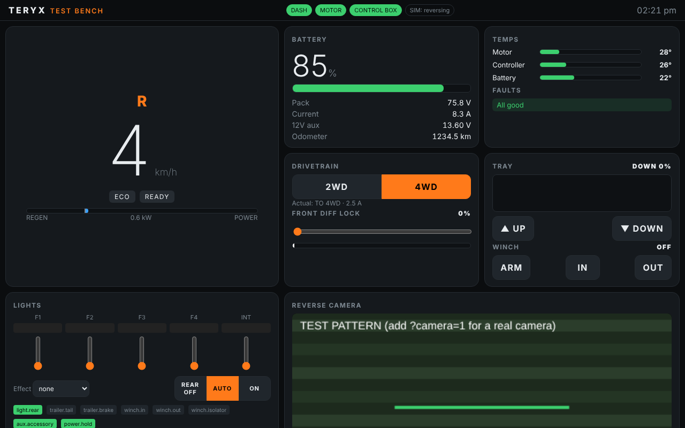
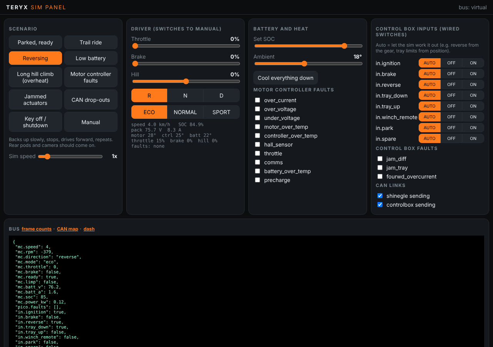
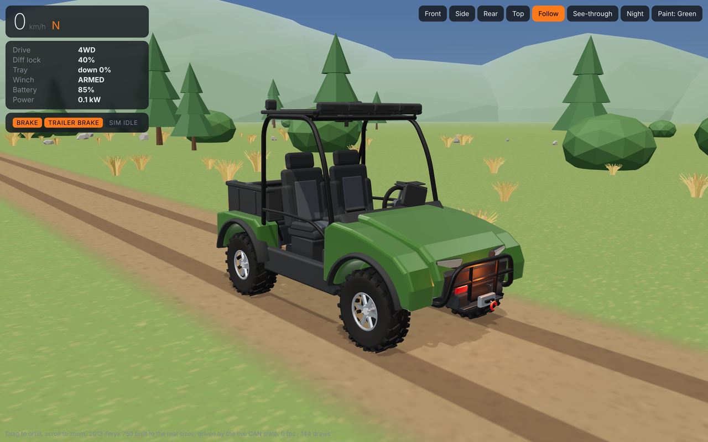
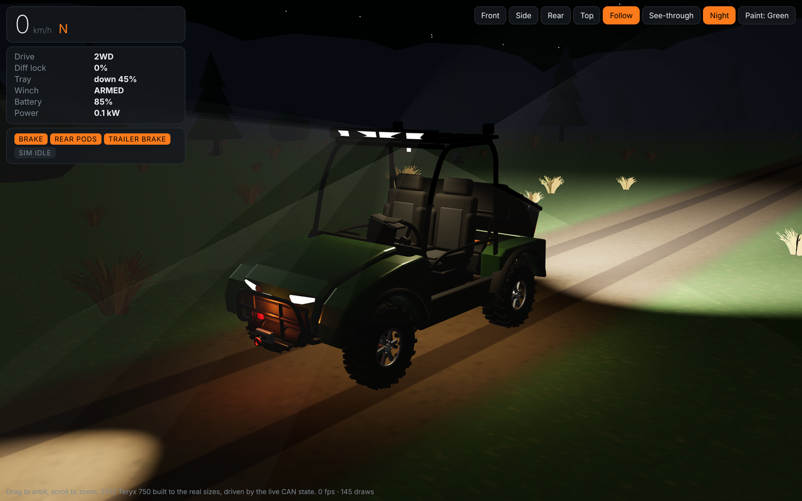

# Test environment

The bench lets us build and test the dash with no Teryx attached. Every fake
device talks real CAN frames, so swapping in the real hardware later is a
change of one command-line option, not a rewrite.

```
 ┌──────────────── one laptop or the Pi ─────────────────┐
 │                                                       │
 │  Fake Shinegle ──┐                                    │
 │  (sim/vehicle)   │                                    │
 │                  ├──── CAN bus ────┐                  │
 │  Fake Pico box ──┘   (virtual,     │                  │
 │  (sim/controlbox)     UDP, vcan    ▼                  │
 │        ▲              or can0)  Dash gateway ── /ws ──┼──► Test screen or real dash UI
 │        │                        (dash/gateway)        │
 │   Sim panel (/sim): scenarios, throttle, faults       │
 └───────────────────────────────────────────────────────┘
```

The rule from the IO list holds here too: **the dash asks, the control box
decides.** The fake control box applies the same safety rules the real Pico
firmware will, and refuses requests with a reason the dash can show.





## Run modes

| Command | What runs | Use it for |
|---|---|---|
| `python -m teryx run` | Sim + dash in one program, in-process bus | Everyday UI work. Works anywhere |
| `python -m teryx sim --bus udp` and `python -m teryx dash --bus udp` | Separate programs on a UDP "bus" | Restarting the dash without resetting the sim, or running the Pico firmware's host build alongside (`run --bus udp --no-controlbox`) |
| `python -m teryx run --bus socketcan:vcan0` | Linux virtual CAN | Using `candump`, `cansniffer`, SavvyCAN on the fake bus. Run `sudo scripts/setup_vcan.sh` first |
| `python -m teryx dash --bus socketcan:can0` | Dash only, on the real bus | The Pi in the Teryx. Run `sudo scripts/setup_can_pi.sh` first |

Other useful bits:

- `python -m teryx monitor --bus udp` prints every frame, decoded. Add
  `--only SG_MOTOR,PICO_STATUS` to cut the noise.
- `python -m teryx replay capture.log --bus udp --loop` plays a recorded CAN
  log (candump `.log`, `.asc`, `.blf`) back onto the bus.
- `python -m teryx run --ui path/to/dash` serves another UI folder (the real
  dash) against the same live feed.
- `python -m teryx canmap` rebuilds `docs/CAN_PROTOCOL.md` and `docs/teryx.dbc`
  after a message change. The tests fail if you forget.
- `/api/state`, `/api/bus` (frame counts, unknown CAN ids) and `/api/canmap`
  are handy from a browser or `curl`.

Bus specs: `virtual`, `udp` (239.0.7.0:47000 on loopback, shared with the
firmware host build), `socketcan:<name>`, or any python-can interface such as
`slcan:/dev/ttyACM0@250000` for a USB CAN adapter.

## Scenarios

Pick them on the sim panel or with `--scenario`.

| Name | What happens | Good for testing |
|---|---|---|
| `idle` | Parked, key on, neutral | 4WD, diff, tray, winch, lights |
| `drive_demo` | Scripted drive, about 100 s: handbrake, pull away, speed up, cruise, regen, hard braking, reverse, hill up and down, park. Loops | Watching the whole dash react, see below |
| `trail` | 2 minute loop: climbs, descents, stops, a quick blast | Speed, power, battery, temps |
| `reversing` | Backs up, stops, drives off, repeats | Reverse camera, rear pods |
| `low_battery` | Starts at 15 % and drains fast, limp under 10 % | Low battery warnings, limp mode |
| `hill_climb` | Steep climb in sport, heats up until limp mode | Temp warnings, derating |
| `faults` | Steps through every Shinegle fault | Fault messages |
| `actuator_faults` | Jammed diff and tray, 4WD over current | Control box faults, refused requests |
| `comms_loss` | Shinegle then control box go quiet for 4 s | Offline / stale display |
| `key_off` | Key off after 3 s | Shutdown and power hold |
| `manual` | You drive with the sim panel sliders | Anything |

### Drive demo

`python -m teryx run --scenario drive_demo --ui dash/web` (with `PYTHONPATH=dash/server`
for the dash extras), or pick "Drive demo (scripted)" on the sim panel. The dash shows a
player bar at the top that says what the driver is doing, with restart, pause/play and skip
buttons. The same thing over the API: `{"paused": true}`, `{"restart": true}`,
`{"demo_step": 11}` to `/api/sim`. The steps live in `DriveDemo.STEPS` in
`teryx/sim/scenarios.py`, one line each, so they're easy to change. The virtual Teryx
(`/virtual`) follows along on its own because it reads the same state.

The sim's handbrake holds the wheels and sets the control box's `in.park` input, so the
dash sees it just like the real handbrake switch.

The sim panel also lets you set SOC and ambient temperature, tick any fault,
force any wired input (ignition, brake, tray limits, winch remote...), cut
either CAN link, and run the sim up to 5x faster.

## Virtual Teryx

`/virtual` (also shown at the top of the sim panel) is a 3D 2013 Teryx 750
two seater, built in code to the real spec-sheet sizes, that shows what the
CAN bus is saying, live:

- wheels turn and the ground scrolls with speed, the body pitches on hills
- the four front bars, interior bar and rear pods light up at their actual
  output level, so dimming and effects (strobe, chase, SOS...) show as they
  would on the real bars
- the tray tips up with the tray position, and its actuator extends
- the front driveshaft lights up in 4WD, and the front diff ring glows with
  the diff lock %
- the winch drum spins and the cable pays out or winds in
- brake and tail lights, and the trailer plug's tail and brake pins
- **See-through** shows the drivetrain under the body, **Night** turns the
  sun off so the lights stand out (keys `x` and `n`)
- **Paint** cycles the body colour (key `p`), and the dash screen shows a
  tiny live version of the dash
- on a Pi (or with `?lite`) it drops the pixel ratio and shadow size to keep
  the frame rate up. `?night`, `?xray` and `?cam=x,y,z` set the view on load

It only reads the dash feed, so it works the same on the sim, a replayed log
or the real bus. No free Teryx model with an MIT-friendly licence
exists, so the model is drawn in code in `teryx/web/virtual/teryx-model.js`
(no third-party mesh or artwork). three.js (MIT) is bundled in `teryx/web/vendor/` so it works with no internet.





## The fake control box

`teryx/sim/controlbox.py` behaves like the Pico frame for frame, and doubles
as a readable spec for the firmware. Rules (defaults from `config/io-map.yaml`,
all changeable over 0x704):

1. Dash heartbeat lost for 500 ms: stop winch, tray and actuators, disarm the
   winch. Lights stay. Driving is never touched.
2. No Shinegle speed for 500 ms: speed unknown, block anything that needs
   "stopped".
3. 2WD/4WD only under 5 km/h. Runs to the end stop, max 3 s, stops over 6 A.
4. Diff lock only under 15 km/h. Max 4 s. Pot not moving: fault.
5. Tray only when stopped, hold-to-run, limit switches, over current, max 20 s.
6. Winch: armed, stopped and hold-to-run. 100 ms dead time between in and out.
   Disarms after 2 min idle.
7. Reverse turns on the rear pods (if set to auto).
8. Key off: hold power for 30 s, then drop it.

Requests act on a **change** of value. The dash resends lights and drive
requests every second so a rebooted Pico catches up, but a refused 4WD
request is never quietly done later when the speed drops. When the box
refuses something, `pico.reject` says why and the dash snaps its request back.

Light bars can be set dimmable or on/off only (setting 16, bit per light), so
both kinds of bar can be tested.

## Swapping in the real Shinegle

The Shinegle's CAN layout isn't published, so `teryx/canbus/shinegle.dbc` is a
**placeholder**. It is the only file that knows the Shinegle frame layout;
`shinegle.py` loads it and turns it into the io-map names (`mc.speed`,
`mc.batt_v`...) that everything else uses.

The decoding kit (a Pico 2 sniffer plus `python -m teryx decode ...`) records
the real bus while you follow a guided procedure, works out the layout, and
writes a new `shinegle.dbc`. Step-by-step guide: [shinegle-decode.md](shinegle-decode.md).

To try a different .dbc without replacing the shipped one, set
`TERYX_SHINEGLE_DBC=/path/to/file.dbc` before running the sim, dash or tests.

## On the Pi

Same commands. For the in-Teryx setup the dash runs as a service and Chromium
opens it full screen:

```bash
python -m teryx dash --bus socketcan:can0 --ui /path/to/dash/web
chromium-browser --kiosk --noerrdialogs --disable-infobars http://localhost:8080/
```

(Service files and auto-start come with the real dash UI.)

## Cameras

The rear camera may be USB or AHD through a USB capture stick. Both show up as
a normal video device, so the dash uses the browser's camera API. On the test
screen add `?camera=1` to the URL to use a real camera, otherwise it shows a
moving test pattern when the Teryx is in reverse.
