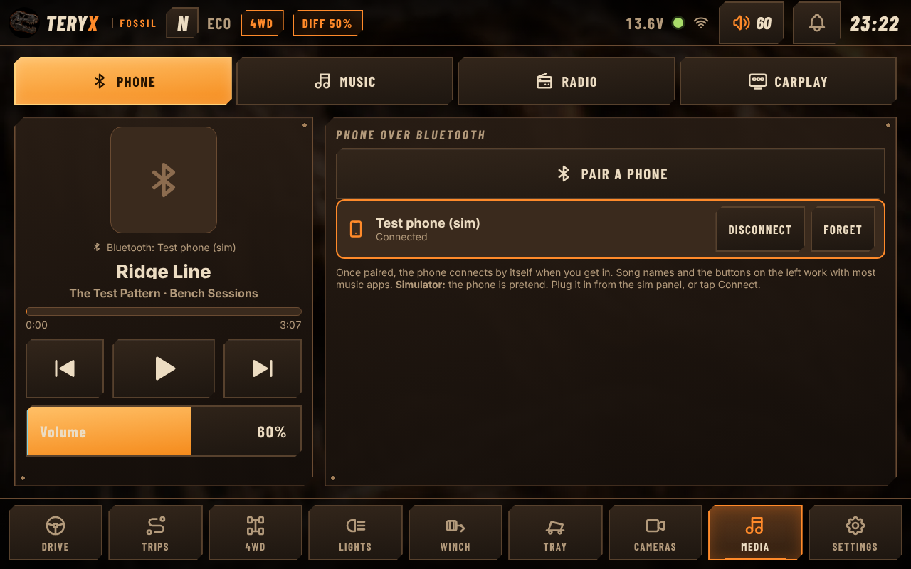

# Audio, media and CarPlay

The Pi is the whole sound system. There's no separate head unit or tuner: the Pi plays the
sound and feeds an amp, and the amp drives the speakers.

```
 phone ──Bluetooth──┐
 Carlinkit adapter ─USB─┤                       ┌──────────┐   speaker wire   ┌──────────┐
 USB stick / ~/Music ───┤  Pi 5 (dash)  ──line──▶│ 12V amp  │─────────────────▶│ speakers │
 internet radio ──Wi-Fi─┘  USB DAC or I2S HAT   └──────────┘                  └──────────┘
 alert beeps (dash) ────┘                              ▲ remote turn-on from the dash 12V rail
```

Nothing here is needed for the dash to work. Without an amp the Media screen still works, it's
just quiet. Everything can be tried on a laptop with the simulator (see the end).

## What the dash does

**Media screen** (new nav button), four tabs:

| Tab | What it is |
|---|---|
| Phone | Bluetooth audio from a phone (the Pi acts as a Bluetooth speaker called "Teryx"). Song name, artist, play/pause/skip. Pair a phone with **Pair a phone**: pairing is only open for 2 minutes, so nobody can pair while you're parked up somewhere. |
| Music | Songs in `~/Music` on the Pi and on any USB stick plugged in. MP3, M4A, FLAC, OGG, WAV. Names come from the MP3 tags or the file name ("Artist - Title.mp3"). Shuffle. |
| Radio | Internet radio over Wi-Fi or a phone hotspot. RNZ National and RNZ Concert are set up already. Add more with the on-screen keyboard. RNZ's streams are HLS, which Chromium can't play, so the Pi passes them through ffmpeg. |
| CarPlay | CarPlay and Android Auto through a Carlinkit USB adapter, drawn inside the dash. |



**One volume** for all of them, on the Media screen. Alert sounds have their own volume
(Settings > Sounds and alerts), so turning the music down or off never makes a warning quieter.

**Music dips under alerts.** Every warning beep turns the music down to 25% (Settings > Audio and
media) for a few seconds. A serious alarm keeps it down until you tap OK. It also drops while
reversing, so you can hear what's behind you. This works for every source, including Bluetooth
phone audio (the Pi turns down the phone's stream in PipeWire) and CarPlay.

**Top bar** shows what's playing. Tap it to go to Media.

**Settings > Audio and media**: where the sound goes (USB DAC, I2S HAT, HDMI), the output level,
how far music drops under alerts, quieter in reverse, and CarPlay options (start by itself,
driver's side: right for NZ).

## CarPlay and Android Auto

CarPlay needs an Apple MFi authentication chip in the car end, and it can't be faked in software.
So the answer is a **Carlinkit CPC200-CCPA** (or CPC200-Autokit) USB adapter. It has the chip,
makes its own Wi-Fi for wireless CarPlay, and does Android Auto too.

- Buy the **CCPA / Autokit** type, made for aftermarket Android screens. The "wired to wireless"
  adapters made for cars that already have CarPlay will **not** work.
- Plug it into a USB port on the Pi. Start it from Media > CarPlay (or let it start by itself).
- First time: pair the phone with the adapter in the phone's Bluetooth settings. After that it
  connects on its own. A cable from the phone into the adapter works too.
- The phone's screen fills the Media screen. The top bar, nav and alert banner stay on top, and
  its sound goes through the same volume and ducking as everything else.
- If CarPlay misbehaves, Bluetooth on the Phone tab is the backup.

How it works: [node-CarPlay](https://github.com/rhysmorgan134/node-CarPlay) (MIT) talks to the
adapter over WebUSB from inside the dash page. It's bundled in `dash/web/lib/node-carplay.js`
(rebuild with `dash/vendor-src/carplay/build.sh`). The video is H.264, decoded with WebCodecs; the
Pi 5 has no H.264 hardware decoder, so this uses some CPU. `scripts/audio-setup.sh` adds a
Chromium policy so the dash can open the adapter without a pop-up.

Other options we looked at (November 2026):

| Option | Verdict |
|---|---|
| Carlinkit CPC200-CCPA + node-CarPlay (this) | Cheap, works today, CarPlay and Android Auto, wired and wireless. Built into the dash. |
| [LIVI](https://github.com/f-io/LIVI) (was pi-carplay) | Very capable, but GPL-3.0, so it can only be run as a separate app beside the dash, never copied in. It still needs an MFi chip: either a bare chip on the Pi's I2C pins or a "LIVI Link", which is a reflashed CPC200-CCPA anyway. Worth a look if the in-dash version isn't good enough. |
| Bare MFi chip on I2C | Not sold to the public, grey market only, fiddly. No. |
| Android Auto with no adapter (aasdk / OpenAuto / LIVI) | Possible, but GPL (separate app only) and only helps Android phones. The Carlinkit already covers it. |
| react-carplay | No licence file, so we can't reuse its code. |

Not done yet: a microphone for Siri, Google Assistant and phone calls through the dash. A USB mic
on the Pi would do it (node-CarPlay supports one). Calls still work on the phone itself.

## Hardware to buy

Prices are rough NZ dollars, November 2026.

### 1. Getting sound out of the Pi (pick one)

The Pi 5 has **no headphone jack**, and the screen has no speaker.

| Option | Good for | Approx |
|---|---|---|
| **Pick (18 Nov): Raspberry Pi DAC+** (official, ex IQaudio, PB Tech SEVRBP0313) | No USB. On 7 jumper leads from the Pi's header (GPIO 18, 19, 21, SDA, SCL, 5 V, GND), not a 40-way ribbon, so the CAN, 4G and IMU leads still reach their pins. RCA out to the amp. `audio-setup.sh --i2s iqaudio-dacplus`. | ~NZ$36 |
| USB DAC with a line out (dropped: USB plugs shake loose) (e.g. a small USB audio adapter with RCA or 3.5 mm out) | Easiest. Plug in and pick it under Settings > Audio and media. Get a decent one, cheap ones hiss. | $20–80 |
| **I2S DAC HAT** (PCM5122 based, e.g. HiFiBerry DAC+ or a clone, RCA out) | Cleanest sound, no USB. Sits on the GPIO header, but the CAN HAT is there too: check they don't both want the same pins, or use a stacking header. Run `audio-setup.sh --i2s hifiberry-dacplus`. | $40–90 |
| **HDMI** | Only if the HDMI to VGA adapter for the screen has a 3.5 mm audio out. Free if it does. | $0 |

Avoid HATs that also power the Pi (some amp HATs do): the Pi already has its own 5V buck.

### 2. Amp

A **marine or UTV 4-channel class D amp**: sealed against water and dust (IPX5 or better), runs
on 12V, about 50–75 W RMS per channel, RCA line inputs and a remote turn-on wire. Examples:
Rockford Fosgate PM400X4 or Punch marine, Kicker KMA, JL Audio MX, Kenwood or Pioneer marine.
2 channels is plenty for one pair of speakers; 4 lets you add a rear pair later.

| | Approx |
|---|---|
| Good marine 4-ch amp | $400–900 |
| Budget sealed 2–4 ch amp | $150–300 |

Mount it out of the weather if you can (under the seat), even if it's rated waterproof.

### 3. Speakers

**Marine coaxial speakers** (UV-proof cone and grille, IPX5 or better). Either 6.5" in the dash or
door panels, or **roll-cage speaker pods** that clamp onto the tube (easiest on a Teryx: no
cutting). Same brands as above.

| | Approx |
|---|---|
| Pair of marine 6.5" coaxials | $150–400 |
| Pair of 6.5" roll-cage pods | $300–700 |

**Sam's speakers (18 Nov): Kenwood KFC-2053MRB, 8" 2-way marine, black.** Already got, so
they're off the shopping list. Specs from retailers (I couldn't find Kenwood's own page for this
model): 4 ohm, about 50 W RMS each (100 W RMS the pair, 300 W peak), 55 Hz to 20 kHz, about 86 dB,
**180 mm (7-1/16") cut-out**, **about 86 mm (3-3/8") mounting depth**
([Quality Mobile Video](https://www.qualitymobilevideo.com/kfc-2053mrb.html),
[Online Car Stereo](https://www.onlinecarstereo.com/CarAudio/p_43004_Kenwood_KFC-2053MRB.aspx),
[Autopro](https://autopro.com.au/ab/Autopro-Category/Brands/Kenwood/Kenwood-2-Way-2-Speaker---KFC-2053MRB/p/ME30640)).
**Amp (Sam's pick, 18 Nov):** an AliExpress 4-channel class D, about NZ$100. 4 x 63 W RMS at 4 ohm,
or 2 x 200 W RMS bridged at 4 ohm, with a fixed 90 Hz high pass and low pass, 8-16 V, up to 33 A
flat out. Channels 1 and 2 drive the Kenwoods: turn the high pass on so they don't get the deep bass,
and set the gain so 63 W doesn't push them past their 50 W. Channels 3 and 4 stay free for a sub
later, bridged into a 4 ohm one (low pass on). It gets its own **40 A** fuse at the battery on
**6 mm²** cable, feed and earth.

**For the printed pods** (not drawn yet): a 180 mm hole in the front face, at least **95 mm** clear
depth behind the mounting face (86 mm plus room for the terminals and the cable), and room for the
speaker's outer flange (measure it, roughly 210 mm across). Bigger inside is better for bass: an 8"
likes about 10 litres or more per side if you can fit it. Measure the real speaker before printing,
since one listing gives a different depth.

### 4. Wiring and bits

| Part | Why | Approx |
|---|---|---|
| Amp wiring kit (8 AWG for up to ~400 W, inline fuse within 30 cm of the battery) | Power to the amp | $60–120 |
| Ground loop isolator (RCA) | Only if you hear a hum or whine with the motor running | $15–30 |
| Carlinkit CPC200-CCPA | CarPlay and Android Auto | $80–150 |
| USB mic (later) | Siri / Assistant / calls through the dash | $15–40 |
| RTL-SDR USB dongle (optional, not built yet) | Real FM radio with no internet. The Pi could tune it and play it like an internet station | $50–80 |

### Power

- The amp runs from the **12V aux battery**, fused at the battery (fuse size from the amp's
  manual).
- Its **remote turn-on** goes to the **dash 12V rail** (key switch / power-hold), so the amp turns
  off with the key and can't flatten the battery. If the amp thumps when it turns on, turn it on
  from a spare control box relay a few seconds after the Pi has booted instead.
- A 4 x 50 W amp can pull 20–30 A at full volume. That adds to the DC-DC load, which is still
  **TBC** (see `docs/io-list.md`).

## Setting it up on the Pi

`scripts/pi-setup.sh` runs `scripts/audio-setup.sh` for you. To add an I2S HAT later:

```bash
sudo bash scripts/audio-setup.sh --i2s hifiberry-dacplus
sudo reboot
```

It installs PipeWire and BlueZ, makes the Pi a Bluetooth speaker called "Teryx" (pairing only
when the dash opens it), lets the dash server reach the desktop's sound through
`/run/teryx-audio/pulse`, and lets the dash open the Carlinkit adapter. Then:

1. Settings > Audio and media: pick the output.
2. Leave **Output level** at 100% and turn the amp's gain up until the music is loud enough at
   about 70% on the Media volume. Then alerts are always loud enough.
3. Media > Phone > Pair a phone.

If Settings shows no outputs: as the desktop user, `pactl list short sinks` should list them, and
`ls -l /run/teryx-audio/` should show the `pulse` socket.

## Trying it with no hardware

```bash
PYTHONPATH=dash/server python -m teryx run --scenario trail --ui dash/web
```

- **Music**: three made-up demo tunes (generated by code, nothing copied) show up on the Music
  tab. Or point `TERYX_MUSIC_DIRS` at a folder of your own.
- **Phone**: the sim panel (`/sim`) has a pretend phone. Tap PHONE IN and it "connects" and
  plays. Skip and pause from the dash.
- **Outputs**: three pretend outputs under Settings > Audio and media.
- **Ducking**: play a tune and trigger a fault or low battery in the sim, or reverse. The music
  dips. The sim panel shows the phone's level dropping too.
- **CarPlay**: Media > CarPlay > Test picture fills the screen and shows your touches.
- `node dash/tests/ui_live.mjs` checks all of this.

## API

| Route | What |
|---|---|
| `GET /api/audio` | outputs, levels, Bluetooth phones, what the phone is playing |
| `POST /api/audio/output {id}` | send sound to this output |
| `POST /api/audio/output-level {level}` | 0..1, the whole output |
| `POST /api/audio/media-level {level}` | 0..1, phone (Bluetooth) audio |
| `POST /api/audio/duck {on, duck_to}` | turn phone audio down under an alert, and back |
| `POST /api/audio/bt/pair {on}` | open or close the 2 minute pairing window |
| `POST /api/audio/bt/play\|pause\|next\|previous` | buttons for the phone |
| `POST /api/audio/bt/connect\|disconnect\|forget {addr}` | paired phones |
| `POST /api/audio/sim {phone, playing}` | simulator only: the pretend phone |
| `GET /api/media/library` | songs on the Pi and USB sticks |
| `GET /api/media/file/{id}` | one song |
| `GET /api/media/radio/{n}` | station n from settings, through ffmpeg |

Server code: `dash/server/teryx_dash/audio.py` (PipeWire and BlueZ, or the sim),
`library.py` (music), `media.py` (routes). Page code: `dash/web/js/media/` (mixer, players,
CarPlay) and `dash/web/js/screens/media.js`.
