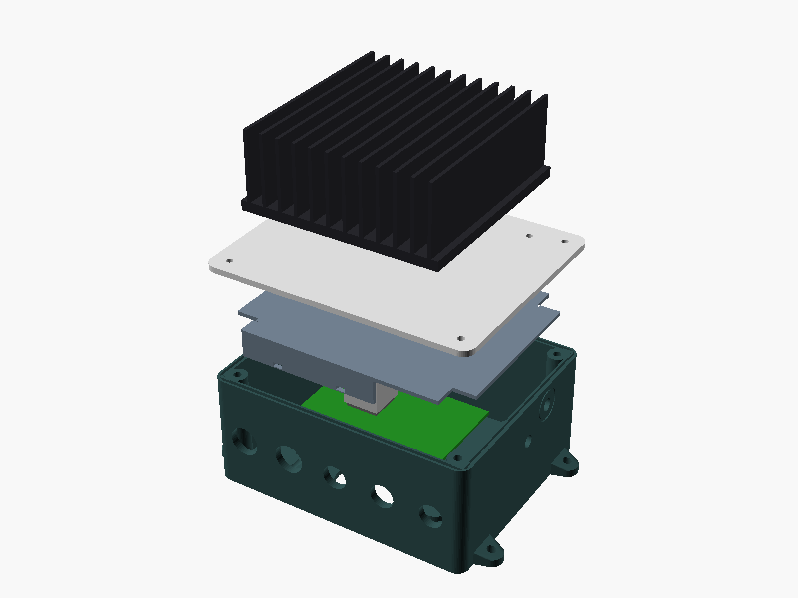

# Pi box cooling: sealed, fanless, heatsink on the outside

Updated 18 November 2026. Sam's ask: the Pi box has to survive hosing the Teryx down, and he'd
rather not have fan noise in a quiet EV. The box sits inside the dash, so it only needs to cope
with splash and hose spray (about IP65 under IEC 60529: dust-tight and safe against water jets),
not being dunked.

## What changed

| Before (PR #41) | Now |
|---|---|
| Printed lid with a 30 mm fan, a rain cowl and louvred vents in both side walls | No vents, no fan. The lid is a **3 mm aluminium plate** (DXF, cut with the back plate) with a **100 x 100 x 40 mm finned heatsink** bolted on the outside |
| Active Cooler on the Pi, stirring air inside the box | A **20 x 20 mm solid aluminium pillar** sits on the Pi's chip (1 mm thermal pad underneath) and is screwed to the lid plate. The chip's heat goes straight out to the fins |
| SSD cradle and 4G board printed into the lid | Same mounts, now on a printed **liner** that hangs under the lid plate, held up by the heatsink screws. It has a big window over the Pi for the pillar |
| Four glands | Four glands plus an **M12 breather vent** in the bottom wall |

Kept as they were: the TPU gasket in the box rim, cable glands in the bottom wall, the SMA
bulkheads (O-ring on the outside) for the 4G and GPS aerials, the micro HDMI cradle, and the 56 mm
inside height so the AI HAT+ 2 can still go in later.

## The options I looked at

| Option | Good | Bad | Verdict |
|---|---|---|---|
| **Heatsink through the lid** (this one) | Chip heat goes by metal all the way out. Box, glands, cradles, SMA holes all stay. The lid plate is one more cut on the same job as the back plate | Needs a pillar cut to length, an M3 tap, and a bit of care with the pad | **Picked** |
| Printed lid with a window, heatsink over the window and a second gasket | No aluminium plate to cut | Another seal to get right, and the window can't be big because the SSD and 4G board hang off the lid. Less metal inside for the rest of the heat | No |
| Whole off-the-shelf die-cast aluminium box | Very good at shedding heat (every wall is a heatsink) | Lose the printed HDMI cradle, SSD cradle, 4G mounts and the floor hole to the screen; drill every hole in metal; the Pi still needs a pillar to a wall | No, a lot of rework for the same result |
| Keep the fan, add a cowl and seal the vents better | Cheapest | Fan noise (Sam), and vents are the weak spot when hosing | No |

## Does it cope with the heat?

Sources for the power figures:

- Pi 5: 4.8 W idle, 6.5 W typical load, 11.6 W flat out ([bret.dk](https://bret.dk/how-to-power-the-raspberry-pi-5-a-complete-guide)).
  It starts slowing the CPU down between 80°C and 85°C and caps at 85°C
  ([Raspberry Pi docs](https://www.raspberrypi.com/documentation/computers/raspberry-pi.html)).
- 4G board (A7670SA): up to 670 mA at 3.8 V when transmitting flat out on LTE (about 2.5 W), from
  SIMCom's table ([A7670 Series Hardware Design V1.00](https://www.elecrow.com/download/product/CRT01260S/A7670_Series_Hardware_Design_V1.00.pdf), table 35).
  4G is off by default, so most of the time it's near zero.
- AI HAT+ 2 (later): about 2.5-4.5 W depending on the job ([Heise](https://heise.de/-11136612), [Jeff Geerling](https://jeffgeerling.com/blog/2026/raspberry-pi-ai-hat-2)).
  Rated for 0-50°C air around it ([Waveshare](https://www.waveshare.com/product/raspberry-pi/boards-kits/raspberry-pi-ai-hat-plus-2.htm), [CNX Software](https://www.cnx-software.com/2026/01/15/raspberry-pi-ai-hat-2-targets-generative-ai-llm-vlm-with-hailo-10h-accelerator/)).
- Kingston XS1000 SSD: Kingston don't publish a power figure. **My estimate: 1.5-2 W while writing.**
- 5V regulator (was the Pololu, now a potted 10 A buck, 19 Nov; similar 85-90% class): 80-95% efficient ([Pololu](https://www.pololu.com/product/4091)), so I've
  allowed 10% of what it feeds as heat.
- Heatsink: Fischer SK 92/100 SA, 100 x 100 x 40 mm, **1.4 K/W** in still air
  ([element14 listing](https://nz.element14.com/fischer-elektronik/sk-92-100-sa/heat-sink-100mm-1-4-c-w/dp/4621580)).
  Ratings like this are taken at a big temperature rise, and ours sits in a dash, so **I've used
  1.8 K/W** (my derating, not a published number).
- Pad: 1 mm at 4 W/m·K (T-Global PC94, [element14](https://nz.element14.com/t-global/pc94-150x150x1-0/thermal-pad-1mm-4w-m-k-red/dp/2466897)),
  20 x 20 mm, so about 0.6 K/W. Pillar: 45 mm of 20 x 20 aluminium at about 170 W/m·K (a typical
  figure for 6061), about 0.7 K/W. So chip to heatsink is about **1.3 K/W**.

**The dash air temperature is a guess: 40°C on a hot summer day.** Everything below scales with it.
The dash logs the Pi's temperature, so we'll know for real after a summer drive.

| Case | Heat in the box | Heatsink | Pi chip | OK? |
|---|---|---|---|---|
| **Normal driving, hot day**: CarPlay on, dashcam recording, 4G idle (Pi 6.5 W, SSD 1.5 W, regulator 0.9 W, 4G and CAN 0.2 W) | about 9 W | 40 + 9 x 1.8 = **about 56°C** | about 4.5 W through the pillar: 56 + 6 = **about 62°C** | Yes, well under the 80°C slow-down point, and silent |
| **Everything flat out at once, hot day**: Pi 11.6 W, SSD 2 W, 4G transmitting 2.8 W, regulator 1.5 W | about 18 W | **about 72°C** | about 8 W through the pillar: **about 82°C** | Just touches the slow-down zone. The Pi slows a little, nothing breaks. Unlikely in real use: flat-out CPU, full 4G and full SSD writing together |
| Same, using the heatsink's published 1.4 K/W | about 18 W | about 65°C | about 75°C | Yes |
| **Later, with the AI HAT+ 2**, normal driving, hot day | about 14 W | **about 65°C** | Active Cooler under the HAT | The box air sits near the lid temperature, which is **above the HAT's 50°C rating** on a hot day. That's when the quiet fan below goes on |
| Any of the above on a 25°C day | | 15°C cooler | 15°C cooler | Yes |

So: **fanless works for what the box does now.** Worst case on a hot day it slows a touch. With
the AI HAT later, plan on the quiet fan.

## Parts

Prices are NZ$ incl GST. AliExpress prices are my estimates (their pages don't open for me).

| Part | What to search / where | Qty | Price | Notes |
|---|---|---|---|---|
| Finned heatsink, 100 x 100 x 40 mm, black anodised, flat base | AliExpress "heatsink 100x100x40" | 1 | ~NZ$20, my estimate | Base must be **5 mm or thicker** (for blind M3 threads) and flat. Fins run one way, not pins |
| or the rated one: Fischer Elektronik SK 92/100 SA | [element14 NZ 4621580](https://nz.element14.com/fischer-elektronik/sk-92-100-sa/heat-sink-100mm-1-4-c-w/dp/4621580) | 1 | Check on the page (TME list it at [US$11.85](https://www.findchips.com/detail/sk%2092%20100%20sa/Fischer-Elektronik-GmbH-%26-Co-KG) ex tax) | 1.4 K/W published. Buy this if you'd rather have the real number |
| Thermal pad, 1 mm, 4 W/m·K or better | AliExpress "thermal pad 1mm 6W", or [T-Global PC94 at element14 NZ](https://nz.element14.com/t-global/pc94-150x150x1-0/thermal-pad-1mm-4w-m-k-red/dp/2466897) | 1 sheet | ~NZ$5, my estimate | 20 x 20 mm square on the chip. Spare for the 5V regulator and, later, the AI HAT chip |
| Solid aluminium, 20 x 20 mm square, about 50 mm | AliExpress "aluminium block 20x20x50", or an offcut. [SD Aluminium](https://sdalu.co.nz/?p=131872) sells 3 m lengths (NZ$47.15), [RS NZ](https://nz.rs-online.com/web/p/metal-bars-metal-rods/1368736) 1 m | 1 | ~NZ$5, my estimate | Cut to `pillar_len` (the CAD prints it, about 45.3 mm). Bunnings NZ doesn't seem to have solid square bar |
| Thermal paste, small tube | AliExpress or PB Tech | 1 | ~NZ$3-10, my estimate | Between the lid plate and the heatsink, and the top of the pillar |
| M12 x 1.5 breather vent plug (membrane type) | AliExpress "M12 waterproof breathable vent plug" | 1-2 | ~NZ$4, my estimate | Lets the box breathe as it heats and cools so it doesn't suck water past the seals and fog up ([Gore on why sealed boxes need a vent](https://www.gore.com/sites/default/files/2016-04/PTV-TechInfo-Temperature-Cycling-US.pdf)) |
| 3 mm aluminium lid plate | `cad/stl/pi_lid_plate.dxf` | 1 | On the same cutting job as the back plate | Countersink the pillar hole on the outside |
| M3 tap and 2.5 mm drill | Hardware shop | | | If you haven't got one |
| M3 x 10 cap screws | | 4 | | Heatsink to lid (from inside) |
| M3 x 8 countersunk screw | | 1 | | Pillar to lid plate |
| Neutral-cure silicone | Hardware shop | | | Thin bead round the heatsink base edge |

**No longer needed:** the 30 mm 3007 fan (out of the AliExpress cart) and the Active Cooler for
now (moved to "Later" with the AI HAT). Keep your passive heatsink for the bench.

### Optional quiet fan, only if testing says so

If the logs show the Pi slowing down, or once the AI HAT goes in, put a quiet 40 mm 5V fan **on
the outside of the heatsink**, blowing onto the fins. It's outside the sealed box, so it doesn't
affect the seal. Fischer's own figures for this heatsink profile go from 1.25 K/W in still air to
0.39 K/W with forced air ([DigiKey, SK 92](https://www.digikey.at/en/products/detail/fischer-elektronik/SK-92-1000-SA/25833309)),
so even a gentle fan makes a big difference.

- Pick: **Noctua NF-A4x10 5V PWM**, about NZ$22 at [Newegg NZ](https://www.newegg.com/global/nz-en/noctua-nf-a4x10-5v-pwm/p/1YF-000T-000N2) (search result, check before buying).
- Run its lead in through the spare PG7 gland to the Pi 5's fan connector (needs a 4-pin PC fan to
  Pi 5 JST adaptor). The Pi's firmware then runs it: **off below 50°C**, 30% at 50°C, rising to
  full speed at 75°C ([Raspberry Pi docs](https://www.raspberrypi.com/documentation/computers/raspberry-pi.html)).
  So it stays silent most of the time.
- Two long M3 screws into the gaps between the fins hold it.

## AI HAT+ 2 later

Still fits, nothing in this change blocks it. When it goes in:

1. Take the pillar out (the HAT sits over the Pi's chip).
2. Fit the Active Cooler on the Pi, then the HAT on its 16 mm header, as Raspberry Pi say
   ([AI HAT+ docs](https://www.raspberrypi.com/documentation/accessories/ai-hat-plus.html)). It sits
   in the sealed box and only spins when the chip is over 50°C.
3. Instead of the HAT's own small heatsink, put a short pillar (same 20 x 20 bar) with a pad from
   the HAT's chip up to the lid plate. Drill and countersink one more hole in the plate over it.
   The liner's window is big enough.
4. Fit the quiet fan on the outside of the heatsink (above), because of the HAT's 50°C limit.

The power budget is unchanged: the 5 V buck was already sized for the HAT (now a 10 A potted buck).

## Putting it together

1. Mark the Pi's chip centre on the lid plate (fit the Pi, lay the plate on, check against
   `soc_pos` in `cad/measurements.scad`). Drill 3.4 mm and countersink it on the outside face.
2. Lay the heatsink on the plate where `hs_pos` puts it, fins running **up and down** when the box
   is in the dash (so hot air rises out between them). Spot through the four `hs_screws` holes,
   drill 2.5 mm, **5 mm deep at most**, into the flat of the heatsink base, and tap M3.
3. Cut the bar to the `pillar_len` that OpenSCAD prints (about 45.3 mm), square the ends, and
   drill and tap one end M3 in the middle.
4. Screw the pillar to the plate with the countersunk screw (thin smear of paste between them).
5. Paste on the heatsink base, heatsink on the plate. Fit the printed liner underneath (SSD and 4G
   board already on it) and bolt the lot together with the four M3 x 10s from inside. A thin bead
   of silicone round the heatsink base edge.
6. Put the 1 mm pad on the Pi's chip. TPU gasket (or 2 mm foam cord) in the box rim. Lower the
   lid on: the pillar should squash the pad by about 0.3 mm. If it doesn't touch, add a second
   pad; if the lid won't sit down, take a bit off the pillar. Bolt the four corners.
7. Breather in the last hole on the bottom wall. Glands done up on their cables, spare glands
   plugged.

## Where it goes in the dash

The box now sticks out about **102 mm** behind the back plate (59 mm box, 3 mm lid plate, 40 mm
fins). Leave at least 20 mm of air behind the fins and a gap above and below so warm air can
rise away. A heatsink jammed against the firewall in a sealed pocket won't work as well as the
sums say.
