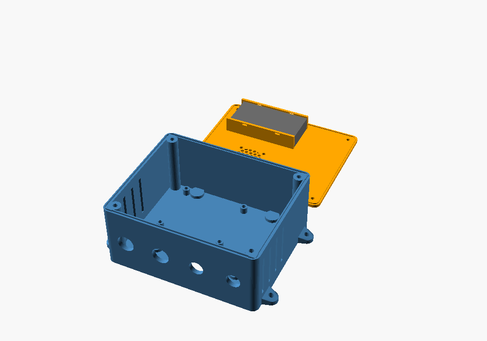

# Sentry, dashcam and clips

Like Tesla's Sentry: when the Teryx is locked and parked, the cameras keep watching and save
a clip when something moves or someone tries to start it. With the key on they record as a
dashcam. Everything goes on a small USB SSD inside the Pi box.

**Nothing is sent anywhere on its own.** No texts, no alerts. Clips wait on the SSD until you
look: on the dash (Settings > Sentry and clips), or from your phone over Tailscale after an
`ONLINE` or `CAMS` text (see [`remote-access.md`](remote-access.md)).

## Modes

| Mode | When | What it does |
|---|---|---|
| Dashcam | Key on | Every fitted camera records in 1-minute pieces. Oldest pieces deleted first when the drive fills |
| Sentry | Key off **and locked** | The Pico keeps the Pi powered. Cameras keep recording and watch for movement. Stops after 12 h, or when the 12V drops under 12.2 V |
| Off | Key off and unlocked, or sentry stopped | Nothing records. The Pi shuts down as normal |

So you get Sentry by locking it with the PIN (see [`vehicle-lock.md`](vehicle-lock.md)), or
with a `LOCK` text.

### Saved clips

A clip is 30 s before to 30 s after the moment, from every camera that was recording:

| Why | When |
|---|---|
| Motion | Something moves in front of a camera while in Sentry. At most one clip a minute |
| Attempted start | The key goes on while it's locked. The cabin camera also takes a still: the face shot |
| Manual | The **Save a clip now** button |

Clips are hard links to the loop pieces, so they cost no extra space until the loop moves on.
Saved clips get 25% of the drive (setting); past that the oldest go first, except ones you've
marked **Keep**.

With more than one camera, someone walking round the Teryx gets caught from more than one side,
and a key-on gets the cabin camera's face shot plus whatever the front and rear see.

## How it keeps the Pi on

The power hold relay feeds both the Pi and the Pico, so with the key off they'd both lose power
once the Pi shuts down. For Sentry:

1. While the dash *would* want Sentry (locked, Sentry on, not stopped early), its heartbeat
   says `dash_state = 3` ("sentry") all the time, so the Pico already knows at the moment of
   key-off.
2. With the key off and that heartbeat fresh, the Pico keeps power hold on, stops all motion,
   disarms the winch, and doesn't ask the Pi to shut down. `0x710` byte 6 bit 5 `sentry_hold`.
3. The Pico watches the 12V itself. Under setting 32 (`sentry_min_12v_mv`, default 12 200 mV,
   allowed 11 000 to 13 500) for 30 s, it latches `sentry_flat` (bit 6) and lets go, whatever
   the Pi says. It resets at the next key-on.
4. If the Pi crashes, its heartbeat stops and the Pico shuts down as normal.

12.2 V is roughly half charge for a resting lead-acid battery, which leaves plenty to run the
winch and start things. Change it in Settings if you fit a lithium 12V.

## How much battery it uses

| State | About | Per day |
|---|---|---|
| Pico only (normal key-off) | 0.03 A | 0.7 Ah |
| Pi idle plus the 4G stick, no cameras | 4.5 W, 0.36 A at 12.5 V | 8.6 Ah |
| Full Sentry: 4 cameras recording and encoding | 10 to 11 W, 0.9 A | 21 Ah |

Pi 5 idle is about 2.7 to 3.6 W [1]. The 4G stick is about 150 mA at 5 V on average [2].
Cameras and encoding add about 6 W, which is my estimate from the encoder load below, not a
measurement: **measure it on the bench** with a clamp meter.

So a 12-hour Sentry night costs about 10 to 11 Ah. That's why it gives up after 12 hours, and
why it stops at 12.2 V whatever the time.

With the Pi off, set `POWER_OFF_ON_HALT=1` in the Pi's EEPROM so a halted Pi 5 draws about
0.01 W instead of 1.3 to 2 W [1].

## Storage

**Video never goes on the SD card.** The SD card holds the system, and writing video to it all
day wears it out. If the video drive isn't plugged in and mounted, nothing records and the
dash says "No video drive".

Sizing, at the defaults (1280 x 720, 15 fps, 2 Mb/s):

| | Size |
|---|---|
| One camera, one hour | 2 Mb/s x 3600 s / 8 = **0.9 GB** |
| Four cameras, one hour | 3.6 GB |
| 1 TB drive, 75% for the loop | about **200 hours** of all four cameras, about 25 days of 8 h driving |
| 500 GB drive | about 100 hours |

**Pick: Kingston XS1000 1 TB** USB-C SSD. 69.5 x 32.6 x 13.5 mm and 29 g [3], so it fits in a
cradle in the Pi box lid. About NZ$189 to 253 at PB Tech (HDDKCP225100), the price moves
around [4]. The ADATA SE880 500 GB is NZ$249 at PB Tech [5], dearer for half the space.

It needs a short right-angle USB-C to USB-A lead into one of the Pi's blue USB 3 ports.

### The SSD in the Pi box

The printed liner under the Pi box's aluminium lid has a cradle for it (`ssd_cradle()` in
`cad/models.scad`): two rails, an end stop, and slots for a cable tie. It sits off to the side,
clear of the AI HAT+ 2's space and the pillar that cools the Pi ([`pi-box-cooling.md`](pi-box-cooling.md)). The 4G stick isn't in the box: it hangs outside on
its 20 cm USB lead so the antenna works.



Set it up once:

```bash
sudo mkfs.ext4 -L teryx-video /dev/sda1     # check it's the SSD first: lsblk
sudo bash scripts/remote-setup.sh --ssd-label teryx-video
```

That mounts it at `/mnt/teryx-video` by label, with `nofail` so the Pi still boots fine
without it.

## Encoding load

The Pi 5 has **no hardware H.264 encoder** (the Pi 4 had one), so video is encoded in software
with x264 on the CPU. Raspberry Pi's own tests: 1080p30 runs at 60 to 90% of one core, and
the "ultrafast" preset at 2 Mb/s about 67% of one core [6].

The dash records at 720p15, which is under a third of the pixels per second of 1080p30. So
about 15 to 25% of one core per camera, or about one core for all four out of the Pi's four.
That's an estimate scaled from their numbers; check `top` on the bench with all cameras on.

Ways to cut it:

- A USB camera that sends **H.264** itself is just copied to disk with no encoding. Set
  "Camera sends H.264" for it in Settings > Cameras.
- Drop to 10 fps or fewer cameras in Settings > Sentry and clips.
- The AI HAT+ 2 (if fitted later) doesn't help with encoding, but nothing here gets in its way.

## Cabin camera

A Raspberry Pi **Camera Module 3 NoIR Wide** on the second ribbon port (`csi1`), aimed at the
driver's seat from up near the screen, for the face shot on an attempted start. NoIR because
it's dark at night: add a small 850 nm IR light so it sees without a visible light. About
NZ$66 to 70 at PB Tech (SEVRBP0441 or SEVRBP0399) [7].

It uses the ribbon port, not USB or PCIe, so the AI HAT+ 2 can still go on later. With the
front camera on `csi0`, that's both ribbon ports used. Set it up in Settings > Cameras >
Cabin: Fitted, device `csi1`.

## Settings

Settings > Sentry and clips:

| Setting | Default |
|---|---|
| Sentry when locked | On |
| Dashcam with the key on | On |
| Stop Sentry after | 12 hours |
| Stop Sentry below | 12.2 V (sent to the Pico as setting 32) |
| Space for saved clips | 25% |
| Frame rate | 15 fps (quality is 2 Mb/s, in `dash-settings.json` as `sentry.kbps`) |

## Where things are

| Part | File |
|---|---|
| Modes, motion, clips, recording | `dash/server/teryx_dash/sentry.py` |
| Power hold and 12V cut-off (firmware) | `firmware/control-box/src/core/controller.c` (`sentry_hold`, `sentry_flat`) |
| Same in the simulator | `teryx/sim/controlbox.py` |
| Heartbeat "sentry" | `teryx/dash/gateway.py` `set_sentry()` |
| Dash | Settings > Sentry and clips in `dash/web/js/screens/settings.js` |
| SSD cradle | `cad/models.scad` `ssd_cradle()`, sizes in `cad/measurements.scad` |
| Tests | `dash/tests/test_sentry.py`, `tests/test_controlbox.py`, `firmware/control-box/tests/test_controller.c` (`test_sentry_hold`) |

In the simulator: lock it, turn the key off, then use **Pretend movement** in Settings >
Sentry and clips to make a motion clip.

## Sources

1. [Jeff Geerling: Pi 5 power use](https://jeffgeerling.com/node/3323): idle power, and halt power with `POWER_OFF_ON_HALT`.
2. [Waveshare wiki: SIM7600G-H 4G Dongle](https://www.waveshare.com/wiki/SIM7600G-H_4G_DONGLE): current draw.
3. [Kingston XS1000 datasheet](https://kingston.com/datasheets/XS1000_en.pdf): size and weight.
4. [PB Tech: Kingston XS1000 1TB](https://www.pbtech.co.nz/product/HDDKCP225100).
5. [PB Tech: ADATA SE880 500GB](https://www.pbtech.co.nz/product/HDDADA68805/ADATA-SE880-500GB-USB-C-Rugged-Portable-SSD-2000Mb).
6. [Raspberry Pi whitepaper RP-010033: H.264 encoding performance on Raspberry Pi 5 series computers](https://pip-assets.raspberrypi.com/categories/685-app-notes-guides-whitepapers/documents/RP-010033-WP-1-H.264%20encoding%20performance%20on%20Raspberry%20Pi%205_series%20computers.pdf).
7. [PB Tech: Raspberry Pi Camera Module 3 NoIR Wide](https://www.pbtech.co.nz/product/SEVRBP0399).
