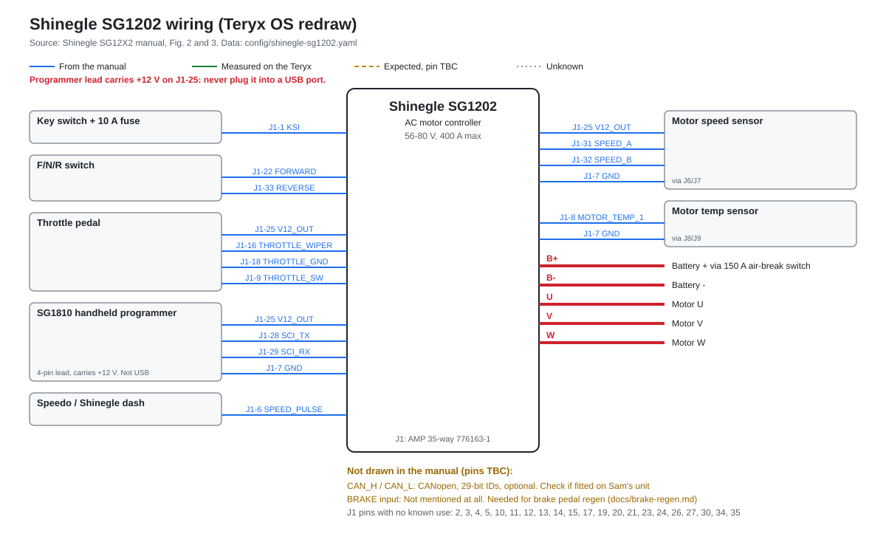

# Shinegle SG12X2 controller: what the manual says

Source: Shinegle "SG12X2 Manual" (SG1212 Manual, Word file dated 2017-09-22,
9 pages), sent by Sam on 2026-11-18. It covers the SG1202 / SG1212 / SG1222
AC induction controllers. Sam's controller is the **SG1202** (7.5 kW kit,
[shinegle.com product page](https://shinegle.com/product/showproduct.php?lang=en&id=37)).
The manual's own spec table names the 72 V model "SG1212", so expect the two
names to be mixed up.

Everything below is from the manual unless marked **TBC**.

**Our own wiring diagram:** [`img/sg1202-wiring.svg`](img/sg1202-wiring.svg),
drawn from the machine-readable pinout
[`config/shinegle-sg1202.yaml`](../config/shinegle-sg1202.yaml). Edit the
YAML (for example mark a pin `measured` once checked on the Teryx), then run
`python -m teryx shinegle-diagram`. A test fails if the two get out of step.

## Headline facts

| | What the manual says |
|---|---|
| Control | "Advanced Vector control with speed sensor", TI DSP |
| Regen | "Extremely wide torque/speed range including **full regeneration capability**". Nothing on how regen is triggered or set |
| Programmer | **SG1810 hand-held programmer**. Sets "maximum speed, acceleration control, throttle offset, and HPD" (HPD = high pedal disable). Talks to the controller over **SCI (serial)** |
| Serial (SCI) | "SCI interface communication is available at any time" |
| CAN | "**CANopen** communication (29-bit extended identifier field) is **optional**". Pins not shown. **TBC whether Sam's unit has CAN fitted** |
| Live data | "Real-time battery current, motor torque, and power estimates available" |
| Firmware | "Field-programmable, with flash downloadable operating code" |
| Protection | Thermal cutback, LED flash fault codes, automatic shutdown, IP65 |
| 72 V model | Battery 56–80 V, 400 A max / 120 A rated (AC), 30 kW max, 3.5 kg, self cooling (fan needed if not ventilated) |
| Mounting | Face up, the long side (A or B in the manual photo) along the vehicle |

## J1 pinout (35-pin AMP 776163-1, mating plug 776164-1)

Only these 14 of the 35 pins are drawn in the manual (Fig. 2 and Fig. 3):

| Pin | Use |
|---|---|
| J1-1 | Key switch power (KS), through a 10 A fuse |
| J1-6 | Speed pulse output, to the speed panel / speedo |
| J1-7 | Ground (programmer, speed sensor, and listed again as Motor Temp 2) |
| J1-8 | Motor temp 1 (Temp 2 drawn on J1-7) |
| J1-9 | Throttle switch (micro switch) |
| J1-16 | Throttle wiper (signal) |
| J1-18 | Throttle ground |
| J1-22 | Forward |
| J1-25 | +12 V out (throttle, speed sensor and programmer supply) |
| J1-28 | Tx, to the programmer |
| J1-29 | Rx, from the programmer |
| J1-31 | Speed sensor signal A |
| J1-32 | Speed sensor signal B |
| J1-33 | Reverse |

Main power: B+ through a 150 A air-break switch, B−, motor U V W.
Small connectors J6/J7 (DJ7041, speed sensor) and J8/J9 (DJ7021, motor temp).

**Not in the manual:** any brake switch or brake regen input, the CAN pins,
and the other 21 J1 pins. They may exist and just not be drawn. **TBC** by
looking at which J1 pins have wires in Sam's harness.

## The programmer lead (Sam's 4-pin plug)

The manual wires the SG1810 to four J1 pins: **+12 V (J1-25), Tx (J1-28),
Rx (J1-29), Ground (J1-7)**. The SG1810's own manual says its 6-pin 5557-6P
plug goes into a socket called **J3**. Most likely J3 carries those same four
signals, but that's **TBC**. Details and how to check:
[`shinegle-sg1810-programmer.md`](shinegle-sg1810-programmer.md#the-programmer-port-j3).

* The lead carries **12 V**. Never plug the handheld or its lead into a
  laptop or the Pi's USB. The USB-shaped plug on the lead is not USB.
* It's a plain serial link. The voltage level (3.3 V/5 V logic or RS-232)
  is **TBC**; measure Tx to ground with a meter before connecting anything.
* If anything is plugged in at key-on, the controller goes into parameter
  mode and won't drive.
* That port gives live data (error code, direction, throttle, RPM, motor
  temp, volts). Leaving the Pi or Pico on it instead of the handheld is
  planned in
  [`shinegle-sg1810-programmer.md`](shinegle-sg1810-programmer.md#leaving-the-pi-on-j3-instead-of-the-programmer):
  listen-only sniff first, then a read-only reader, 12 V isolated, no
  parameter writes.

## What this means for Teryx OS

* **Regen:** built in, and left to the controller (Sam, 2026-11-19). The SG1810
  menus have the regen coefficient `B_Cur` (locked) and the brake and decel
  rates `B_Rat`/`DecRat` (allowed to change), which set how it feels. See
  [`shinegle-sg1810-tables.md`](shinegle-sg1810-tables.md).
* **Fault codes:** codes 1-46 with fixes, in English and Chinese, are in
  [`config/shinegle-faults.yaml`](../config/shinegle-faults.yaml).
* **CAN decode:** CAN is optional on this controller. If Sam's has it, it's
  CANopen with 29-bit IDs, so the sniffer must capture extended frames. If
  the bus is quiet, the Shinegle dash may be running off the J1-6 speed
  pulse or the serial port instead. See [`shinegle-decode.md`](shinegle-decode.md).
* **Speed for the control box:** J1-6 gives a speed pulse, which could feed
  the Pico directly if CAN isn't fitted.
