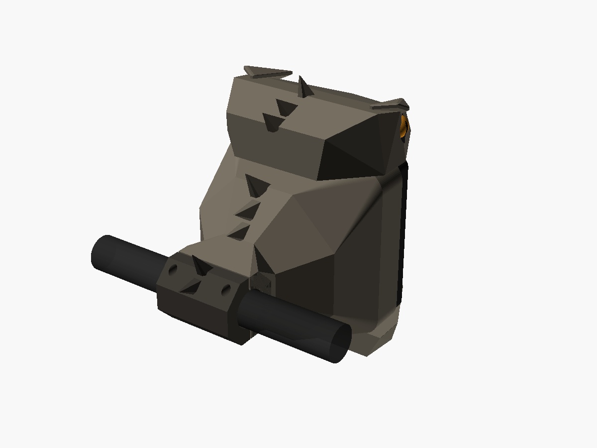
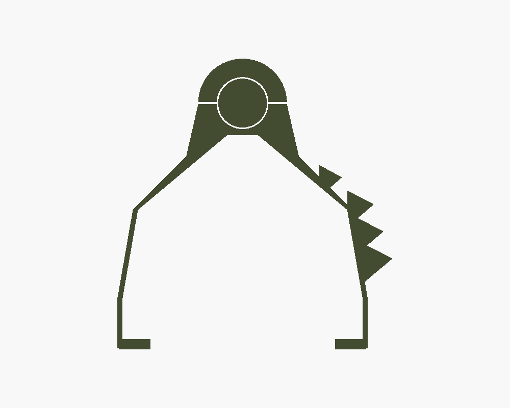

# Speaker pods

Two printed pods for Sam's **Kenwood KFC-2053MRB** 8" marine coaxials, built for sound
first and then for mud, water and bumps.





| File | What |
|---|---|
| [`cad/parts/speaker_pod.scad`](../cad/parts/speaker_pod.scad) | The pod. Every size is in [`cad/measurements.scad`](../cad/measurements.scad) under "Speaker pods" |
| `cad/stl/speaker_pod.stl` | Print 2 (same part both sides) |
| `cad/stl/speaker_pod_gasket.stl` | Print 2 in TPU, goes under each speaker's flange |
| [`config/speaker_pods.yaml`](../config/speaker_pods.yaml) | Speaker numbers, pod volume, stuffing, amp filter, EQ target |
| [`teryx/speaker_box.py`](../teryx/speaker_box.py) | The maths: `python -m teryx speakerbox` |
| [`scripts/pipewire/50-teryx-pod-eq.conf`](../scripts/pipewire/50-teryx-pod-eq.conf) | The Pi's bass EQ for the pods (made from the YAML) |

## The short version

- **Sealed, 7.4 L inside** (7.05 L once the speaker's in). One piece, no seams. The speaker is the
  only lid, so there's one joint to seal.
- **No port.** A port on a buggy fills with water and mud, and the amp cuts everything under
  90 Hz anyway, which is where a port would have helped.
- **The Pi fixes the bass hump.** These are free-air marine speakers (made for boat panels), so
  in any box small enough to hang off a cage they boom at around 110 to 130 Hz. Making the pod big
  enough to stop that would need 45 L or more each. Instead the Pi runs a bass EQ (a Linkwitz
  transform) that flattens it out. Pod + EQ + the amp's 90 Hz high pass ends up as a clean
  24 dB/octave roll-off at 90 Hz, the same as a proper crossover, so a sub can take over below
  that later.
- **Mounts on the cage** with two bought aluminium tube clamps bolted to M6 inserts in the back pad.

## Where the numbers come from

**Kenwood's spec page** ([kenwood.com](https://www.kenwood.com/usa/car/marine/kfc-2053mrb/spec.html)):
180 mm (7-1/16") cut-out, 86 mm (3-3/8") mounting depth, 230 mm (9-1/16") square grille,
4 ohm, 86 dB, 55 Hz to 20 kHz, 90 mm ferrite magnet. These set the hole, the face size and the
depth (100 mm clear behind the face).

**Thiele-Small numbers (Fs, Qts, Vas): Kenwood don't publish them.** Not on the US or AU
pages and not on any retailer I could find. So the YAML has estimates, marked `ESTIMATE`:
Fs 55 Hz (Kenwood's 55 Hz bottom end), Qts 0.85 and Vas 35 L (typical for a soft, small-magnet
free-air 8"). Kicker say the same thing about their KM marine coaxials: "designed for mounting in
free-air applications" ([Kicker KM manual](https://www.kicker.com/app/manuals/marine/kmCoaxials/2018_KM_Coax.pdf)).

Because the real numbers are unknown, the tool checks the pod against **every corner** of a wide
range (Fs 45 to 65 Hz, Qts 0.6 to 1.1, Vas 20 to 50 L). Worst case without EQ is a 9 dB hump;
with the speaker measured, the EQ takes it out. Run `python -m teryx speakerbox` to see the table:

```
  net L   fc Hz   Qtc    peak dB  F3 Hz (with the amp's 90 Hz high pass)
    4.0     161   2.49    +7.8     115
    7.0     127   1.96    +5.4      96  <- this pod
   15.0      96   1.48    +2.5      81
   20.0      87   1.35    +1.7      80
Qtc 1.1 needs 45.1 L net
```

So going bigger doesn't really pay: 15 L would be twice the size for half the hump, and still
needs the EQ. 7.4 L is about the biggest that prints on a 250 mm bed (face 244 mm square, 239 mm
long).

**Amp high pass**: 90 Hz (Sam's amp listing). Its slope isn't listed, so 12 dB/octave is a guess.

## Measure the speaker (15 minutes, worth doing)

This makes the EQ exact. You need a multimeter that reads AC volts, a 10 ohm 5 W resistor
(Jaycar), a phone with a tone generator app, the amp, and some coins and Blu Tack.

1. **Re**: multimeter on ohms across the speaker terminals (nothing else connected). Write it down
   (about 3.2 ohm).
2. Hang the speaker in free air, face up, away from walls. Wire: amp ch 1 out, through the 10 ohm
   resistor, to the speaker. Amp high pass **off** for this test. Phone into the amp, volume low
   (about 1 V across the resistor).
3. Play tones from 20 to 150 Hz. At each one, read the AC volts across the **speaker** (Vs) and
   across the **resistor** (Vr). Impedance = 10 x Vs / Vr. Do every 2 Hz near the peak (it'll be
   somewhere around 40 to 70 Hz) and every 5 to 10 Hz away from it.
4. **Vas**: stick a known mass on the cone (e.g. 4 x $2 coins, weigh them, about 40 g) evenly
   round the dust cap with Blu Tack, and find the new peak frequency. Measure the cone diameter
   from the middle of the rubber surround on one side to the middle on the other (about 165 mm).
5. Put it in a file like this and run `python -m teryx speakerbox --measure kenwood.yaml`:

```yaml
re: 3.2
points: [[30, 4.1], [40, 6.0], [46, 9.5], [50, 14.2], [52, 16.8], [54, 17.5], [56, 16.1], ...]
added_g: 40.0        # step 4
fs_added: 41.5       # peak with the mass on
cone_d_mm: 165
```

It prints Fs, Qts, Vas and the new bass table. Put them in `config/speaker_pods.yaml` under
`driver:` (change `source` to `MEASURED`) and run `python -m teryx speakerbox --write`. That
updates the EQ file; `scripts/audio-setup.sh` copies it onto the Pi.

## Turning the EQ on

`sudo bash scripts/audio-setup.sh` installs it. Then on the dash, Settings > Audio and media,
pick **Teryx speaker pods** as the output. It only touches the bass under about 300 Hz.
If you swap speakers or change the pod size, update the YAML and rerun `--write`.

## How the pod is built (and why)

**Shape.** Square face to fit the speaker's square grille, tapering to round, then a 45° cone to
the mounting pad. Curves are far stiffer than flat panels, so the walls don't buzz, and the 45°
cone means it prints with **no supports**: face down on the bed, cone up. The face is 10 mm solid
round the cut-out so the speaker's screws bite.

**Bracing.** Eight fins run front to back on the inside wall, clear of the speaker basket. They
stop the big flat-ish sides near the face from flexing. The cone and the solid pad close the back.

**Wall.** 5 mm. Print it **solid**: ASA, 0.2 mm layers, 8 or more walls (perimeters) so the walls
are all perimeter, 100% infill anyway for the face and pad. A solid 5 mm ASA wall is heavy and
dead, which is what you want. About 1.5 kg of ASA each, roughly 40 to 60 hours with a 0.4 mm nozzle (a 0.6 mm nozzle about halves that).
ASA because they sit in the sun; PETG works but goes chalky and soft in UV over a few summers.
No PLA (it sags in a hot car).

**Stuffing.** About 70 g of loose polyester fibre (speaker wadding or pillow stuffing) per pod,
fluffed, filling about half of it, not packed tight and not touching the back of the cone. It
calms the inside and makes the pod act about 15% bigger. Not foam: foam soaks up water and stays
wet.

**The ridge.** Four plates along the top like a T. rex back, our own take on it, not copied from
anything. They're at 45° so they print clean. Leave them off with `pod_spines = 0`.

## Water, mud and hosing

- **Sealed box, so no drain hole.** A drain hole is a leak, and a leak ruins a sealed box's
  bass. Nothing should get in: the speaker is marine (water-resistant cone and surround), and the
  only joint is its flange on the TPU gasket.
- **Gasket**: print `speaker_pod_gasket` in TPU (or use 3 mm closed-cell foam tape). Put a thin bead
  of neutral-cure silicone round the outside of the speaker flange too if it'll be hosed a lot.
- **Breather**: an M12 membrane vent (same as the Pi box) underneath. It lets the air inside
  breathe as the pod heats up in the sun and cools, so the cone isn't pushed in or out and damp
  air can get out, but water can't get in. The membrane leaks so little air that the bass doesn't
  notice.
- **Cable**: through a PG7 gland underneath, with a drip loop before it so water runs off the
  cable instead of into the gland.
- **Drip edge**: the small step round the face stops water running back over the shell.
- **Hosing**: fine. Don't point a pressure washer straight into the speaker cone.

## Mounting

- Two **aluminium roll-cage clamps** with a flat tab per pod, bolted to the two M6 brass inserts
  in the pad with M6 x 20 stainless bolts, spring washers and threadlocker. Clamps are on the parts
  list.
- **Tube size**: aftermarket pod makers list 1.875" (47.6 mm) for the Teryx perimeter tube and
  1.7" for the top crossbars ([Axia Alloys](https://axiaalloys.com/color-roll-cage-size-information),
  SSV Works). Not confirmed for the 2013, so **measure the tube where they'll go** before buying
  the clamps.
- Speaker plus pod is about 2.4 kg each. Two clamps per pod and nylocs or threadlocker, and check
  them after the first few rides.
- Point them at the seats, slightly down, so rain runs off the cone.
- Inserts: press the M6 heat-set inserts in with the iron at ASA temperature, square and flush.

## Wiring

Unchanged: amp ch 1 and 2 to the pods, 1.5 mm² speaker cable (wire X22 in
`config/wiring.yaml`). Turn the amp's high pass on, and set its gain so it doesn't push the
Kenwoods past 50 W.

## Parts (all on the parts list)

Speakers (owned), 4 cage clamps, 10 M6 heat-set inserts, M6 bolts, 2 PG7 glands, 2 M12 vents,
polyester fill, ASA (about 3 kg for the pair), TPU for the gaskets.

## Not done yet

- The sub box for the Kicker KM104 (Sam has bought it, it is on amp ch 3 + 4 bridged in the wiring): on hold until the space under the seat is scanned.
- Real Thiele-Small numbers (see "Measure the speaker" above).
- Real clamp tab size: the pad's insert spacing (`pod_mount_dx`, 40 mm) may need changing to suit
  the clamps that turn up.
