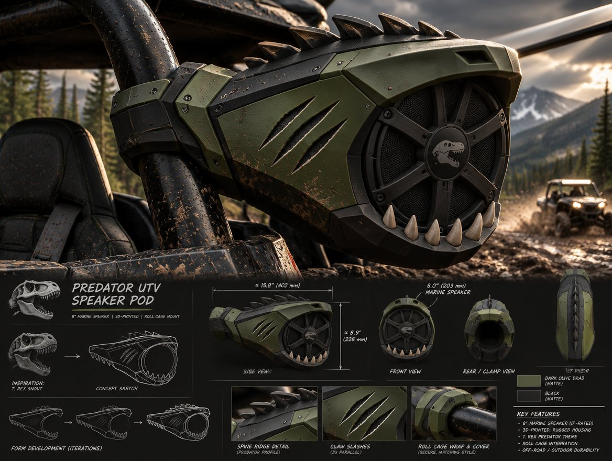
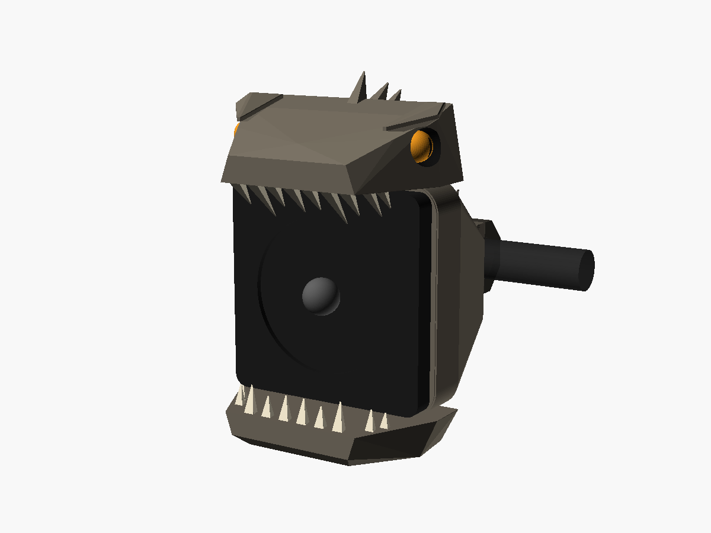
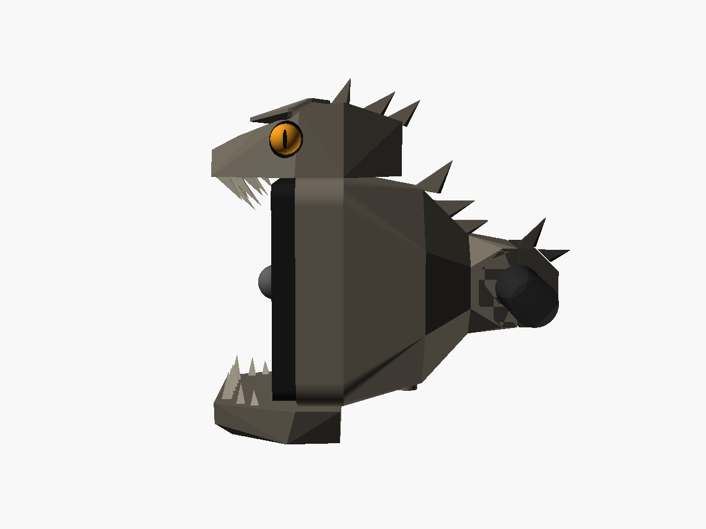

# Speaker pods

Two printed pods for Sam's **Kenwood KFC-2053MRB** 8" marine coaxials, built for sound
first and then for mud, water and bumps.






| File | What |
|---|---|
| [`cad/parts/speaker_pod.scad`](../cad/parts/speaker_pod.scad) | The pod. Every size is in [`cad/measurements.scad`](../cad/measurements.scad) under "Speaker pods" |
| `cad/stl/speaker_pod.stl` | Print 2 (same part both sides), face down |
| `cad/stl/speaker_pod_cover.stl` | Print 2, flat face down: closes over the tube |
| `cad/stl/speaker_pod_plug.stl` | Print 14: caps that hide the cover and jaw bolts |
| `cad/stl/speaker_pod_head.stl` + `_head_teeth` + `_head_eyes` + `_head_pupils` | Print 2: the T. rex head, one STL per colour (see "Printing in colour"). Snout face down |
| `cad/stl/speaker_pod_jaw.stl` + `_jaw_teeth` | Print 2: lower jaw, two colours, flat bottom down |
| `cad/stl/speaker_pod_gasket.stl` | Print 2 in TPU, goes under each speaker's flange |
| [`config/speaker_pods.yaml`](../config/speaker_pods.yaml) | Speaker numbers, pod volume, stuffing, amp filter, EQ target |
| [`teryx/speaker_box.py`](../teryx/speaker_box.py) | The maths: `python -m teryx speakerbox` |
| [`scripts/pipewire/50-teryx-pod-eq.conf`](../scripts/pipewire/50-teryx-pod-eq.conf) | The Pi's bass EQ for the pods (made from the YAML) |

## The short version

- **Sealed, 6.85 L inside** (6.5 L once the speaker's in). One piece, no seams. The speaker is the
  only lid, so there's one joint to seal.
- **No port.** A port on a buggy fills with water and mud, and the amp cuts everything under
  90 Hz anyway, which is where a port would have helped.
- **The Pi fixes the bass hump.** These are free-air marine speakers (made for boat panels), so
  in any box small enough to hang off a cage they boom at around 110 to 130 Hz. Making the pod big
  enough to stop that would need 45 L or more each. Instead the Pi runs a bass EQ (a Linkwitz
  transform) that flattens it out. Pod + EQ + the amp's 90 Hz high pass ends up as a clean
  24 dB/octave roll-off at 90 Hz, the same as a proper crossover, so a sub can take over below
  that later.
- **Wraps round the cage tube.** The back of the pod is half a "knuckle" round the bar and a
  printed cover closes over it with 4 hidden M6 bolts, so it looks like part of the cage. No
  clamps to buy and no drilling the cage.

## Where the numbers come from

**Kenwood's spec page** ([kenwood.com](https://www.kenwood.com/usa/car/marine/kfc-2053mrb/spec.html)):
180 mm (7-1/16") cut-out, 86 mm (3-3/8") mounting depth, 230 mm (9-1/16") square grille,
4 ohm, 86 dB, 55 Hz to 20 kHz, 90 mm ferrite magnet. These set the hole, the face size and the
depth (100 mm clear behind the face).

**Thiele-Small numbers (Fs, Qts, Vas): Kenwood don't publish them.** Not on the US or AU
pages and not on any retailer I could find. So the YAML has estimates, marked `ESTIMATE`:
Fs 55 Hz (Kenwood's 55 Hz bottom end), Qts 0.85 and Vas 35 L (typical for a soft, small-magnet
free-air 8"). Kicker say the same thing about their KM marine coaxials: "designed for mounting in
free-air applications" ([Kicker KM manual](https://www.kicker.com/app/manuals/marine/kmCoaxials/2018_KM_Coax.pdf)).

Because the real numbers are unknown, the tool checks the pod against **every corner** of a wide
range (Fs 45 to 65 Hz, Qts 0.6 to 1.1, Vas 20 to 50 L). Worst case without EQ is a 9 dB hump;
with the speaker measured, the EQ takes it out. Run `python -m teryx speakerbox` to see the table:

```
  net L   fc Hz   Qtc    peak dB  F3 Hz (with the amp's 90 Hz high pass)
    4.0     161   2.49    +7.8     115
    6.5     131   2.03    +5.7      98  <- this pod
   15.0      96   1.48    +2.5      81
   20.0      87   1.35    +1.7      80
Qtc 1.1 needs 45.1 L net
```

So going bigger doesn't really pay: 15 L would be twice the size for half the hump, and still
needs the EQ. 6.85 L is about the biggest that prints on a 250 x 250 bed with **240 mm of
height** (face 244 mm square, 240 mm tall as printed; 283 mm front to back once the cover's on).
If your printer is shorter, shrink `pod_taper_l` and the build tells you the new volume.

**Amp high pass**: 90 Hz (Sam's amp listing). Its slope isn't listed, so 12 dB/octave is a guess.

## Measure the speaker (15 minutes, worth doing)

This makes the EQ exact. You need a multimeter that reads AC volts, a 10 ohm 5 W resistor
(Jaycar), a phone with a tone generator app, the amp, and some coins and Blu Tack.

1. **Re**: multimeter on ohms across the speaker terminals (nothing else connected). Write it down
   (about 3.2 ohm).
2. Hang the speaker in free air, face up, away from walls. Wire: amp ch 1 out, through the 10 ohm
   resistor, to the speaker. Amp high pass **off** for this test. Phone into the amp, volume low
   (about 1 V across the resistor).
3. Play tones from 20 to 150 Hz. At each one, read the AC volts across the **speaker** (Vs) and
   across the **resistor** (Vr). Impedance = 10 x Vs / Vr. Do every 2 Hz near the peak (it'll be
   somewhere around 40 to 70 Hz) and every 5 to 10 Hz away from it.
4. **Vas**: stick a known mass on the cone (e.g. 4 x $2 coins, weigh them, about 40 g) evenly
   round the dust cap with Blu Tack, and find the new peak frequency. Measure the cone diameter
   from the middle of the rubber surround on one side to the middle on the other (about 165 mm).
5. Put it in a file like this and run `python -m teryx speakerbox --measure kenwood.yaml`:

```yaml
re: 3.2
points: [[30, 4.1], [40, 6.0], [46, 9.5], [50, 14.2], [52, 16.8], [54, 17.5], [56, 16.1], ...]
added_g: 40.0        # step 4
fs_added: 41.5       # peak with the mass on
cone_d_mm: 165
```

It prints Fs, Qts, Vas and the new bass table. Put them in `config/speaker_pods.yaml` under
`driver:` (change `source` to `MEASURED`) and run `python -m teryx speakerbox --write`. That
updates the EQ file; `scripts/audio-setup.sh` copies it onto the Pi.

## Turning the EQ on

`sudo bash scripts/audio-setup.sh` installs it. Then on the dash, Settings > Audio and media,
pick **Teryx speaker pods** as the output. It only touches the bass under about 300 Hz.
If you swap speakers or change the pod size, update the YAML and rerun `--write`.

## The T. rex head (what you print)

The pod you print is the sculpted T. rex head in `cad/sculpt/` (concept 4).
The speaker sits in its open mouth, the head's back skull clamps the cage
tube, and the sealed box inside holds 10.8 L of air. How to print it, the
parts, colours and bolts: [cad/sculpt/README.md](../cad/sculpt/README.md).

The plain OpenSCAD pod below (and its faceted head) still builds, if you
ever want a smaller, simpler pod. If you print that one instead, set
`pod.gross_l` back to `plain_gross_l` and rerun `--write`.

## How the pod is built (and why)

**Shape.** Square face to fit the speaker's square grille, tapering to round, then a 45° cone
that flows into the knuckle round the cage tube. Curves are far stiffer than flat panels, so the walls don't buzz, and the 45°
cone means it prints with **no supports**: face down on the bed, cone up. Inside, the top of
the air space carries on at 45° to a small 30 mm roof, so nothing sags. The face is 10 mm solid
round the cut-out so the speaker's screws bite.

**Bracing.** Eight fins run front to back on the inside wall, clear of the speaker basket. They
stop the big flat-ish sides near the face from flexing. The cone and the solid knuckle close the
back; there's 6 mm of solid between the air inside and the tube channel, so it stays sealed.

**Wall.** 5 mm. Print it **solid**: ASA, 0.2 mm layers, 8 or more walls (perimeters) so the walls
are all perimeter, 100% infill anyway for the face and the knuckle. A solid 5 mm ASA wall is heavy and
dead, which is what you want. About 1.5 kg of ASA each, roughly 40 to 60 hours with a 0.4 mm nozzle (a 0.6 mm nozzle about halves that).
ASA because they sit in the sun; PETG works but goes chalky and soft in UV over a few summers.
No PLA (it sags in a hot car).

**Stuffing.** About 65 g of loose polyester fibre (speaker wadding or pillow stuffing) per pod,
fluffed, filling about half of it, not packed tight and not touching the back of the cone. It
calms the inside and makes the pod act about 15% bigger. Not foam: foam soaks up water and stays
wet.

**The T. rex look** (Sam picked concept 4 of four Higgsfield renders, all in the project files
under `speaker-pods/concepts/`). Each pod is a T. rex head and the speaker sits in its open
mouth: a faceted snout and skull on top with angry brows, amber eyes with slit pupils and
nostrils, teeth hanging from the roof of the mouth, a lower jaw with its own teeth underneath,
gill slots down each cheek and a ridge of spikes running back onto the cage cover. Our own
design, nothing copied from any film.

The pod is still the same plain sealed box, so the air volume and the bass EQ don't change.
The head and the jaw are separate prints that bolt on:

- **Head**: 3 M4 bolts come up from *inside* the pod through its top wall into heat-set inserts
  in the head, so nothing shows. Reach in through the speaker hole before the speaker goes in.
  Put a rubber or nylon washer (or a dab of silicone) under each bolt head so the box stays
  sealed. M4x12.
- **Jaw**: 3 M4 bolts up through the jaw into inserts in the pads under the pod. Heads hide
  under plugs. M4x16.
- **Teeth clearance**: the teeth stand in front of the speaker grille. `spk_proud` (25 mm, a
  GUESS) is how far the grille sticks out of the face; the CAD refuses to build if a tooth
  would hit it. Measure the real speaker and set it in `cad/measurements.scad`.

Everything leans back at 45° or more, so the pod and head print face down and the jaw prints
flat side down with no supports. The eye sockets have small overhangs the eyeballs fill in;
if your slicer flags them, tree supports "on build plate only" is plenty.

**Printing in colour (AMS).** The head comes as 4 STLs and the jaw as 2, all in the same
place. In Bambu Studio (or Orca), select the head files together and load them; when it asks
"load as a single object with multiple parts?", say yes, then give each part its filament:

| Part | Colour |
|---|---|
| `head`, `jaw`, pod, cover | stone grey or olive ASA |
| `head_teeth`, `jaw_teeth` | bone / off-white ASA |
| `head_eyes` | amber / orange ASA |
| `head_pupils` | black ASA |

That's 4 colours, so there's room on a 7-slot AMS for extras later. The pod and cover are one
colour each.

## Water, mud and hosing

- **Sealed box, so no drain hole.** A drain hole is a leak, and a leak ruins a sealed box's
  bass. Nothing should get in: the speaker is marine (water-resistant cone and surround), and the
  only joint is its flange on the TPU gasket.
- **Gasket**: print `speaker_pod_gasket` in TPU (or use 3 mm closed-cell foam tape). Put a thin bead
  of neutral-cure silicone round the outside of the speaker flange too if it'll be hosed a lot.
- **Breather**: an M12 membrane vent (same as the Pi box) underneath. It lets the air inside
  breathe as the pod heats up in the sun and cools, so the cone isn't pushed in or out and damp
  air can get out, but water can't get in. The membrane leaks so little air that the bass doesn't
  notice.
- **Cable**: through a PG7 gland underneath, with a drip loop before it so water runs off the
  cable instead of into the gland.
- **Drip edge**: the small step round the face stops water running back over the shell.
- **Hosing**: fine. Don't point a pressure washer straight into the speaker cone.

## Mounting: wraps round the cage

The back of the pod is a knuckle round the tube. The pod's half is printed with it; the cover
half closes over the bar and pulls the two together with **4 M6 bolts** into M6 heat-set inserts
in the pod. The bolt heads sit down holes in the cover, hidden under push-in printed plugs.

1. Press 4 M6 heat-set inserts into the pod's half of the knuckle (square and flush, iron at
   ASA temperature).
2. Wrap the tube with a strip of rubber, 1.5 mm thick and 110 mm wide (inner tube or rubber sheet).
   The bore is 1.5 mm bigger all round for it (`rubber_t`). It grips, stops rattles, and acts
   like a spring so the bolts stay tight.
3. Sit the pod on the bar, cover over the top, 4 x **M6 x 25** stainless bolts with washers and
   a drop of medium threadlocker. Do them up evenly until the 2 mm gap between the halves is
   nearly closed. Don't crank them: it's plastic.
4. Push the plugs in (a dab of silicone holds them), sand flush.

**Tube size**: the bore is set by `cage_tube_d`, 47.6 mm (1.875") by default. Aftermarket pod
makers list 1.875" for the Teryx perimeter tube and 1.7" (43.2 mm) for the top crossbars
([Axia Alloys](https://axiaalloys.com/color-roll-cage-size-information), SSV Works). Not
confirmed for the 2013, so **measure the tube where they'll go** and change it if needed. Set
`tube_along_x = false` if the pod goes on an upright rather than a crossbar.

**Don't drill the cage.** It's the rollover protection and holes weaken it.

### Is a printed clamp strong enough?

Yes, with care. Pod plus speaker is about 2.4 kg. A hard hit (about 5 g) puts roughly 15 Nm of
twist on the knuckle. Four M6 bolts on rubber grip several times that when they're fresh. The
weak points, and what handles them:

- **Plastic creep.** ASA slowly relaxes under a constant squeeze, so the bolts lose some grip
  over the first weeks. The rubber strip keeps pushing back, but **re-tighten after the first few
  rides and then every few months**. Pop a plug out with a small screwdriver to get at them.
- **Print it solid.** The knuckle is 18 mm of plastic round the bore: 100% infill and 8+ walls, so
  it's solid all through. Layers run across the bolt load, which is the strong way.
- **ASA, not PETG or PLA.** It's in the sun on a dark part; ASA stays stiff when hot.
- **Inserts.** M6 brass inserts in solid ASA hold far more than these bolts are asked to.
- **Belt and braces.** If you want a backup, a stainless cable tie or a short stainless lanyard
  from the cage round the knuckle's neck (where the cone meets it) stops a pod landing in your lap
  if anything ever let go.

## Wiring

Unchanged: amp ch 1 and 2 to the pods, 1.5 mm² speaker cable (wire X22 in
`config/wiring.yaml`). Turn the amp's high pass on, and set its gain so it doesn't push the
Kenwoods past 50 W.

## Parts

Speakers (owned), 8 M6 heat-set inserts and 8 M6 x 25 bolts (Sam's kits), 2 PG7 glands and
2 M12 vents (Sam's packs), polyester fill and ASA (about 3.2 kg for the pair) on the parts list,
TPU for the gaskets, a strip of rubber.

## Not done yet

- The sub box for the Kicker KM104 (Sam has bought it, it is on amp ch 3 + 4 bridged in the wiring): on hold until the space under the seat is scanned.
- Real Thiele-Small numbers (see "Measure the speaker" above).
- The real tube size where the pods go (see Mounting).
