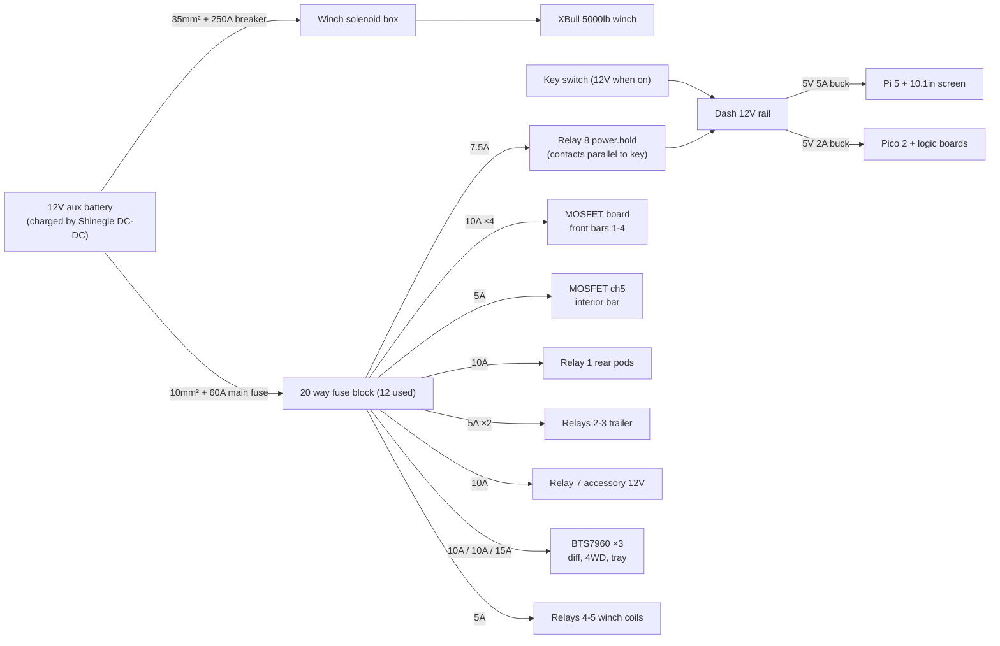
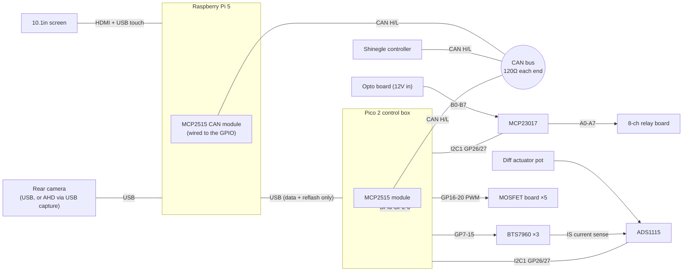

# Wiring

> **The whole-vehicle wiring now lives in [`config/wiring.yaml`](../config/wiring.yaml).**
> It draws the single line diagrams, wire and fuse schedule and the check list in
> [`docs/wiring/`](wiring/README.md) (`python -m teryx wiring`), and a test checks it:
> fuses, wire sizes, no 12 V on a 3.3 V pin, two CAN ends, Pico pins match `io-map.yaml`,
> PCIe and header kept for the AI HAT+ 2. Viewer:
> <https://electrumnz.github.io/TERYXDACTL/wiring/>. This page explains the why.
> If the two disagree, the YAML wins.

How everything connects, with wire sizes and fuses. Pin numbers come from
[`io-list.md`](io-list.md) section 3, so if a pin changes there, change it here
too. Nothing here has been checked on the real Teryx yet: treat it as the
starting point for the bench build.

**Before you start**
- Disconnect the 12V battery (and the traction pack isolator) before any work.
- Every 12V feed gets a fuse **as close to the battery or fuse block as you can**.
- Grounds: one solid ground point near the fuse block, star-wired from there.
- Sharing a fuse is fine only for small loads that can go out together without
  making anything unsafe: the front bars in pairs (outer 1+4, inner 2+3, so a
  blown fuse still leaves light on both sides), the trailer tail + stop, and the
  "extras" (interior bar + accessory relay 7). All four front bars on one fuse
  was ruled out: one fault would black out the front at night.
  The winch coils, the hand winch switches, the key, the power hold and each
  actuator keep their own fuse, so one fault can't take out the backup too or
  let a stalled actuator blow another one's fuse.
  Keep the traction pack (72V) completely separate from the 12V system.
- The Pi, Pico and their boards are 3.3V/5V logic. **Never** put 12V on a Pico,
  Pi, MCP23017 or ADS1115 pin. 12V signals go through the opto board first.

---

## 1. Power

**The dash 12V rail.** The key switch and the contacts of relay 8 are wired in
parallel onto one rail. Key on powers the rail, the Pico boots and closes
relay 8 straight away, so after key-off the rail stays up until the Pico has
told the Pi to shut down and then lets go. **The key feed needs a diode
(10A Schottky, band towards the rail).** Without it, relay 8 feeds the rail
back up the key wire after key-off, the `in.ignition` input still sees 12V and
the Pico never shuts down. Take `in.ignition` from the key side of that diode
(through its own 1A diode into the opto board).

**Relay 8 needs a coil supply that's on while the rail is up.** Feed the relay
board's JD-VCC from the Pico's 5V buck, which is on the rail, so the relay
holds itself in.

| From | To | Wire | Fuse | Notes |
|---|---|---|---|---|
| Battery + | Winch solenoid box | 35mm² (2 AWG) | 250A breaker | Use the cable that came with the winch |
| Battery + | Fuse block | 10mm² (8 AWG) | 60A main | Total of all small loads, light bars on full ≈ 35A. Was 6mm², but 6mm² is only good for a 40A fuse ([table](https://info.speedingparts.eu/what-cable-size-should-you-use-in-a-12v-automotive-system)) |
| Key switch | Dash 12V rail | 1mm² | 7.5A | Through a 10A Schottky diode (see above) |
| Fuse block | Relay 8 common | 1mm² | 7.5A | Relay 8 NO contact → dash 12V rail |
| Dash 12V rail | Pi buck in | 1.5mm² | (rail fuse) | Buck out → Pi USB-C or 5V/GND pins, keep under 30cm |
| Dash 12V rail | Pico buck in (5V 2A) | 0.75mm² | 2A inline | Buck out → Pico VSYS + GND, and 5V to relay board JD-VCC (8 coils ≈ 0.6A) |
| Ground point | Everything | Same size as the feed | – | |

---

## 2. Signals and data

### CAN bus
- Twisted pair, 0.5mm², about one twist every 2–3cm. Shielded if you can get it,
  with the shield grounded at **one** end only.
- 120Ω across CAN H and CAN L at the two far ends of the bus. Check: with
  everything off, CAN H to CAN L should read **60Ω**. 120Ω means one end is
  missing a resistor, 40Ω means one too many.
- Most MCP2515 modules and the Waveshare HAT have a jumper for their 120Ω.
  Turn it on only on the boards at the ends.
- Short stubs (under 30cm) from the main run to each board.

### Pico 2 to its boards
| Pico | Board pin | Notes |
|---|---|---|
| GP2 / GP3 / GP4 / GP5 | MCP2515 SCK / SI / SO / CS | Keep these short, under 10cm |
| GP6 | MCP2515 INT | |
| GP26 / GP27 | MCP23017 + ADS1115 SDA / SCL | 4.7kΩ pull-ups to 3.3V (once, not on every board) |
| GP21 | MCP23017 INTB | |
| GP22 | Steering CAN chip select | ADS1115 ALERT left free |
| 3V3(OUT) | MCP2515 module VCC (if 3.3V type), MCP23017 VDD, ADS1115 VDD | If the MCP2515 module is a 5V TJA1050 type, power its transceiver from 5V but keep the MCP2515 chip's SPI at 3.3V, or use a SN65HVD230 (3.3V) module instead |
| GND | All boards | |

MCP23017 address pins A0/A1/A2 to ground (address 0x20). ADS1115 ADDR to
ground (0x48). RESET on the MCP23017 to 3.3V through 10kΩ.

### Relay board
| MCP23017 | Relay | Load side (COM → NO) |
|---|---|---|
| A0 | 1 | Fuse block 10A → trailer plug reversing pin (rear floods are on the MOSFET board now) |
| A1 | 2 | Spare (trailer tail moved to BTS7960 no. 8, see [`lights.md`](lights.md)) |
| A2 | 3 | Spare (trailer stop moved to BTS7960 no. 8) |
| A3 | 4 | Fuse block 3A → winch solenoid box "in" coil wire |
| A4 | 5 | Fuse block 3A → winch solenoid box "out" coil wire |
| A5 | 6 | Spare (was the winch isolator, dropped) |
| A6 | 7 | Fuse block 10A (shared with interior bar) → accessory 12V |
| A7 | 8 | Fuse block 7.5A → dash 12V rail (see power) |
| MCP2 A0 | 9 | Steering ECU ignition feed |
| MCP2 A1 | 10 | Drive lock, NC contact in the Shinegle KSI line |

7 of the 16 relays are used, 9 spare (2, 3, 6, 11-16).

- Remove the JD-VCC/VCC jumper and feed JD-VCC from the Pico's 5V buck, VCC
  from the Pico's 3.3V. That keeps the relay coils isolated and lets 3.3V logic
  trigger them. If they won't click from 3.3V, flip firmware setting 18
  (active-low) first, then try a level shifter.
- The winch motor current **never** goes through this board. Relays 4 and 5
  only drive the solenoid box's coil wires, in parallel with the handheld
  remote and the two hidden momentary hand switches (winch and cab). Each
  source feeds the coil wires through its own 3 A diode so they can't
  back-feed each other. See the hand switch notes at the end of
  [`io-list.md`](io-list.md).

### Opto board (12V signals in)
| Opto input (12V side) | Signal | MCP23017 out (3.3V side) |
|---|---|---|
| 1 | Key switch (through 1A diode) | B0 `in.ignition` |
| 2 | Brake light switch | B1 `in.brake` |
| 3 | Shinegle reverse wire | B2 `in.reverse` |
| 4 | Tray down limit (NC to ground) | B3 `in.tray_down` |
| 5 | Tray up limit (NC to ground) | B4 `in.tray_up` |
| 6 | Winch remote or either hand switch, "in" or "out" pressed (each through its own diode) | B5 `in.winch_remote` |
| 7 | Parking brake pedal switch (stock, feeds the meter's parking brake light) | B6 `in.park` |
| 8 | Trailer plug reed switch in the 7-pin socket (check on the bench which way it switches, see `cameras.md`) | B7 `in.trailer` |

The limit switches are normally closed, so a broken wire reads as "at the
limit" and stops the tray instead of letting it run.

### Actuators (BTS7960)
| Driver | Pico RPWM / LPWM / EN | B+ fuse | Actuator wire | Current sense |
|---|---|---|---|---|
| #1 front diff | GP7 / GP8 / GP9 | 10A, 1.5mm² | 1.5mm² | R_IS + L_IS → 2 diodes → 1kΩ to ground → Pico GP28 |
| #2 2WD/4WD | GP10 / GP11 / GP12 | 10A, 1.5mm² | 1.5mm² | Same → ADS1115 A2 |
| #3 tray | GP13 / GP14 / GP15 | 15A, 2.5mm² | 2.5mm² | Same → ADS1115 A3 |

- R_EN and L_EN are joined and go to the one EN pin.
- BTS7960 VCC (logic) to 3.3V from the Pico, or 5V if the board's inputs need
  it (most work fine at 3.3V).
- Diff actuator pot: ends to ADS1115 VDD (3.3V) and GND, wiper to **A0**.
  Never to 12V.
- If an actuator moves the wrong way, swap the direction in firmware
  (`DIFF_LOCK_DIR`, `FOURWD_ENGAGE_DIR`, `TRAY_UP_DIR`), not the wires, so the
  wiring always matches this page.

### Lights (MOSFET board)
| Pico | MOSFET channel | Light | Fuse | Wire |
|---|---|---|---|---|
| GP16 | 1 | Front bar 1 (far left) | 15A (shared with bar 4) | 1.5mm² |
| GP17 | 2 | Front bar 2 (inner left) | 15A (shared with bar 3) | 1.5mm² |
| GP18 | 3 | Front bar 3 (inner right) | 15A (shared with bar 2) | 1.5mm² |
| GP19 | 4 | Front bar 4 (far right) | 15A (shared with bar 1) | 1.5mm² |
| GP20 | 5 | Interior bar | 10A (shared with accessory relay 7) | 1mm² |

These are low-side switches: the light's **+** goes to its fuse, the light's
**−** goes to the MOSFET board's output, and the MOSFET board ground goes to
the ground point. Use logic-level MOSFETs (AOD4184, IRLZ44N or similar) that
fully turn on from 3.3V. If the bars turn out not to dim, nothing changes
here; the dash just treats them as on/off.

### Analogue
| ADS1115 | Signal | Notes |
|---|---|---|
| A0 | Diff actuator pot wiper | 0–3.3V |
| A1 | 12V aux battery | 10kΩ from 12V, 2.2kΩ to ground. Add a 3.3V zener across the 2.2kΩ |
| A2 | BTS7960 #2 current | |
| A3 | BTS7960 #3 current | |

### Pi 5
| Pi | Connects to |
|---|---|
| HDMI 0 | Screen HDMI |
| USB 3 (blue) | Screen touch USB |
| USB 3 (blue) | Rear camera (or AHD capture stick) |
| USB 2 | Pico 2 USB (data + reflash) |
| 40-pin header | AI HAT+ 2 on its 16 mm stacking header. The MCP2515 CAN module is wired to the header pins that come up through the HAT: 3V3 (pin 1), GND (6), MOSI GPIO10 (19), MISO GPIO9 (21), SCLK GPIO11 (23), CS CE0 GPIO8 (24), INT GPIO25 (22). Use a 2x20 female housing or glue the leads so they can't shake off |
| I2C1 GPIO2/3 | IMU (optional) |
| UART0 GPIO14/15 (pins 8, 10) | 4G module board (A7670SA), optional: Pi TX to module RX, Pi RX to module TX, GND pin 6. Module UART is 1.8 V, so a level shifter unless the board has one. Own 3.8 V 3 A buck, not the Pi's 5 V. See [`remote-access.md`](remote-access.md) |
| Power button pads | Optional dash power button |

---

## 3. Trailer plug

The Teryx has no indicators from the factory, so the trailer plug only carries
tail and brake to start with.

| Plug pin (NZ/AU 7-pin flat) | Signal |
|---|---|
| Earth | Ground point |
| Tail | Relay 2 |
| Stop | Relay 3 |
| Left / Right | Not used yet (would need 2 more outputs) |

As a backup, also run a diode from the brake light switch straight to the
trailer "stop" pin, so trailer brake lights work even if the control box is off.
