# Teryx wiring (made from `config/wiring.yaml`)

Don't edit this file or the SVGs here. Edit [`config/wiring.yaml`](../../config/wiring.yaml), then run
`python -m teryx wiring`. A test fails if they get out of step, and it also checks the wiring
itself: every fused feed has a fuse, wires are thick enough for their fuse, no 12 V or 72 V
wire lands on a 3.3 V pin, each CAN bus has exactly two 120 ohm ends, the Pico pins match
`config/io-map.yaml`, and the Pi's PCIe port and header stay free for the AI HAT+ 2.

Why things are wired this way (power hold, diodes, CAN rules): [`docs/wiring.md`](../wiring.md).
Viewer with search: [`index.html`](index.html), also online at
<https://electrumnz.github.io/TERYXDACTL/wiring/>.

**79 devices, 255 wires.** By status: 19 from_manual, 3 confirmed, 201 planned, 28 tbc, 4 placeholder.
Nothing has been checked on the real Teryx yet.

Wire sizes follow the conservative table in the YAML (from
[speedingparts.eu](https://info.speedingparts.eu/what-cable-size-should-you-use-in-a-12v-automotive-system),
runs up to about 5 m). Go one size up for bundled or hot runs.

## Sheets

### Traction: 72 V pack, controller, motor, DC-DC

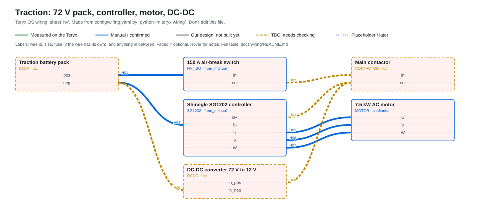

### Shinegle low voltage: key, F-N-R, throttle, sensors, programmer

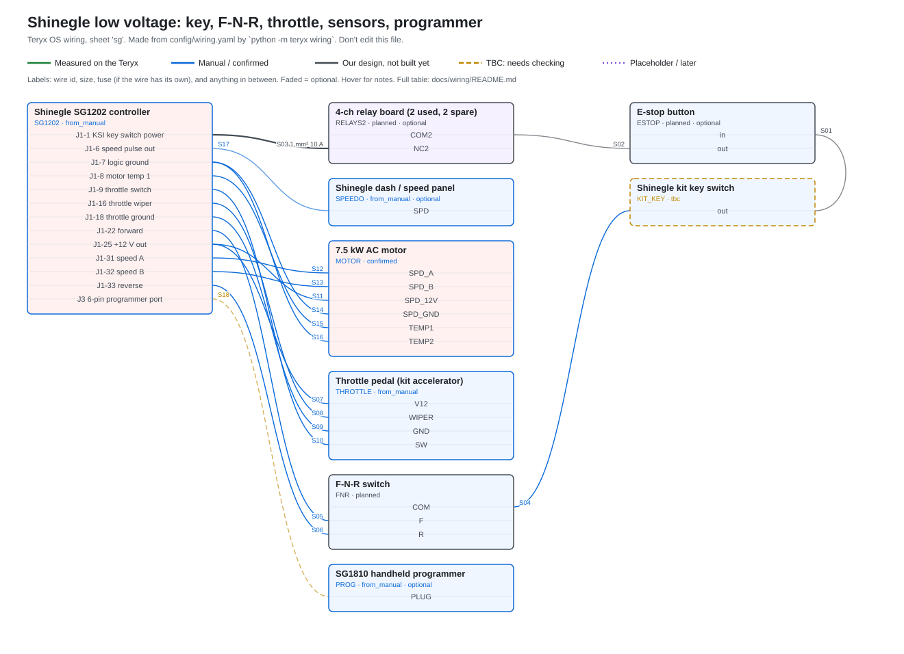

### 12 V power: battery, fuses, key, dash rail, bucks

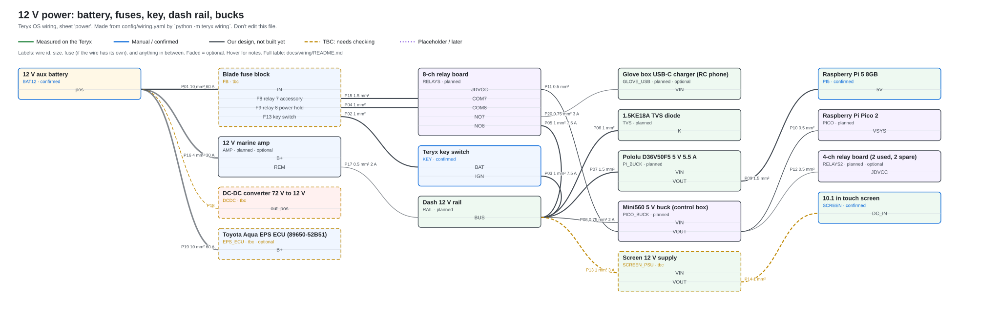

### Grounds (chassis, star point)

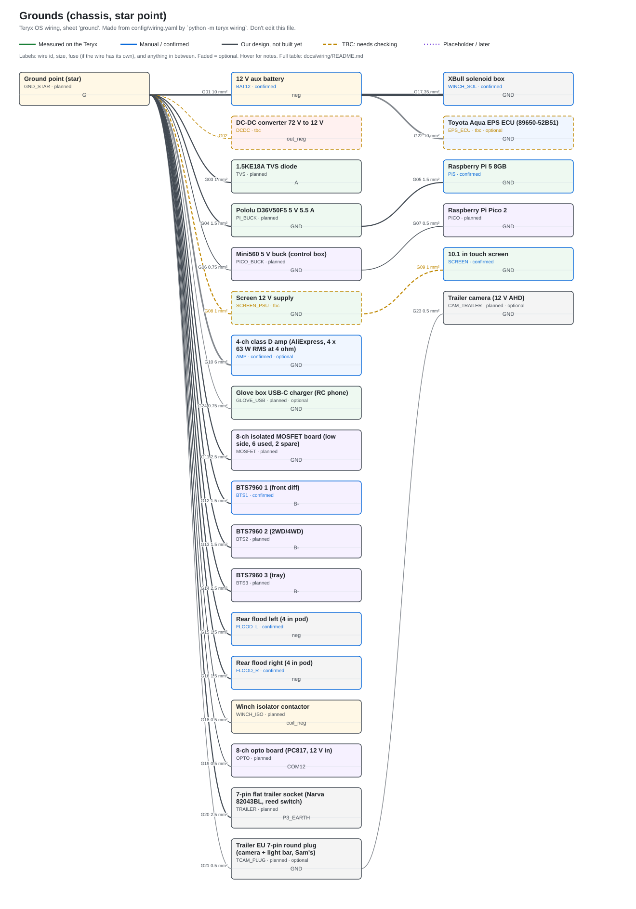

### CAN buses: main Teryx bus and the steering bus

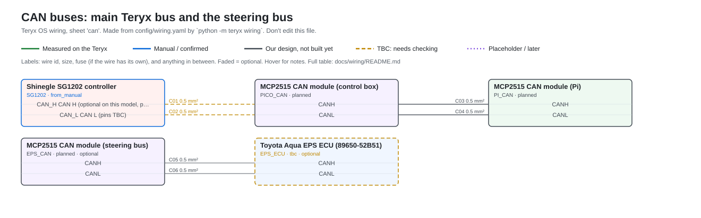

### Control box inside: Pico 2 and its boards

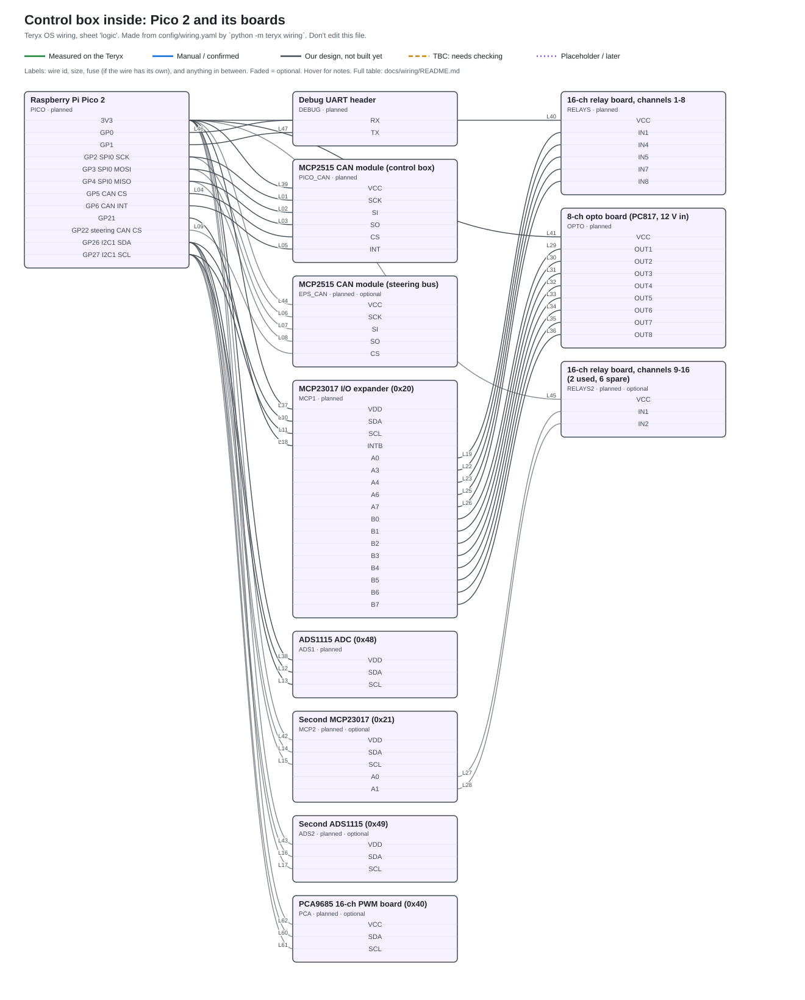

### 12 V signals into the control box (opto board)

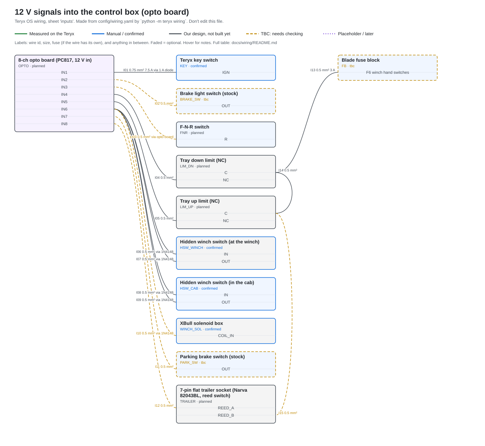

### Lights

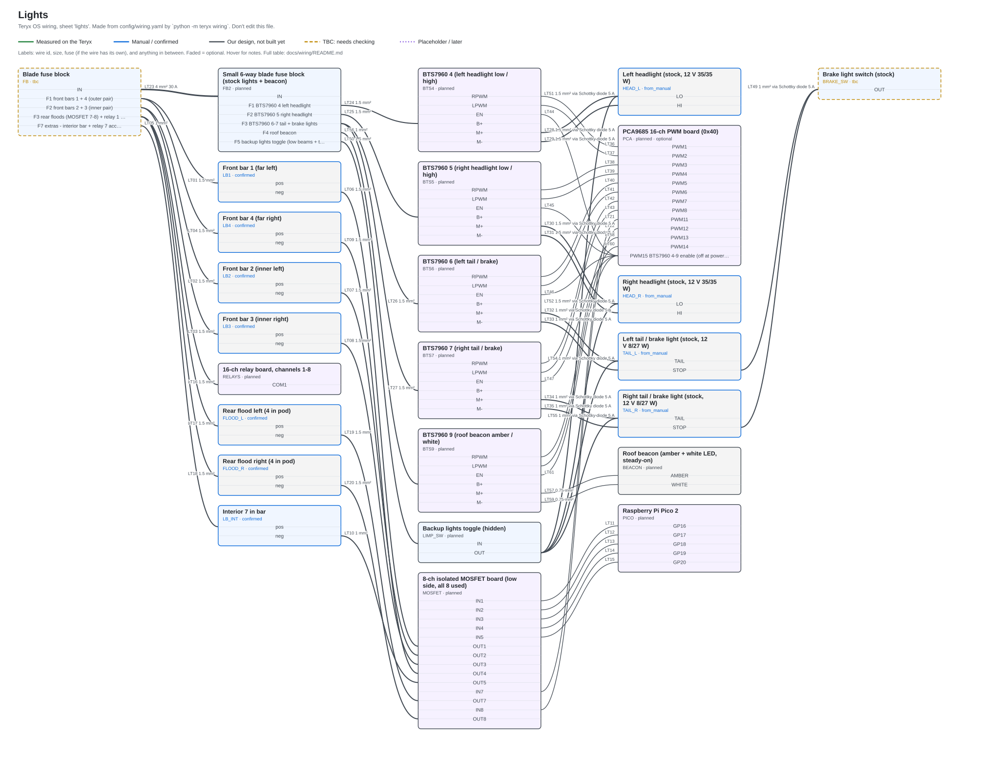

### Winch

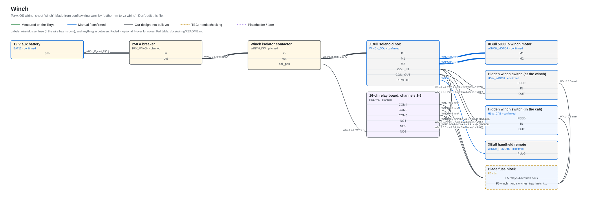

### Drive: 4WD, diff lock, tray, power steering

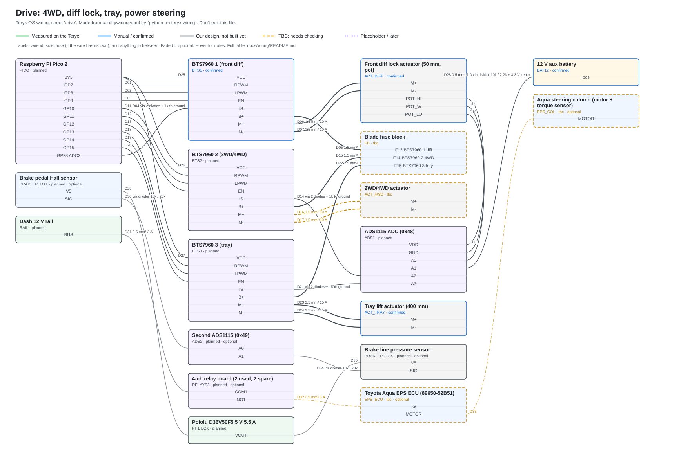

### Trailer plug and trailer camera

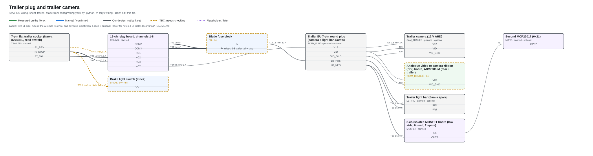

### Dash computer: Pi 5, screen, cameras, USB, audio

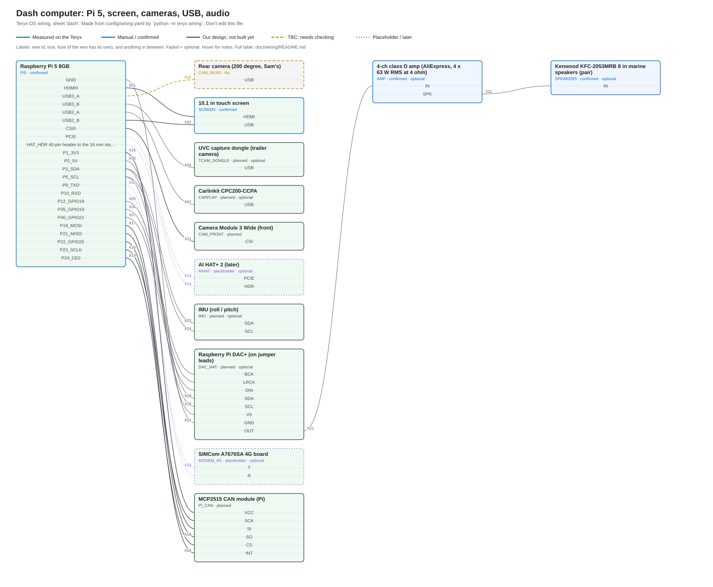

## Things to check or photograph on the Teryx

- [ ] **Traction battery pack** (PACK): Battery pack make, size (kWh), and where its main fuse is. Photo the label
- [ ] **150 A air-break switch** (HV_ISO): Is the air-break switch fitted, and where? Photo it
- [ ] **Main contactor** (CONTACTOR): Is there a main contactor between the pack and the controller? Photo it and trace its two small coil wires
- [ ] **DC-DC converter 72 V to 12 V** (DCDC): DC-DC label (amps out), where its 72 V feed comes from, and whether it is isolated (does its 12 V negative join the pack negative?)
- [ ] **Shinegle kit key switch** (KIT_KEY): Is the kit key the same switch as the Teryx key? Meter what voltage reaches J1-1 with the key on (12 V or 72 V)
- [ ] **Blade fuse block** (FB): Check the 12-way's rating (want 30 A per way, about 100 A total, a cover). Read the front bar labels. Each pair (1+4, 2+3) must draw under about 12 A together (about 140 W) to share a 15 A fuse. If not, give each bar its own 10 A again
- [ ] **Screen 12 V supply** (SCREEN_PSU): Read the label on the screen's power brick (volts and amps)
- [ ] **16-ch relay board, channels 1-8** (RELAYS): Does the relay board click from 3.3 V logic? Active high or low? Relays are SRD-05VDC type, 10 A at 28-30 V DC. Keep each load under about 7 A. Only rear floods (relay 1) could get near that, so read the pod labels (two pods + trailer reverse under about 80 W). If over, relay 1 drives a 40 A automotive relay instead
- [ ] **16-ch relay board, channels 9-16 (2 used, 6 spare)** (RELAYS2): Relay 10 is rated 30 V DC. If the Shinegle KSI turns out to be 72 V (see KIT_KEY), swap relay 10 for one rated 80 V DC or more
- [ ] **8-ch isolated MOSFET board (low side, 6 used, 2 spare)** (MOSFET): The listing must say 3.3 V input, at least 24 V load and 10 A per channel. If it only says 5 A, use single LR7843 modules instead
- [ ] **Rear flood left (4 in pod)** (FLOOD_L): Light bars and pods dim with PWM? Test one on a cheap dimmer
- [ ] **Winch isolator contactor** (WINCH_ISO): Do the remote and hand switches need to work with the dash dead? If so the isolator needs a second coil feed from a hidden key switch
- [ ] **XBull solenoid box** (WINCH_SOL): Photo the XBull solenoid box terminals and the remote plug pins
- [ ] **2WD/4WD actuator** (ACT_4WD): Is the stock electric 4WD actuator still on the front diff, and is the dash 2WD/4WD switch still wired to it? Photo its plug
- [ ] **Brake light switch (stock)** (BRAKE_SW): Find the brake light switch wire and meter it (12 V when pressed?)
- [ ] **Parking brake switch (stock)** (PARK_SW): Find the parking brake switch wire at the meter plug. Does it switch ground or 12 V?
- [ ] **Toyota Aqua EPS ECU (89650-52B51)** (EPS_ECU): Photo both EPS ECU plugs (pin numbers and wire colours) when the column is picked up
- [ ] **Aqua steering column (motor + torque sensor)** (EPS_COL): Measure the space from the steering wheel to where the Teryx shaft goes to the rack
- [ ] **7-pin flat trailer socket (Narva 82043BL, reed switch)** (TRAILER): Which way does the Narva reed switch switch, and what triggers it?
- [ ] **Analogue video to camera-ribbon (CSI) board, ADV7280-M (rear + trailer)** (TCAM_DONGLE): Confirm the board works on the Pi 5 (dtoverlay=adv728x-m,adv7280m=1); set each AHD camera to CVBS/PAL (OSD menu or mode wire)
- [ ] **Glove box USB-C charger (RC phone)** (GLOVE_USB): Pick a 12 V USB-C PD panel socket (waterproof cap, about 20-30 W)
- [ ] **Rear camera (200 degree, Sam's)** (CAM_REAR): Rear camera: AHD with a CVBS mode? Photo its plug and label

Wires marked TBC, with what's unknown:

- H08 CONTACTOR.out to DCDC.in_pos: Where the DC-DC takes its 72 V from is TBC
- S18 SG1202.J3 to PROG.PLUG: Setup only. J3 to J1-25/28/29/7 TBC
- P13 RAIL.BUS to SCREEN_PSU.VIN: Fuse size depends on the screen's draw
- P18 DCDC.out_pos to BAT12.pos: DC-DC charge lead. Size and fuse depend on its rating
- C01 SG1202.CAN_H to PICO_CAN.CANH: Twisted pair. CAN is optional on the SG1202, check it's fitted. Bit rate TBC (try 250k then 500k)
- I03 FNR.R to OPTO.IN3: The F-N-R switch is on the Shinegle key line. If J1-1 runs at 72 V, this needs a 72 V rated input, not the 12 V opto
- I10 WINCH_SOL.COIL_IN to OPTO.IN6: Remote taps: only if the remote's own lines can be reached. TBC
- I11 PARK_SW.OUT to OPTO.IN7: If the switch grounds, wire the opto input the other way round
- D33 EPS_ECU.MOTOR to EPS_COL.MOTOR: Toyota's own plug, keep it from the wrecker
- T05 BRAKE_SW.OUT to TRAILER.P6_STOP: Trailer brake lights still work with the control box off
- T06 RELAYS.NO1 to TRAILER.P2_REV: Reversing pin. Relay 1 also runs the floods by hand, so trailer reverse lights would come on with them
- X03 CAM_REAR.VID to TCAM_DONGLE.VID_R: Shielded video lead, soldered
- X04 TCAM_DONGLE.CSI to PI5.CSI1: Camera ribbon, 2nd port

## Fuse block

| Slot | Fuse | Feeds | Wires |
|---|---|---|---|
| F1 | 15 A | front bars 1 + 4 (outer pair) | LT01, LT04 |
| F2 | 15 A | front bars 2 + 3 (inner pair) | LT02, LT03 |
| F3 | 10 A | relay 1 rear floods | LT16 |
| F4 | 7.5 A | relays 2-3 trailer tail + stop | T01, T03 |
| F5 | 3 A | relays 4-6 winch coils | WN07, WN08, WN09 |
| F6 | 3 A | winch hand switches, tray limits, trailer reed | I13, WN13, WN14 |
| F7 | 10 A | extras - interior bar + relay 7 accessory (phone charger, trailer cam) | P15, LT05 |
| F8 | 7.5 A | relay 8 power hold | P04 |
| F9 | 10 A | BTS7960 1 diff | D05 |
| F10 | 10 A | BTS7960 2 4WD | D15 |
| F11 | 15 A | BTS7960 3 tray | D22 |
| F12 | 7.5 A | key switch | P02 |

Fuses not in the block (inline, at the battery or on a board):

| Wire | Fuse | From | To |
|---|---|---|---|
| S03 | 10 A | RELAYS2.NC2 | SG1202.J1-1 |
| P01 | 60 A | BAT12.pos | FB.IN |
| P03 | 7.5 A | KEY.IGN | RAIL.BUS |
| P05 | 7.5 A | RELAYS.NO8 | RAIL.BUS |
| P08 | 2 A | RAIL.BUS | PICO_BUCK.VIN |
| P13 | 3 A | RAIL.BUS | SCREEN_PSU.VIN |
| P20 | 3 A | RELAYS.NO7 | GLOVE_USB.VIN |
| P16 | 40 A | BAT12.pos | AMP.B+ |
| P17 | 2 A | RAIL.BUS | AMP.REM |
| P19 | 60 A | BAT12.pos | EPS_ECU.B+ |
| I01 | 7.5 A | KEY.IGN | OPTO.IN1 |
| LT17 | 10 A | RELAYS.NO1 | FLOOD_L.pos |
| LT18 | 10 A | RELAYS.NO1 | FLOOD_R.pos |
| WN01 | 250 A | BAT12.pos | BRK_WINCH.in |
| WN02 | 250 A | BRK_WINCH.out | WINCH_ISO.in |
| WN03 | 250 A | WINCH_ISO.out | WINCH_SOL.B+ |
| WN10 | 3 A | RELAYS.NO4 | WINCH_SOL.COIL_IN |
| WN11 | 3 A | RELAYS.NO5 | WINCH_SOL.COIL_OUT |
| WN12 | 3 A | RELAYS.NO6 | WINCH_ISO.coil_pos |
| WN15 | 3 A | HSW_WINCH.IN | WINCH_SOL.COIL_IN |
| WN16 | 3 A | HSW_WINCH.OUT | WINCH_SOL.COIL_OUT |
| WN17 | 3 A | HSW_CAB.IN | WINCH_SOL.COIL_IN |
| WN18 | 3 A | HSW_CAB.OUT | WINCH_SOL.COIL_OUT |
| D06 | 10 A | BTS1.M+ | ACT_DIFF.M+ |
| D07 | 10 A | BTS1.M- | ACT_DIFF.M- |
| D16 | 10 A | BTS2.M+ | ACT_4WD.M+ |
| D17 | 10 A | BTS2.M- | ACT_4WD.M- |
| D23 | 15 A | BTS3.M+ | ACT_TRAY.M+ |
| D24 | 15 A | BTS3.M- | ACT_TRAY.M- |
| D28 | 1 A | BAT12.pos | ADS1.A1 |
| D31 | 3 A | RAIL.BUS | RELAYS2.COM1 |
| D32 | 3 A | RELAYS2.NO1 | EPS_ECU.IG |
| T02 | 7.5 A | RELAYS.NO2 | TRAILER.P7_TAIL |
| T04 | 7.5 A | RELAYS.NO3 | TRAILER.P6_STOP |
| T06 | 10 A | RELAYS.NO1 | TRAILER.P2_REV |
| T07 | 2 A | RELAYS.NO7 | TCAM_PLUG.V12 |
| T08 | 2 A | TCAM_PLUG.V12 | CAM_TRAILER.V12 |

## Wire schedule

### Traction: 72 V pack, controller, motor, DC-DC

| Wire | From | To | Size | Fuse | Via | Status | Note |
|---|---|---|---|---|---|---|---|
| H01 | PACK.pos | HV_ISO.in |  |  |  | from_manual | Main pack + to the air-break switch. Size TBC, check for a main HV fuse |
| H02 | HV_ISO.out | CONTACTOR.in |  |  |  | tbc |  |
| H03 | CONTACTOR.out | SG1202.B+ |  |  |  | tbc |  |
| H04 | PACK.neg | SG1202.B- |  |  |  | from_manual |  |
| H05 | SG1202.U | MOTOR.U |  |  |  | from_manual |  |
| H06 | SG1202.V | MOTOR.V |  |  |  | from_manual |  |
| H07 | SG1202.W | MOTOR.W |  |  |  | from_manual |  |
| H08 | CONTACTOR.out | DCDC.in_pos |  |  |  | tbc | Where the DC-DC takes its 72 V from is TBC |
| H09 | PACK.neg | DCDC.in_neg |  |  |  | tbc |  |

### Shinegle low voltage: key, F-N-R, throttle, sensors, programmer

| Wire | From | To | Size | Fuse | Via | Status | Note |
|---|---|---|---|---|---|---|---|
| S01 | KIT_KEY.out | ESTOP.in |  |  |  | planned (optional) | Without the e-stop, KIT_KEY goes straight to the lock relay or J1-1 |
| S02 | ESTOP.out | RELAYS2.COM2 |  |  |  | planned (optional) |  |
| S03 | RELAYS2.NC2 | SG1202.J1-1 | 1 mm² | 10 A |  | planned | KSI through 10 A fuse (manual). NC contact so a dead control box never strands you |
| S04 | KIT_KEY.out | FNR.COM |  |  |  | from_manual | Manual feeds the direction switch from the key |
| S05 | FNR.F | SG1202.J1-22 |  |  |  | from_manual |  |
| S06 | FNR.R | SG1202.J1-33 |  |  |  | from_manual |  |
| S07 | SG1202.J1-25 | THROTTLE.V12 |  |  |  | from_manual |  |
| S08 | THROTTLE.WIPER | SG1202.J1-16 |  |  |  | from_manual |  |
| S09 | THROTTLE.GND | SG1202.J1-18 |  |  |  | from_manual |  |
| S10 | THROTTLE.SW | SG1202.J1-9 |  |  |  | from_manual |  |
| S11 | SG1202.J1-25 | MOTOR.SPD_12V |  |  |  | from_manual | Speed sensor plugs J6/J7 |
| S12 | MOTOR.SPD_A | SG1202.J1-31 |  |  |  | from_manual |  |
| S13 | MOTOR.SPD_B | SG1202.J1-32 |  |  |  | from_manual |  |
| S14 | MOTOR.SPD_GND | SG1202.J1-7 |  |  |  | from_manual |  |
| S15 | MOTOR.TEMP1 | SG1202.J1-8 |  |  |  | from_manual | Motor temp plugs J8/J9 |
| S16 | MOTOR.TEMP2 | SG1202.J1-7 |  |  |  | from_manual |  |
| S17 | SG1202.J1-6 | SPEEDO.SPD |  |  |  | from_manual (optional) | Speed pulse. Could also feed the Pico if CAN isn't fitted |
| S18 | SG1202.J3 | PROG.PLUG |  |  |  | tbc (optional) | Setup only. J3 to J1-25/28/29/7 TBC |

### 12 V power: battery, fuses, key, dash rail, bucks

| Wire | From | To | Size | Fuse | Via | Status | Note |
|---|---|---|---|---|---|---|---|
| P01 | BAT12.pos | FB.IN | 10 mm² | 60 A |  | planned | 60 A main fuse at the battery. Was 6 mm² in wiring.md, which the table only rates to 40 A |
| P02 | FB.F12 | KEY.BAT | 1 mm² | 7.5 A |  | planned |  |
| P03 | KEY.IGN | RAIL.BUS | 1 mm² | 7.5 A |  | planned |  |
| P04 | FB.F8 | RELAYS.COM8 | 1 mm² | 7.5 A |  | planned |  |
| P05 | RELAYS.NO8 | RAIL.BUS | 1 mm² | 7.5 A |  | planned | Power hold, in parallel with the key |
| P06 | RAIL.BUS | TVS.K | 1 mm² | 7.5 A |  | planned |  |
| P07 | RAIL.BUS | PI_BUCK.VIN | 1.5 mm² | 7.5 A |  | planned |  |
| P08 | RAIL.BUS | PICO_BUCK.VIN | 0.75 mm² | 2 A |  | planned | 2 A inline fuse |
| P09 | PI_BUCK.VOUT | PI5.5V | 1.5 mm² |  |  | planned | Short and thick, under 30 cm. Set usb_max_current_enable=1 |
| P10 | PICO_BUCK.VOUT | PICO.VSYS | 0.5 mm² |  |  | planned |  |
| P11 | PICO_BUCK.VOUT | RELAYS.JDVCC | 0.5 mm² |  |  | planned | Relay coils, about 0.6 A for 8 |
| P12 | PICO_BUCK.VOUT | RELAYS2.JDVCC | 0.5 mm² |  |  | planned (optional) |  |
| P13 | RAIL.BUS | SCREEN_PSU.VIN | 1 mm² | 3 A |  | tbc | Fuse size depends on the screen's draw |
| P14 | SCREEN_PSU.VOUT | SCREEN.DC_IN | 1 mm² |  |  | tbc |  |
| P15 | FB.F7 | RELAYS.COM7 | 1.5 mm² | 10 A |  | planned | Accessory 12 V, on with ignition |
| P20 | RELAYS.NO7 | GLOVE_USB.VIN | 0.75 mm² | 3 A |  | planned (optional) | 3 A inline fuse. Charges the RC phone with the key on; the control box may hold it on for a while after key-off (TBC) |
| P16 | BAT12.pos | AMP.B+ | 6 mm² | 40 A |  | planned (optional) | Own 40 A fuse at the battery. The amp pulls up to 33 A flat out, so 6 mm² (good to 40 A on the table) |
| P17 | RAIL.BUS | AMP.REM | 0.5 mm² | 2 A |  | planned (optional) | Remote turn-on, goes off with the rail |
| P18 | DCDC.out_pos | BAT12.pos |  |  |  | tbc | DC-DC charge lead. Size and fuse depend on its rating |
| P19 | BAT12.pos | EPS_ECU.B+ | 10 mm² | 60 A |  | planned (optional) | Own 60 A fuse and cable straight to the battery (Toyota fuses the Prius EPS at 60 A) |

### Grounds (chassis, star point)

| Wire | From | To | Size | Fuse | Via | Status | Note |
|---|---|---|---|---|---|---|---|
| G01 | BAT12.neg | GND_STAR.G | 10 mm² |  |  | planned | Same size as the main feed |
| G02 | DCDC.out_neg | GND_STAR.G |  |  |  | tbc |  |
| G03 | TVS.A | GND_STAR.G | 1 mm² |  |  | planned |  |
| G04 | PI_BUCK.GND | GND_STAR.G | 1.5 mm² |  |  | planned |  |
| G05 | PI5.GND | PI_BUCK.GND | 1.5 mm² |  |  | planned |  |
| G06 | PICO_BUCK.GND | GND_STAR.G | 0.75 mm² |  |  | planned |  |
| G07 | PICO.GND | PICO_BUCK.GND | 0.5 mm² |  |  | planned | All control box boards share the Pico ground |
| G08 | SCREEN_PSU.GND | GND_STAR.G | 1 mm² |  |  | tbc |  |
| G09 | SCREEN.GND | SCREEN_PSU.GND | 1 mm² |  |  | tbc |  |
| G10 | AMP.GND | GND_STAR.G | 6 mm² |  |  | planned (optional) | Same size as the feed |
| G24 | GLOVE_USB.GND | GND_STAR.G | 0.75 mm² |  |  | planned (optional) |  |
| G11 | MOSFET.GND | GND_STAR.G | 2.5 mm² |  |  | planned | Carries all five lights' current |
| G12 | BTS1.B- | GND_STAR.G | 1.5 mm² |  |  | planned |  |
| G13 | BTS2.B- | GND_STAR.G | 1.5 mm² |  |  | planned |  |
| G14 | BTS3.B- | GND_STAR.G | 2.5 mm² |  |  | planned |  |
| G15 | FLOOD_L.neg | GND_STAR.G | 1.5 mm² |  |  | planned |  |
| G16 | FLOOD_R.neg | GND_STAR.G | 1.5 mm² |  |  | planned |  |
| G17 | WINCH_SOL.GND | BAT12.neg | 35 mm² |  |  | planned | Winch return straight to the battery, cable from the winch kit |
| G18 | WINCH_ISO.coil_neg | GND_STAR.G | 0.5 mm² |  |  | planned |  |
| G19 | OPTO.COM12 | GND_STAR.G | 0.5 mm² |  |  | planned | 12 V side ground of the opto board |
| G20 | TRAILER.P3_EARTH | GND_STAR.G | 2.5 mm² |  |  | planned |  |
| G21 | TCAM_PLUG.GND | GND_STAR.G | 0.5 mm² |  |  | planned (optional) |  |
| G22 | EPS_ECU.GND | BAT12.neg | 10 mm² |  |  | planned (optional) |  |
| G23 | CAM_TRAILER.GND | TCAM_PLUG.GND | 0.5 mm² |  |  | planned (optional) | Earth the camera at the hitch, not through the 7-pin earth |

### CAN buses: main Teryx bus and the steering bus

| Wire | From | To | Size | Fuse | Via | Status | Note |
|---|---|---|---|---|---|---|---|
| C01 | SG1202.CAN_H | PICO_CAN.CANH | 0.5 mm² |  |  | tbc | Twisted pair. CAN is optional on the SG1202, check it's fitted. Bit rate TBC (try 250k then 500k) |
| C02 | SG1202.CAN_L | PICO_CAN.CANL | 0.5 mm² |  |  | tbc |  |
| C03 | PICO_CAN.CANH | PI_CAN.CANH | 0.5 mm² |  |  | planned | 120 ohm at the Shinegle end and the Pi end. 60 ohm H to L with all off |
| C04 | PICO_CAN.CANL | PI_CAN.CANL | 0.5 mm² |  |  | planned |  |
| C05 | EPS_CAN.CANH | EPS_ECU.CANH | 0.5 mm² |  |  | planned (optional) | Own bus, 500 kbit/s, Toyota frames 0x0B4 and 0x2C4 |
| C06 | EPS_CAN.CANL | EPS_ECU.CANL | 0.5 mm² |  |  | planned (optional) |  |

### Control box inside: Pico 2 and its boards

| Wire | From | To | Size | Fuse | Via | Status | Note |
|---|---|---|---|---|---|---|---|
| L01 | PICO.GP2 | PICO_CAN.SCK |  |  |  | planned | SPI under 10 cm |
| L02 | PICO.GP3 | PICO_CAN.SI |  |  |  | planned |  |
| L03 | PICO.GP4 | PICO_CAN.SO |  |  |  | planned |  |
| L04 | PICO.GP5 | PICO_CAN.CS |  |  |  | planned |  |
| L05 | PICO_CAN.INT | PICO.GP6 |  |  |  | planned |  |
| L06 | PICO.GP2 | EPS_CAN.SCK |  |  |  | planned (optional) |  |
| L07 | PICO.GP3 | EPS_CAN.SI |  |  |  | planned (optional) |  |
| L08 | PICO.GP4 | EPS_CAN.SO |  |  |  | planned (optional) |  |
| L09 | PICO.GP22 | EPS_CAN.CS |  |  |  | planned (optional) | GP22 freed from ADS1115 ALERT |
| L10 | PICO.GP26 | MCP1.SDA |  |  |  | planned | 4.7k pull-ups to 3.3 V, once for the whole bus |
| L11 | PICO.GP27 | MCP1.SCL |  |  |  | planned |  |
| L12 | PICO.GP26 | ADS1.SDA |  |  |  | planned |  |
| L13 | PICO.GP27 | ADS1.SCL |  |  |  | planned |  |
| L14 | PICO.GP26 | MCP2.SDA |  |  |  | planned (optional) |  |
| L15 | PICO.GP27 | MCP2.SCL |  |  |  | planned (optional) |  |
| L16 | PICO.GP26 | ADS2.SDA |  |  |  | planned (optional) |  |
| L17 | PICO.GP27 | ADS2.SCL |  |  |  | planned (optional) |  |
| L18 | MCP1.INTB | PICO.GP21 |  |  |  | planned |  |
| L19 | MCP1.A0 | RELAYS.IN1 |  |  |  | planned | light.rear |
| L20 | MCP1.A1 | RELAYS.IN2 |  |  |  | planned | trailer.tail |
| L21 | MCP1.A2 | RELAYS.IN3 |  |  |  | planned | trailer.brake |
| L22 | MCP1.A3 | RELAYS.IN4 |  |  |  | planned | winch.in |
| L23 | MCP1.A4 | RELAYS.IN5 |  |  |  | planned | winch.out |
| L24 | MCP1.A5 | RELAYS.IN6 |  |  |  | planned | winch.isolator |
| L25 | MCP1.A6 | RELAYS.IN7 |  |  |  | planned | aux.accessory |
| L26 | MCP1.A7 | RELAYS.IN8 |  |  |  | planned | power.hold |
| L27 | MCP2.A0 | RELAYS2.IN1 |  |  |  | planned (optional) | steering enable |
| L28 | MCP2.A1 | RELAYS2.IN2 |  |  |  | planned (optional) | drive lock (opens the KSI line while locked and parked) |
| L29 | OPTO.OUT1 | MCP1.B0 |  |  |  | planned | in.ignition |
| L30 | OPTO.OUT2 | MCP1.B1 |  |  |  | planned | in.brake |
| L31 | OPTO.OUT3 | MCP1.B2 |  |  |  | planned | in.reverse |
| L32 | OPTO.OUT4 | MCP1.B3 |  |  |  | planned | in.tray_down |
| L33 | OPTO.OUT5 | MCP1.B4 |  |  |  | planned | in.tray_up |
| L34 | OPTO.OUT6 | MCP1.B5 |  |  |  | planned | in.winch_remote |
| L35 | OPTO.OUT7 | MCP1.B6 |  |  |  | planned | in.park |
| L36 | OPTO.OUT8 | MCP1.B7 |  |  |  | planned | in.trailer |
| L37 | PICO.3V3 | MCP1.VDD |  |  |  | planned |  |
| L38 | PICO.3V3 | ADS1.VDD |  |  |  | planned |  |
| L39 | PICO.3V3 | PICO_CAN.VCC |  |  |  | planned |  |
| L40 | PICO.3V3 | RELAYS.VCC |  |  |  | planned |  |
| L41 | PICO.3V3 | OPTO.VCC |  |  |  | planned |  |
| L42 | PICO.3V3 | MCP2.VDD |  |  |  | planned (optional) |  |
| L43 | PICO.3V3 | ADS2.VDD |  |  |  | planned (optional) |  |
| L44 | PICO.3V3 | EPS_CAN.VCC |  |  |  | planned (optional) |  |
| L45 | PICO.3V3 | RELAYS2.VCC |  |  |  | planned (optional) |  |
| L46 | PICO.GP0 | DEBUG.RX |  |  |  | planned | UART0 TX |
| L47 | DEBUG.TX | PICO.GP1 |  |  |  | planned |  |

### 12 V signals into the control box (opto board)

| Wire | From | To | Size | Fuse | Via | Status | Note |
|---|---|---|---|---|---|---|---|
| I01 | KEY.IGN | OPTO.IN1 | 0.75 mm² | 7.5 A | 1 A diode | planned | So the Pico sees key-off while relay 8 holds the rail. 0.75 mm² because the 7.5 A key fuse is upstream |
| I02 | BRAKE_SW.OUT | OPTO.IN2 | 0.5 mm² |  |  | tbc |  |
| I03 | FNR.R | OPTO.IN3 | 0.5 mm² |  | opto board | tbc | The F-N-R switch is on the Shinegle key line. If J1-1 runs at 72 V, this needs a 72 V rated input, not the 12 V opto |
| I04 | LIM_DN.NC | OPTO.IN4 | 0.5 mm² |  |  | planned | Normally closed, a broken wire reads as at the limit |
| I05 | LIM_UP.NC | OPTO.IN5 | 0.5 mm² |  |  | planned |  |
| I06 | HSW_WINCH.IN | OPTO.IN6 | 0.5 mm² |  | 1N4148 | planned | Each hand control taps in through its own small diode |
| I07 | HSW_WINCH.OUT | OPTO.IN6 | 0.5 mm² |  | 1N4148 | planned |  |
| I08 | HSW_CAB.IN | OPTO.IN6 | 0.5 mm² |  | 1N4148 | planned |  |
| I09 | HSW_CAB.OUT | OPTO.IN6 | 0.5 mm² |  | 1N4148 | planned |  |
| I10 | WINCH_SOL.COIL_IN | OPTO.IN6 | 0.5 mm² |  | 1N4148 | tbc | Remote taps: only if the remote's own lines can be reached. TBC |
| I11 | PARK_SW.OUT | OPTO.IN7 | 0.5 mm² |  |  | tbc | If the switch grounds, wire the opto input the other way round |
| I12 | TRAILER.REED_A | OPTO.IN8 | 0.5 mm² |  |  | tbc |  |
| I13 | FB.F6 | LIM_DN.C | 0.5 mm² | 3 A |  | planned | Limit switch and reed feed from a small fused 12 V |
| I14 | LIM_DN.C | LIM_UP.C | 0.5 mm² |  |  | planned |  |
| I15 | LIM_UP.C | TRAILER.REED_B | 0.5 mm² |  |  | tbc |  |

### Lights

| Wire | From | To | Size | Fuse | Via | Status | Note |
|---|---|---|---|---|---|---|---|
| LT01 | FB.F1 | LB1.pos | 1.5 mm² | 15 A |  | planned |  |
| LT02 | FB.F2 | LB2.pos | 1.5 mm² | 15 A |  | planned |  |
| LT03 | FB.F2 | LB3.pos | 1.5 mm² | 15 A |  | planned |  |
| LT04 | FB.F1 | LB4.pos | 1.5 mm² | 15 A |  | planned |  |
| LT05 | FB.F7 | LB_INT.pos | 1 mm² | 10 A |  | planned |  |
| LT06 | LB1.neg | MOSFET.OUT1 | 1.5 mm² |  |  | planned |  |
| LT07 | LB2.neg | MOSFET.OUT2 | 1.5 mm² |  |  | planned |  |
| LT08 | LB3.neg | MOSFET.OUT3 | 1.5 mm² |  |  | planned |  |
| LT09 | LB4.neg | MOSFET.OUT4 | 1.5 mm² |  |  | planned |  |
| LT10 | LB_INT.neg | MOSFET.OUT5 | 1 mm² |  |  | planned |  |
| LT11 | PICO.GP16 | MOSFET.IN1 |  |  |  | planned | light.front_1 PWM |
| LT12 | PICO.GP17 | MOSFET.IN2 |  |  |  | planned | light.front_2 PWM |
| LT13 | PICO.GP18 | MOSFET.IN3 |  |  |  | planned | light.front_3 PWM |
| LT14 | PICO.GP19 | MOSFET.IN4 |  |  |  | planned | light.front_4 PWM |
| LT15 | PICO.GP20 | MOSFET.IN5 |  |  |  | planned | light.interior PWM |
| LT16 | FB.F3 | RELAYS.COM1 | 1.5 mm² | 10 A |  | planned |  |
| LT17 | RELAYS.NO1 | FLOOD_L.pos | 1.5 mm² | 10 A |  | planned | light.rear, auto on in reverse |
| LT18 | RELAYS.NO1 | FLOOD_R.pos | 1.5 mm² | 10 A |  | planned |  |

### Winch

| Wire | From | To | Size | Fuse | Via | Status | Note |
|---|---|---|---|---|---|---|---|
| WN01 | BAT12.pos | BRK_WINCH.in | 35 mm² | 250 A |  | planned | Cable that came with the winch |
| WN02 | BRK_WINCH.out | WINCH_ISO.in | 35 mm² | 250 A |  | planned |  |
| WN03 | WINCH_ISO.out | WINCH_SOL.B+ | 35 mm² | 250 A |  | planned |  |
| WN04 | WINCH_SOL.M1 | WINCH_MOTOR.M1 | 35 mm² |  |  | confirmed |  |
| WN05 | WINCH_SOL.M2 | WINCH_MOTOR.M2 | 35 mm² |  |  | confirmed |  |
| WN06 | WINCH_SOL.REMOTE | WINCH_REMOTE.PLUG |  |  |  | confirmed | XBull remote stays as a backup |
| WN07 | FB.F5 | RELAYS.COM4 | 0.5 mm² | 3 A |  | planned |  |
| WN08 | FB.F5 | RELAYS.COM5 | 0.5 mm² | 3 A |  | planned |  |
| WN09 | FB.F5 | RELAYS.COM6 | 0.5 mm² | 3 A |  | planned |  |
| WN10 | RELAYS.NO4 | WINCH_SOL.COIL_IN | 0.5 mm² | 3 A | 3 A diode (1N5408) | planned | winch.in. Never the motor current through the relay board |
| WN11 | RELAYS.NO5 | WINCH_SOL.COIL_OUT | 0.5 mm² | 3 A | 3 A diode (1N5408) | planned | winch.out, interlocked with in |
| WN12 | RELAYS.NO6 | WINCH_ISO.coil_pos | 0.5 mm² | 3 A |  | planned | winch.isolator, only while armed |
| WN13 | FB.F6 | HSW_WINCH.FEED | 0.5 mm² | 3 A |  | planned |  |
| WN14 | FB.F6 | HSW_CAB.FEED | 0.5 mm² | 3 A |  | planned |  |
| WN15 | HSW_WINCH.IN | WINCH_SOL.COIL_IN | 0.5 mm² | 3 A | 3 A diode (1N5408) | planned |  |
| WN16 | HSW_WINCH.OUT | WINCH_SOL.COIL_OUT | 0.5 mm² | 3 A | 3 A diode (1N5408) | planned |  |
| WN17 | HSW_CAB.IN | WINCH_SOL.COIL_IN | 0.5 mm² | 3 A | 3 A diode (1N5408) | planned |  |
| WN18 | HSW_CAB.OUT | WINCH_SOL.COIL_OUT | 0.5 mm² | 3 A | 3 A diode (1N5408) | planned |  |

### Drive: 4WD, diff lock, tray, power steering

| Wire | From | To | Size | Fuse | Via | Status | Note |
|---|---|---|---|---|---|---|---|
| D01 | PICO.GP7 | BTS1.RPWM |  |  |  | planned | act.diff |
| D02 | PICO.GP8 | BTS1.LPWM |  |  |  | planned |  |
| D03 | PICO.GP9 | BTS1.EN |  |  |  | planned | R_EN and L_EN joined |
| D04 | BTS1.IS | PICO.GP28 |  |  | 2 diodes + 1k to ground | planned | an.diff_current |
| D05 | FB.F9 | BTS1.B+ | 1.5 mm² | 10 A |  | planned |  |
| D06 | BTS1.M+ | ACT_DIFF.M+ | 1.5 mm² | 10 A |  | planned | Wrong way? Change DIFF_LOCK_DIR in firmware, not the wires |
| D07 | BTS1.M- | ACT_DIFF.M- | 1.5 mm² | 10 A |  | planned |  |
| D08 | ADS1.VDD | ACT_DIFF.POT_HI |  |  |  | planned | Pot on 3.3 V, never 12 V |
| D09 | ACT_DIFF.POT_W | ADS1.A0 |  |  |  | planned | an.diff_pos |
| D10 | ACT_DIFF.POT_LO | ADS1.GND |  |  |  | planned |  |
| D11 | PICO.GP10 | BTS2.RPWM |  |  |  | planned | act.4wd |
| D12 | PICO.GP11 | BTS2.LPWM |  |  |  | planned |  |
| D13 | PICO.GP12 | BTS2.EN |  |  |  | planned |  |
| D14 | BTS2.IS | ADS1.A2 |  |  | 2 diodes + 1k to ground | planned | an.4wd_current |
| D15 | FB.F10 | BTS2.B+ | 1.5 mm² | 10 A |  | planned |  |
| D16 | BTS2.M+ | ACT_4WD.M+ | 1.5 mm² | 10 A |  | tbc |  |
| D17 | BTS2.M- | ACT_4WD.M- | 1.5 mm² | 10 A |  | tbc |  |
| D18 | PICO.GP13 | BTS3.RPWM |  |  |  | planned | act.tray |
| D19 | PICO.GP14 | BTS3.LPWM |  |  |  | planned |  |
| D20 | PICO.GP15 | BTS3.EN |  |  |  | planned |  |
| D21 | BTS3.IS | ADS1.A3 |  |  | 2 diodes + 1k to ground | planned | an.tray_current |
| D22 | FB.F11 | BTS3.B+ | 2.5 mm² | 15 A |  | planned |  |
| D23 | BTS3.M+ | ACT_TRAY.M+ | 2.5 mm² | 15 A |  | planned |  |
| D24 | BTS3.M- | ACT_TRAY.M- | 2.5 mm² | 15 A |  | planned |  |
| D25 | PICO.3V3 | BTS1.VCC |  |  |  | planned |  |
| D26 | PICO.3V3 | BTS2.VCC |  |  |  | planned |  |
| D27 | PICO.3V3 | BTS3.VCC |  |  |  | planned |  |
| D28 | BAT12.pos | ADS1.A1 | 0.5 mm² | 1 A | divider 10k / 2.2k + 3.3 V zener | planned | an.aux_12v. Fuse the sense lead |
| D29 | PI_BUCK.VOUT | BRAKE_PEDAL.V5 |  |  |  | planned (optional) | Or the Pico buck. 5 V sensor |
| D30 | BRAKE_PEDAL.SIG | ADS2.A0 |  |  | divider 10k / 20k | planned (optional) | an.brake_pedal, 4.5 V reads 3.0 V |
| D34 | BRAKE_PRESS.SIG | ADS2.A1 |  |  | divider 10k / 20k | planned (optional) | an.brake_pressure |
| D35 | PI_BUCK.VOUT | BRAKE_PRESS.V5 |  |  |  | planned (optional) |  |
| D31 | RAIL.BUS | RELAYS2.COM1 | 0.5 mm² | 3 A |  | planned (optional) | Steering ignition feed through relay 9, so the lock and RC kill can turn assist off |
| D32 | RELAYS2.NO1 | EPS_ECU.IG | 0.5 mm² | 3 A |  | tbc (optional) |  |
| D33 | EPS_ECU.MOTOR | EPS_COL.MOTOR |  |  |  | tbc (optional) | Toyota's own plug, keep it from the wrecker |

### Trailer plug and trailer camera

| Wire | From | To | Size | Fuse | Via | Status | Note |
|---|---|---|---|---|---|---|---|
| T01 | FB.F4 | RELAYS.COM2 | 1 mm² | 7.5 A |  | planned |  |
| T02 | RELAYS.NO2 | TRAILER.P7_TAIL | 1 mm² | 7.5 A |  | planned | trailer.tail |
| T03 | FB.F4 | RELAYS.COM3 | 1 mm² | 7.5 A |  | planned |  |
| T04 | RELAYS.NO3 | TRAILER.P6_STOP | 1 mm² | 7.5 A |  | planned | trailer.brake |
| T05 | BRAKE_SW.OUT | TRAILER.P6_STOP | 1 mm² |  | diode (backup) | tbc | Trailer brake lights still work with the control box off |
| T06 | RELAYS.NO1 | TRAILER.P2_REV | 1 mm² | 10 A |  | tbc (optional) | Reversing pin. Relay 1 also runs the floods by hand, so trailer reverse lights would come on with them |
| T07 | RELAYS.NO7 | TCAM_PLUG.V12 | 0.5 mm² | 2 A |  | planned (optional) | 2 A inline fuse. Runs while driving, not just reversing |
| T08 | TCAM_PLUG.V12 | CAM_TRAILER.V12 | 0.5 mm² | 2 A |  | planned (optional) |  |
| T09 | CAM_TRAILER.VID | TCAM_PLUG.VID |  |  |  | planned (optional) |  |
| T10 | CAM_TRAILER.VID_GND | TCAM_PLUG.VID_GND |  |  |  | planned (optional) |  |
| T11 | TCAM_PLUG.VID | TCAM_DONGLE.VID |  |  |  | planned (optional) | Shielded video cable |
| T13 | FB.IN | TCAM_PLUG.LB_POS | 1.5 mm² | 10 A |  | planned (optional) | Own 10 A inline fuse off the fuse block's feed stud (the 12-way is full) |
| T14 | TCAM_PLUG.LB_POS | LB_TRL.pos | 1.5 mm² |  |  | planned (optional) |  |
| T15 | LB_TRL.neg | TCAM_PLUG.LB_NEG | 1.5 mm² |  |  | planned (optional) |  |
| T16 | TCAM_PLUG.LB_NEG | MOSFET.OUT6 | 1.5 mm² |  |  | planned (optional) |  |
| T17 | MCP2.GPB7 | MOSFET.IN6 |  |  |  | planned (optional) | light.trailer on/off (the Pico has no free PWM pin) |
| T12 | TCAM_PLUG.VID_GND | TCAM_DONGLE.VID_GND |  |  |  | planned (optional) |  |

### Dash computer: Pi 5, screen, cameras, USB, audio

| Wire | From | To | Size | Fuse | Via | Status | Note |
|---|---|---|---|---|---|---|---|
| X01 | PI5.HDMI0 | SCREEN.HDMI |  |  |  | planned |  |
| X02 | SCREEN.USB | PI5.USB2_B |  |  |  | planned | Touch. Screen only does touch over USB. Right-angle lead, cable-tied to the box |
| X03 | CAM_REAR.VID | TCAM_DONGLE.VID_R |  |  |  | tbc | Shielded video lead, soldered |
| X03b | CAM_REAR.VID_GND | TCAM_DONGLE.VID_R_GND |  |  |  | tbc |  |
| X04 | TCAM_DONGLE.CSI | PI5.CSI1 |  |  |  | tbc | Camera ribbon, 2nd port |
| X07 | CARPLAY.USB | PI5.USB2_A |  |  |  | planned (optional) | CarPlay dongle is USB only. Right-angle lead, dongle zip-tied down inside the box |
| X11 | CAM_FRONT.CSI | PI5.CSI0 |  |  |  | planned |  |
| X13 | AIHAT.PCIE | PI5.PCIE |  |  |  | placeholder (optional) | Keep the PCIe port free for this |
| X14 | AIHAT.HDR | PI5.HAT_HDR |  |  |  | placeholder (optional) | 16 mm stacking header over the Active Cooler |
| X15 | PI5.P1_3V3 | PI_CAN.VCC |  |  |  | planned |  |
| X16 | PI5.P23_SCLK | PI_CAN.SCK |  |  |  | planned |  |
| X17 | PI5.P19_MOSI | PI_CAN.SI |  |  |  | planned |  |
| X18 | PI_CAN.SO | PI5.P21_MISO |  |  |  | planned |  |
| X19 | PI5.P24_CE0 | PI_CAN.CS |  |  |  | planned |  |
| X20 | PI_CAN.INT | PI5.P22_GPIO25 |  |  |  | planned |  |
| X21 | DAC_HAT.OUT | AMP.IN |  |  |  | planned (optional) | RCA to RCA lead out through the Pi box's spare PG7 gland |
| X32 | PI5.P8_TXD | MODEM_4G.R |  |  |  | placeholder (optional) | Soldered lead, 115200 baud |
| X33 | MODEM_4G.T | PI5.P10_RXD |  |  |  | placeholder (optional) | Soldered lead. Measure T first: 3.3 V ok, else BSS138 |
| X25 | PI5.P12_GPIO18 | DAC_HAT.BCK |  |  |  | planned (optional) | jumper lead |
| X26 | PI5.P35_GPIO19 | DAC_HAT.LRCK |  |  |  | planned (optional) | jumper lead |
| X27 | PI5.P40_GPIO21 | DAC_HAT.DIN |  |  |  | planned (optional) | jumper lead |
| X28 | PI5.P3_SDA | DAC_HAT.SDA |  |  |  | planned (optional) | jumper lead |
| X29 | PI5.P5_SCL | DAC_HAT.SCL |  |  |  | planned (optional) | jumper lead |
| X30 | PI5.P2_5V | DAC_HAT.V5 |  |  |  | planned (optional) | jumper lead |
| X31 | DAC_HAT.GND | PI5.GND |  |  |  | planned (optional) | jumper lead |
| X22 | AMP.SPK | SPEAKERS.IN |  |  |  | planned (optional) |  |
| X23 | PI5.P3_SDA | IMU.SDA |  |  |  | planned (optional) |  |
| X24 | PI5.P5_SCL | IMU.SCL |  |  |  | planned (optional) |  |

## Devices

| ID | Device | Where | Status | Notes |
|---|---|---|---|---|
| PACK | Traction battery pack | hv | tbc | 72 V. Size TBC (the range maths assumes 7.5 kWh) |
| HV_ISO | 150 A air-break switch | hv | from_manual | SG12X2 manual Fig. 2 puts B+ through it |
| CONTACTOR | Main contactor | hv | tbc | SG1810 fault 13 is "main contactor or brake fault", so there is probably one. Coil wiring not in any manual we have |
| SG1202 | Shinegle SG1202 controller | hv | from_manual | Full J1 pinout in config/shinegle-sg1202.yaml and docs/img/sg1202-wiring.svg See [`docs/shinegle-controller.md`](../../docs/shinegle-controller.md). |
| MOTOR | 7.5 kW AC motor | hv | confirmed |  |
| DCDC | DC-DC converter 72 V to 12 V | hv | tbc | Charges the 12 V battery. Rating TBC; it decides how long winch + steering can run |
| KIT_KEY | Shinegle kit key switch | cab | tbc | The kit comes with its own key switch. Is it the Teryx key, or a second one? |
| ESTOP | E-stop button | cab | planned (optional) | For RC mode. In series with KSI so it cuts drive with no software See [`docs/power-steering-rc.md`](../../docs/power-steering-rc.md). |
| FNR | F-N-R switch | cab | planned | Physical switch straight to the controller. The reverse side is also tapped for the control box |
| THROTTLE | Throttle pedal (kit accelerator) | cab | from_manual |  |
| SPEEDO | Shinegle dash / speed panel | cab | from_manual (optional) |  |
| PROG | SG1810 handheld programmer | cab | from_manual (optional) | Only plugged in for setup. Carries 12 V, never into USB See [`docs/shinegle-sg1810-programmer.md`](../../docs/shinegle-sg1810-programmer.md). |
| BAT12 | 12 V aux battery | engine_bay | confirmed | Kept after the conversion. Charged by the DC-DC |
| GND_STAR | Ground point (star) | engine_bay | planned | One solid chassis ground near the fuse block. Every 12 V ground goes here |
| FB | Blade fuse block | cab | tbc | 12 fuses in use. Small loads that can go out together share a fuse (front bars in pairs, trailer tail + stop, interior bar + accessory). All four front bars are NOT on one fuse, so one fault can't black out the front at night. The winch, control box power, key, power hold and each actuator keep their own. Sam's 12-way (in the post) is used, so it is full with no spares; add a small 6-way next to it if more circuits come |
| KEY | Teryx key switch | cab | confirmed |  |
| RAIL | Dash 12 V rail | dash | planned | Key OR relay 8 (power hold). Stays up after key-off until the Pico lets go See [`docs/wiring.md`](../../docs/wiring.md). |
| TVS | 1.5KE18A TVS diode | dash | planned | Clamps spikes on the dash rail |
| PI_BUCK | Pololu D36V50F5 5 V 5.5 A | dash | planned | Pi 5 power. About 16 W of its 27 W with the AI HAT+ 2 fitted |
| PICO_BUCK | Mini560 5 V buck (control box) | control_box | planned |  |
| SCREEN_PSU | Screen 12 V supply | dash | tbc | LTC3780 buck-boost board (5-32 V in, set to 12.0 V, 80 W) in the Pi box. Keeps the screen on a steady 12 V while the battery swings 11-14.4 V. No reverse-polarity protection, so it sits after the fuse. Skip it if the screen's own board says 9-36 V in |
| PICO | Raspberry Pi Pico 2 | control_box | planned | Talks to the Pi over CAN only. No USB lead to the Pi; reflash with a laptop on its own USB port in the workshop See [`docs/io-list.md`](../../docs/io-list.md). |
| DEBUG | Debug UART header | control_box | planned | Inside the box. Vehicle lock workshop reset |
| PICO_CAN | MCP2515 CAN module (control box) | control_box | planned | Seeed MCP2515 + SN65HVD230 (3.3 V). Crystal TBC on the bench |
| EPS_CAN | MCP2515 CAN module (steering bus) | control_box | planned (optional) | Own 500 kbit/s bus to the steering ECU. Transmit only, INT not wired See [`docs/power-steering-wrecker.md`](../../docs/power-steering-wrecker.md). |
| MCP1 | MCP23017 I/O expander (0x20) | control_box | planned |  |
| MCP2 | Second MCP23017 (0x21) | control_box | planned (optional) | More outputs for the steering enable and the drive lock relay. The first one is full See [`docs/vehicle-lock.md`](../../docs/vehicle-lock.md). |
| ADS1 | ADS1115 ADC (0x48) | control_box | planned | ALERT pin left free so GP22 can be the steering CAN chip select (read "ready" over I2C) |
| ADS2 | Second ADS1115 (0x49) | control_box | planned (optional) | Brake pedal regen only See [`docs/brake-regen.md`](../../docs/brake-regen.md). |
| OPTO | 8-ch opto board (PC817, 12 V in) | control_box | planned | All 8 channels used. A second 8-ch board (AliExpress cart) gives 8 spare inputs, read on MCP2 port B |
| RELAYS | 16-ch relay board, channels 1-8 | control_box | planned | One 16-channel board of mechanical 5 V relays with opto and JD-VCC jumper (AliExpress cart), in an aux box next to the control box. RELAYS2 is channels 9-16 of the same board. The solid state G3MB-202P board Sam has is AC only and won't turn off on 12 V DC. JD-VCC jumper off, coils on 5 V, inputs from 3.3 V |
| RELAYS2 | 16-ch relay board, channels 9-16 (2 used, 6 spare) | control_box | planned (optional) | Same board as RELAYS. Relay 9 steering enable, relay 10 drive lock (uses the NC contact) |
| BTS1 | BTS7960 1 (front diff) | control_box | confirmed |  |
| BTS2 | BTS7960 2 (2WD/4WD) | control_box | planned |  |
| BTS3 | BTS7960 3 (tray) | control_box | planned |  |
| MOSFET | 8-ch isolated MOSFET board (low side, 6 used, 2 spare) | control_box | planned | One 8-channel opto-isolated MOSFET board (3.3 V input version), one channel per light bar, 3 spare. About 6 A per front bar. Low side switching, so each bar's + comes from its fuse and its - goes to an OUT pin |
| LB1 | Front bar 1 (far left) | front | confirmed |  |
| LB2 | Front bar 2 (inner left) | front | confirmed |  |
| LB3 | Front bar 3 (inner right) | front | confirmed |  |
| LB4 | Front bar 4 (far right) | front | confirmed |  |
| LB_INT | Interior 7 in bar | cab | confirmed |  |
| LB_TRL | Trailer light bar (Sam's spare) | trailer | planned (optional) | On the trailer, through the 8-pin plug. On/off from the dash and the phone remote; only live when the trailer plug is in |
| FLOOD_L | Rear flood left (4 in pod) | rear | confirmed | Outside of the roll cage mounting plate. Also the reverse light |
| FLOOD_R | Rear flood right (4 in pod) | rear | confirmed |  |
| BRK_WINCH | 250 A breaker | engine_bay | planned |  |
| WINCH_ISO | Winch isolator contactor | engine_bay | planned | Only on while the winch is armed on the dash (relay 6) |
| WINCH_SOL | XBull solenoid box | front | confirmed |  |
| WINCH_MOTOR | XBull 5000 lb winch motor | front | confirmed |  |
| WINCH_REMOTE | XBull handheld remote | front | confirmed |  |
| HSW_WINCH | Hidden winch switch (at the winch) | front | confirmed | Momentary (ON)-OFF-(ON) |
| HSW_CAB | Hidden winch switch (in the cab) | cab | confirmed | Momentary (ON)-OFF-(ON) |
| ACT_DIFF | Front diff lock actuator (50 mm, pot) | front | confirmed |  |
| ACT_4WD | 2WD/4WD actuator | front | tbc | 50 mm actuator, or drive the stock Kawasaki electric 4WD actuator instead See [`docs/teryx-drivetrain.md`](../../docs/teryx-drivetrain.md). |
| ACT_TRAY | Tray lift actuator (400 mm) | rear | confirmed |  |
| LIM_DN | Tray down limit (NC) | rear | planned |  |
| LIM_UP | Tray up limit (NC) | rear | planned |  |
| BRAKE_SW | Brake light switch (stock) | cab | tbc |  |
| PARK_SW | Parking brake switch (stock) | cab | tbc | Lights the red parking brake light in the meter |
| BRAKE_PEDAL | Brake pedal Hall sensor | cab | planned (optional) | Brake regen only, once the Shinegle check passes See [`docs/brake-regen.md`](../../docs/brake-regen.md). |
| BRAKE_PRESS | Brake line pressure sensor | front | planned (optional) | Optional cross-check for the pedal sensor, 0.5-4.5 V See [`docs/brake-regen.md`](../../docs/brake-regen.md). |
| EPS_ECU | Toyota Aqua EPS ECU (89650-52B51) | cab | tbc (optional) | Wrecker column, bench test with the Prius CAN frames first. ECU plug pinout TBC See [`docs/power-steering-wrecker.md`](../../docs/power-steering-wrecker.md). |
| EPS_COL | Aqua steering column (motor + torque sensor) | cab | tbc (optional) | Motor and torque sensor plugs go to the ECU on Toyota's own loom |
| TRAILER | 7-pin flat trailer socket (Narva 82043BL, reed switch) | rear | planned | See [`docs/cameras.md`](../../docs/cameras.md). |
| TCAM_PLUG | Trailer 8-pin plug (camera + light bar), Deutsch DT | rear | planned (optional) | Own waterproof Deutsch DT 8-pin next to the 7-pin (DT04-08PA on the Teryx, DT06-08SA on the trailer lead), 13 A per pin. 1 cam +12 V, 2 cam ground, 3 video, 4 video shield, 5 light bar +12 V, 6 light bar - (switched), 7-8 spare |
| CAM_TRAILER | Trailer camera (12 V AHD) | trailer | planned (optional) |  |
| TCAM_DONGLE | Analogue video to camera-ribbon (CSI) board, ADV7280-M (rear + trailer) | dash | tbc | No USB (Sam). The cameras run in CVBS (PAL) mode into this board, which sits in the Pi box on the Pi's 2nd camera ribbon port. ADV7280-M has several analogue inputs picked in software (adv728x-m overlay, adv7180 driver), so it swaps rear/trailer itself, no relay. A spare input can take a small cabin camera later. Pi 5 support for these boards is not proven yet: bench test it first |
| PI5 | Raspberry Pi 5 8GB | dash | confirmed | The 40-pin header and the PCIe port are kept for the AI HAT+ 2. CAN module wires go to header pins that come up through the HAT See [`docs/wiring.md`](../../docs/wiring.md). |
| AIHAT | AI HAT+ 2 (later) | dash | placeholder (optional) | Not buying yet. Room, cooling (about 4.5 W) and the PCIe port stay free for it See [`docs/ai-hat-ideas.md`](../../docs/ai-hat-ideas.md). |
| PI_CAN | MCP2515 CAN module (Pi) | dash | planned | Seeed MCP2515 + SN65HVD230 on the Pi box wall |
| SCREEN | 10.1 in touch screen | dash | confirmed | 1280x800, HDMI + USB touch, 3.5 mm audio in |
| GLOVE_USB | Glove box USB-C charger (RC phone) | dash | planned (optional) | 12 V to USB-C PD socket for the phone that lives in the glove box (docs/rc-beach-launch.md 4b). Fed from the accessory relay so it's off with the key off |
| CAM_REAR | Rear camera (200 degree, Sam's) | rear | tbc | Sam thinks it's AHD. Set to CVBS/PAL mode, soldered shielded video lead to the analogue-to-ribbon board. Rear or trailer is picked in software when the trailer plug is in. 12 V feed TBC |
| CAM_FRONT | Camera Module 3 Wide (front) | dash | planned | Inside the screen housing, 200-300 mm ribbon |
| MODEM_4G | SIMCom A7670SA 4G board | dash | placeholder (optional) | 6-pin header S G V K T R G. V takes 5-10 V from the spare Mini560 5 V buck. NEVER raw 12 V (10 V max, and the car runs 14.4 V with spikes). K is tied to ground on the board, so it starts by itself. T/R are 115200 baud TTL to the Pi's GPIO 15/14; measure T before connecting (3.3 V ok, else BSS138). Micro USB also on board. Its GNSS (FASE version, u.FL GPS socket on Sam's board) is the dash GPS too, so there is no separate USB GPS. Check on arrival that it gets a fix with the SIM out / 4G off. No USB: it's on the header pins (soldered leads), so texts, GPS and slow data only, no live video over 4G |
| CARPLAY | Carlinkit CPC200-CCPA | dash | planned (optional) |  |
| DAC_HAT | Raspberry Pi DAC+ (on jumper leads) | dash | planned (optional) | PCM5122 DAC HAT (ex IQaudio DAC+), RCA line out to the amp. Sits on standoffs in the right-hand end of the Pi box, off the Pi, so the top of the Pi stays free for the AI HAT+ 2. Joined by 7 male-to-female jumper leads (about 20 cm), not a full 40-way ribbon: a ribbon would cover the header pins the CAN board, 4G board and IMU leads plug onto. Uses GPIO 18, 19, 21 (I2S), 2 and 3 (I2C, shared with the IMU: DAC 0x4D, IMU 0x68), 5 V and GND. Nothing else on the Pi uses 18-21 (CAN is SPI0 + GPIO 25, 4G is UART GPIO 14/15). The ID EEPROM pins 27/28 are left off, so it never fights the AI HAT's EEPROM; set the overlay by hand: scripts/audio-setup.sh --i2s iqaudio-dacplus. A dab of hot glue on the leads at both ends against vibration. Later the leads move onto the AI HAT's stacking header pins See [`docs/audio.md`](../../docs/audio.md). |
| AMP | 4-ch class D amp (AliExpress, 4 x 63 W RMS at 4 ohm) | cab | confirmed (optional) | Sam's pick. 4 x 63 W RMS at 4 ohm, or 2 x 200 W RMS bridged at 4 ohm; built-in 90 Hz high and low pass; 8-16 V; up to 33 A flat out (16.5 A on music); 145 x 100 x 45 mm. Channels 1 and 2 drive the Kenwoods (set the HPF on). Channels 3 and 4 are kept for a sub later, bridged (e.g. a 4 ohm 150 W RMS one, LPF on) See [`docs/audio.md`](../../docs/audio.md). |
| SPEAKERS | Kenwood KFC-2053MRB 8 in marine speakers (pair) | cab | confirmed (optional) | Sam has these. 8 in 2-way, 4 ohm, about 50 W RMS each (100 W the pair), 180 mm cut-out, about 86 mm mounting depth (retailer specs). One amp channel each; speaker cable 1.5 mm² is plenty |
| IMU | IMU (roll / pitch) | dash | planned (optional) |  |
